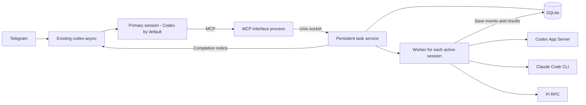

> Language: English | [中文](zh/design.md)

# Local Cross-Agent Bridge System Design

This design describes the development of `cli-agent-bridge`, a cross-agent system running on one machine. A primary Codex session assigns tasks by default. Codex, Claude Code, and Pi can execute them, including independent sessions using different models within the same program.

The user-confirmed default is `balanced`: meet the quality requirement, then account for both cost and completion time. The primary agent can specify the program, provider, model, and reasoning effort; explicit choices are never replaced automatically. The following sections define intended behavior and development checks. They do not establish deployment status or measured performance gains. This is the original three-runtime design; current commands and later additions are documented in the [README](../README.md).

## Programs and models

Record four things separately: the program, provider configuration, requested model, and reasoning effort. Track the same model separately when used through different programs because tools, prompts, caching, and retries can differ.

| Example use | Program | Provider configuration | Model |
| --- | --- | --- | --- |
| Primary-session analysis and result review | Codex | Current Codex login | Keep the primary model; for example, `gpt-6-astra` |
| Implement a clearly defined small task | Codex | The same or another configured Codex login | `gpt-6.1-sol` |
| Independently review changes or execute a task | Claude Code | An explicit Anthropic or compatible service configuration | The exact model ID that configuration supports |
| Analyze, edit, or write tests | Pi | DeepSeek configuration | `deepseek-flash` or `deepseek-v4-pro` |
| Compare one model across programs | Pi | OpenAI API or Codex login | A model ID returned by discovery at startup |

This is an initial assignment example, not a model ranking. Local tests must establish how Astra, Sol, Claude, and DeepSeek perform on the actual tasks. The primary agent may do a task directly when opening another session would add unnecessary work.

An execution configuration contains `runtime`, `provider_profile`, `model_id`, `reasoning_effort`, `service_tier`, `billing_mode`, and `quota_group`. Authentication settings reference private files or existing logins; keys are never copied into tasks, logs, or MCP parameters. Codex and Pi configurations sharing one account allowance belong to the same `quota_group`.

Each task records the requested model, the model reported by the CLI, the provider configuration, and how far the backend model identity has been confirmed. Unknown identity stays unknown. DeepSeek's Anthropic-compatible API translates some Claude model aliases, so a program name or alias does not prove that a Claude model ran. See the [DeepSeek documentation](https://api-docs.deepseek.com/guides/anthropic_api/).

Existing sessions keep their program and provider configuration. Changing either requires a new session supplied with a task summary, code version, and result files. A native session ID from one provider is not portable to another. Parallel use of different models in one program also uses separate sessions.

## Runtime structure

Use Python, local Unix sockets, SQLite WAL, and systemd user services. The primary agent decides how to divide tasks and whether results meet the requirements. Ordinary code handles queues, processes, state, and statistics; no additional model is assigned to manage task allocation.



The client starts the MCP interface; the persistent task service runs independently. Each active session's worker holds its native connection, continuously reads output, and saves events. Workers use independent systemd user units so an MCP or broker restart does not close their pipes. A paused or long-idle session can release its worker while retaining its record. Check whether the user service manager is available and report its absence explicitly rather than quietly weakening the promised process lifetime. Later platform support is described in the README.

| Participants | Transport | Purpose |
| --- | --- | --- |
| Primary agent and Bridge | MCP over stdio | Submit tasks, control sessions, query results |
| Internal processes | Versioned JSONL requests over Unix sockets | Control, queries, reconnection |
| Codex | App Server JSON-RPC over stdio or an existing local daemon socket | Sessions, turns, model choice, interruption |
| Claude Code | Official Python Agent SDK controlling the local CLI through pipes and JSON messages | Execution, continuation, progress, results |
| Pi | `pi --mode rpc`, JSONL commands and events | Execution, model choice, continuation, interruption |

Check Codex's native interface against the schema generated by the installed version. Control an existing shared daemon by thread ID; closing one session must not end the daemon. See [Codex App Server](https://learn.chatgpt.com/docs/app-server).

Use the official `claude-agent-sdk` streaming client with the local CLI path and native model, session, and authentication. Use its interrupt and permission callbacks instead of reimplementing private control messages. Pin compatible SDK and CLI versions during development. See the [Claude Python SDK](https://code.claude.com/docs/en/agent-sdk/python).

Use native RPC for new background Pi sessions. Existing terminal sessions continue through the existing Pi extension; never start a second writer for the same session file. See [Pi RPC](https://github.com/earendil-works/pi/blob/main/packages/coding-agent/docs/rpc.md).

## Sessions, tasks, and execution records

A session is context that can be continued repeatedly. A task is one defined deliverable. An attempt is one execution of that task. Retrying or changing the model creates a new attempt while preserving previous costs, file changes, and exit reasons.

| Record | Main fields |
| --- | --- |
| Session | `session_id`, `parent_session_id`, execution configuration snapshot, `native_session_id` or Pi session file, working directory, `desired_state`, `observed_state`, `revision`, `owner` |
| Task | `task_id`, `parent_session_id`, `assigned_session_id`, `request_id`, request-summary hash, instruction, dependencies, deliverables, budget, status, `validation_status` |
| Attempt | `attempt_id`, `task_id`, `execution_session_id`, `native_turn_id`, actual execution configuration, start/end times, usage, exit reason |
| Event | `event_seq`, `session_id`, `task_id`, `attempt_id`, event type, content or local-file reference |
| Delivery | `event_id`, receiving primary session, whether received, whether processed by that session |

The caller generates `request_id`. Repeating the same ID and content returns the original result; changing the content under that ID returns a conflict. Database uniqueness constraints and transactions prevent concurrent retries from creating two tasks.

Task states include `queued / running / waiting_input / interrupted / completed / failed / cancelled / recovery_needed`. An unmet dependency leaves the task queued with a reason; dependency cycles are rejected. By default, a dependent task starts only after its predecessor passes review. A model finishing its answer does not satisfy that requirement. On a retry through another program or model, Task points to the new execution session while Attempt retains the previous identity. Failed or rejected prerequisites leave dependent tasks queued with a reason until the primary agent changes or cancels them.

Raw output stays in a private local directory. The primary agent normally receives a short answer, changed files, test results, costs, and questions requiring attention. Read large logs by file location and range. Read and replay events by sequence number, deduplicating repeated event IDs.

## How the primary agent calls Bridge

The original design provides nine MCP tools without adding a general-purpose process engine. Later tools are listed in the current README.

| Tool | Inputs and behavior |
| --- | --- |
| `agent_catalog` | Return programs, profiles, model catalog, supported operations, price sources, and verification times |
| `agent_open` | Create an independent session with an execution configuration and working directory, optionally without a task yet |
| `agent_dispatch` | Submit to an existing session, an explicit execution configuration, or automatic selection; return `task_id` and `session_id`; the design also allows an `execute_locally` recommendation without creating a child when delegation is unnecessary |
| `agent_control` | `pause`, `resume`, `close`, `reopen`, or `respond`, with `request_id` and `expected_revision` |
| `agent_cancel` | Cancel one queued or running task without closing other tasks in that session |
| `agent_inspect` | Query sessions, tasks, model-selection reasons, processes, and remaining budget |
| `agent_wait` | Wait by event sequence for a bounded time; return current state on timeout, which does not mean task failure |
| `agent_result` | Repeatedly read the final answer, files, test records, usage, and unfinished work |
| `agent_review` | Accept or reject a particular task and attempt at a revision, with actual inspection evidence; release dependent work after acceptance |

When an existing session is specified, the supplied model configuration must match it. Otherwise return an error and require a separate session. Every write checks whether the caller can manage that session. By default, a child agent can report its task result but cannot control the parent, other tasks, or create more child agents.

The implemented discovery interface is `agent_catalog(refresh=false, profile=null)`. It queries metadata from the configured program or provider, caches it for five minutes, and reports errors separately from retained old results. The primary agent can pass a returned exact ID as `model` to `agent_open/agent_dispatch` together with an existing `profile`; a separate profile per model is unnecessary. A new model inherits provider, authentication, permissions, and concurrency group, but not the previous model's price or inference-verification flag. Discovery performs no inference. Untargeted balanced selection still uses verified configurations. See [Autonomous Model Discovery and Selection](getting-started.md#autonomous-model-discovery-and-selection).

The following is a design-level task envelope, not a replacement for the current tool signatures:

```json
{
  "request_id": "fix-parser-example-001",
  "target": {
    "runtime": "codex",
    "provider_profile": "codex-example",
    "model_id": "gpt-6.1-sol",
    "reasoning_effort": "medium"
  },
  "task": {
    "kind": "code_edit",
    "instruction": "Fix the reproduced parser error and run the specified tests",
    "workspace": "example-project",
    "base_snapshot": "example-snapshot",
    "depends_on": [],
    "deliverables": ["patch", "test-results"]
  },
  "policy": {
    "objective": "balanced",
    "allow_model_fallback": false
  }
}
```

The explicit model in this example is never replaced automatically. The design omits `target` for automatic allocation from registered candidates. Repeated submissions and `depends_on` express task order. In the first-version design, follow-ups enter Bridge's queue and are sent after the current turn, avoiding ambiguous ordering across CLI-internal queues.

Native input and permission requests become events containing `question_id`, native request ID, and expiration time. `agent_control(action=respond)` answers only a still-valid request. The primary agent may answer ordinary questions; requests requiring user approval go to the user. Without an answer, remain `waiting_input` or deny according to the native protocol; never approve automatically. Approval cannot be sent later for a request invalidated by pause, close, or disconnection.

## Open, pause, resume, and close

Record desired state `open / paused / closed` separately from observed state `starting / idle / running / waiting_input / stopping / stopped / recovery_needed`. Receiving a control request is not completion; callers confirm observed state through events.

| Operation | Behavior |
| --- | --- |
| open | Create the session record and native session; preserve a startup error instead of claiming readiness |
| pause, default | Stop dispatching later tasks, interrupt the current turn, and mark paused only after confirmed stop |
| pause, drain | Stop later dispatches and enter paused after the current turn finishes |
| resume | Restore native context and allow later tasks; only an explicit `continue_task_id` resumes that interrupted task in a new attempt |
| close | Stop dispatch, interrupt active work, cancel unstarted tasks, release this session's processes/connections, and retain history, results, and unmerged edits |
| reopen | Reopen a closed session only on an explicit primary-agent request; notices and new messages never reopen it automatically |
| cancel task | Cancel queued work immediately; for running work, call native interruption and wait for confirmed end of the turn before marking cancelled |

Codex uses `turn/interrupt`; Pi uses `abort` and handles any native retries or queued messages as required. Claude calls SDK `interrupt()` and continues reading the interrupted turn's terminal result before accepting the next turn, preventing an old result from being mistaken for a new one. The session process may then be released and later restored using the same native ID or file. See [Claude interruption behavior](https://code.claude.com/docs/en/agent-sdk/python).

Pause preserves recoverable context and the working directory; it does not promise continuation from a partially generated token. Supply the original session with completed steps, file changes already made, and the interruption point to prevent repeated actions. Pause cannot undo external operations, and interrupted remote computation may already have incurred charges. Process-freeze signals are not the default pause implementation.

Every control includes `expected_revision` so an old cancellation cannot stop a later task. Identify processes by PID, start time, boot ID, and systemd unit; terminate only owned processes. A termination timeout leaves `stopping` or `recovery_needed`, never a false paused state.

## Balanced task selection by default

The primary agent supplies task type, deliverables, tools, input length/type, allowed providers, whether files may change, and time/cost constraints. First check mandatory conditions, then compare estimated work.

1. For an explicit program or model, check that configuration can execute the request. Return a specific reason for missing configuration, authorization, or required operations; do not substitute a model.
2. During automatic selection, exclude configurations failing tool permissions, context length, input type, provider permission, account allowance, or verification requirements.
3. Select candidates meeting the quality requirement for similar tasks, then estimate total cost and completion time. Include startup, input context, primary-agent assignment and review, failed retries, tests, and merge work.
4. Remove choices worse in both cost and time without better quality. Weight the remaining cost and time equally at 0.5, normalized by the positive minimum among these candidates. Without reliable estimates, return `Unmeasured` and use a fixed verified-candidate order instead of inventing scores.
5. Include direct execution by the primary agent. Avoid a child session when the task is too small, context transfer too expensive, or review too costly.

Quality pass rates come from actual tests and primary-agent decisions, grouped by task category, execution configuration, and approximate input size. With no history, validate a small sample before adding a model as a candidate; initial assignments remain hypotheses. Dated, sourced catalog prices estimate reference compute cost by default. Subscription reference cost is not the amount the user actually paid. If any candidate price is incomplete or an incomparable zero, use estimated total tokens as the cost term for the entire candidate set and explain why. Never combine dollars and tokens in one number or treat unknown cost as free. Actual API spending limits and account allowances are still checked separately.

Scoring requires no extra model call. The primary agent already understands the task; the service computes candidates from stored statistics. Save candidates, exclusion reasons, estimates, data timestamps, and the final reason for each choice. After failure, the primary agent decides whether to retry, switch model, or take over. Any bounded automatic retry must be allowed in advance, and all attempts count toward cost.

One native session runs one turn at a time. Other sessions may run concurrently subject to global concurrency, shared-account limits, dependencies, and working-directory write restrictions. Start with three external tasks globally and two per shared account group; adjust from measurements without claiming these values are optimal. On rate-limit or insufficient-balance errors, back off for the provider's stated period and pause new dispatches instead of repeatedly opening sessions.

## Context, files, and results

Supply only what each task needs: goal, completion conditions, relevant file locations, code snapshot, restrictions, and prerequisite results. Do not copy the entire primary chat by default. Continue an existing work session for related tasks when useful, but remember that session restoration may charge input tokens again; it is not a promise of free caching.

Each writing session uses an independent Git worktree retained for later questions. Create it from an explicit commit plus specified patch snapshot. Include needed dirty/untracked files individually; never commit, stash, or clean the primary checkout without authorization. For non-Git projects use an explicit directory copy or one writer, without claiming worktree isolation.

Read-only requests require native tool restrictions or verified OS restrictions. A worktree separates edits and is not a security sandbox. Restrict both Pi and MCP tools for the task; disabling `write` while keeping arbitrary shell writes is insufficient. Reject a permission mode the backend cannot enforce.

A child result includes completion notes, patch, test commands and exit codes, unfinished work, and questions. Runtime `completed` means only that the native turn ended normally. Separate `validation_status` records whether checks are pending, passed, or failed. The primary agent must inspect actual files and relevant tests before acceptance; a child's natural-language statement is not a substitute. Child results are task data and cannot grant authority to change the primary session's permissions.

## Disconnection, restart, and automatic continuation

SQLite stores tasks, events, budget reservations, and notices. Session workers hold native I/O, so MCP-client exit does not terminate tasks. After restart, the task service reconnects to existing workers and reads unprocessed events and state. If a worker exits unexpectedly, inspect native context and results; use `recovery_needed` when execution progress cannot be confirmed.

Persist task and attempt before execution starts. After native acceptance, save `native_turn_id`. Each session worker and active attempt has one owner record. Controls carry session revision; events carry `attempt_id`. Events from an obsolete worker may be retained as history but cannot advance a new attempt. A crash after sending and before recording acceptance must not trigger automatic resend: a missing completed record does not prove the work never ran. `request_id` prevents duplicate task creation, not exactly-once external file or network operations.

Save completion and result together, then notify the primary session. If busy, use its existing queue. If exited, its registered controller restores that same session. A paused parent accumulates events; a closed parent is not woken. For a native session still owned by a desktop or terminal, use its existing message interface. If lawful control cannot be obtained, report waiting instead of taking over.

Record notice receipt separately from primary-agent processing, deduplicated by `event_id`. Telegram continues to use existing topics and message-send records. The primary agent accepts, asks follow-ups, or ends the overall task after processing the completion event; child exit does not complete the primary task.

The intended example starts in Telegram: Codex Astra assigns code edits to Codex Sol while Pi analyzes independent material. Claude reviews the same patch afterward. Children continue while the primary window is closed; completion events queue, and the restored primary session checks results and replies.

## Checking cost and speed

For every attempt record input, output, cache reads/writes, available reasoning tokens, queue time, first meaningful output, execution/test time, and retry count. Sources include native Codex usage, Claude result usage, and Pi usage events/session statistics. Distinguish cumulative from per-turn values. Do not blindly add them across model changes, compaction, or restarts, or count reasoning twice when output already includes it.

Store `provider_reported_cost`, `catalog_estimate`, and invoice-confirmation state. Prices carry source, date, currency, and unit. Show subscription and API costs separately. Pi's local price catalog estimates cost but does not establish the actual invoice. Include primary-agent assignment, review, and summary tokens in project totals. If unavailable, mark the count partial and do not claim lower total cost.

Reserve budget transactionally at task start; concurrent tasks share the ledger. At the threshold, stop new dispatches and request interruption. External CLI statistics may arrive late, so ordinary token or money limits are best-effort and may exceed the limit by an in-flight request. A strict no-overspend request requires a configuration with a verified hard limit; otherwise refuse to start.

After implementation, compare fixed code versions, tasks, tests, and recorded cache conditions across direct primary-agent execution, explicit model delegation, and automatic balanced delegation. Count all failures, retries, reviews, and primary overhead. Measure total user-task time through passed validation, reporting medians and slower tasks. Validate selection rules on tasks separate from tuning samples. Report a benefit only when quality does not decline and cost or duration improves; no savings percentage is predicted here.

## Existing code and development sequence

Existing `codex-async` code calls Codex App Server, Claude CLI, and Pi RPC/extensions, and handles Telegram topics, queues, and notices. Retain native-session recognition, busy checks, and error handling when extracting useful parts. Do not inherit every unattended-task permission policy. Add only task/session management, execution configurations, budgets, and selection rules required by this project.

| Reference project | Useful design | Choice for this project |
| --- | --- | --- |
| [CLI-Subagents](https://github.com/lunati228/CLI-Subagents) | Real CLI sessions, asynchronous tasks, follow-ups | Test directly usable parts first; Pi and common session controls still need work |
| [PAL clink](https://github.com/serpro69/pal-mcp-server/blob/main/docs/tools/clink.md) | Small MCP tools, working-directory checks, result parsing | Prefer native session continuation; never present history replay as restoration |
| [codex-agy-bridge](https://github.com/varadfromeast/codex-agy-bridge) | Execution independent of MCP, saved events and results | Use the worker idea for Codex, Claude, and Pi; Antigravity is not an initial-version dependency |

Exercise key cases before selecting existing code. Reuse suitable code with its license, without running three separate task-management services. Keep development separate from those upstream projects. Organize code into `mcp_server`, `broker`, `store`, `worker`, `routing`, `runtimes`, and related modules. SQLite holds structured state; local files hold large logs and patches. The original first-version scope excludes a Web administration service, remote cluster, and account rotation; later implemented features are described separately in the README.

| Phase | Development | Completion check |
| --- | --- | --- |
| 1 | Three program connections, exact model choice, native continuation, interruption | Codex, Claude, and Pi each run a small task and follow-up in the original session; identify actual providers |
| 2 | Workers, SQLite, MCP, pause/close, abnormal recovery | No repeated execution across disconnect/restart; controlling one session does not affect another |
| 3 | Directory isolation, dependencies, usage, budgets | Source checkout remains intact, concurrent budgets are not allocated twice, failures remain in statistics |
| 4 | Balanced selection, primary continuation, Telegram | Run a complete cross-program task and compare the fixed task set |

Estimated initial-version work is 10–15 working days for one developer with existing logins; performance comparisons require additional runtime. Codex, Claude, Pi, and multiple models per program are included. Connecting only one program does not complete that scope.

## Required post-implementation checks

| ID | Check | Pass condition |
| --- | --- | --- |
| R1 | Three local programs | Codex, Claude, and Pi execute real tasks with checkable results; versions/catalogs alone do not pass |
| R2 | Primary-agent delegation | One Codex primary submits independent tasks to at least two programs, receives correctly associated results, and continues processing |
| R3 | Selection by requirements | Exclude candidates failing image/tool/context/provider requirements; identify missing quality data |
| R4 | Multiple models and providers | Astra controls Sol and Pi DeepSeek concurrently; Claude retains its actual configuration; primary model stays unchanged |
| R5 | Session controls | All three programs exercise open/pause/resume/close/reopen with continuous native identity and edit history |
| R6 | Cost/speed comparison | Compare direct and delegated execution on fixed tasks, including primary overhead, failures, retries, reviews, and quality |
| E1 | Duplicate requests | Identical retries create one task; same ID with changed content errors |
| E2 | Pause races | Old revision cannot stop a later turn; paused tasks do not run; drain sends no interrupt |
| E3 | Close/reopen | Completion never wakes a closed parent; reopening preserves history and unmerged edits |
| E4 | Client/service restarts | MCP disconnect does not stop work; service recovers the original run; uncertain execution is not resent |
| E5 | Files/permissions | Parallel worktrees are independent; dirty source files remain; forbidden writes actually fail |
| E6 | Native completion | Codex checks the matching turn's terminal state; Claude checks that turn's `ResultMessage` and `terminal_reason`; Pi waits for `agent_settled` and final errors; acceptance is not completion |
| E7 | Quotas/models | Shared limits apply together; unavailable explicit models are not replaced; catalog visibility does not imply inference verification |
| E8 | Complete cost accounting | Replay never bills twice; restored cumulative usage is not added twice; unknown price is not zero |
| E9 | Input/approval | Waiting input differs from model execution; native request IDs match; timeout/no reply never approves |
| E10 | Parents/Telegram | Queue while busy; restore only through legitimate control after exit; do not wake paused/closed parents; duplicate notices do not repeat processing |
| E11 | Continue after interruption | Drain the interrupted result before another turn; `continue_task_id` identifies the task; previous file actions are not blindly repeated |
| E12 | Review/dependencies | Release dependencies only after `agent_review` accepts the right attempt; accepting an old attempt cannot affect a new execution |

Native programs may start background commands or child agents. Controls must check whether those still run; a top-level answer or closed connection cannot establish that all background work stopped. Report external jobs outside Bridge ownership as still running when observed.

## Local pre-development checks

On 2026-10-22, metadata checks found Codex CLI 0.163.0, Claude Code 2.1.307, and Pi 1.3.0. Codex App Server metadata succeeded and listed `gpt-6-astra` and `gpt-6.1-sol`. Pi RPC metadata returned 55 entries across DeepSeek, OpenAI, and OpenAI Codex, including `deepseek-flash` and `deepseek-v4-pro`. Query processes exited; no inference request was sent.

These observations establish installation and metadata access, not access to every listed model. See [OpenAI's explanation of catalog visibility and model access](https://developers.openai.com/siwc/token-sharing-open-source/codex-app-server).

During development, run a minimal authorized real request in the actual systemd service environment to verify authentication, proxy, exact model, permissions, and usage. Confirm Claude's actual provider/model separately rather than infer them from the program name. Context windows and price catalogs can differ when programs access the same model, so record the actual execution configuration.

R1–R6 cover the six primary requirements; the remaining checks cover recovery and data handling. Record design delivery separately from software completion. Completion requires the actual execution results above; historical results and remaining gaps are listed in [Verification Records](verification.md).
