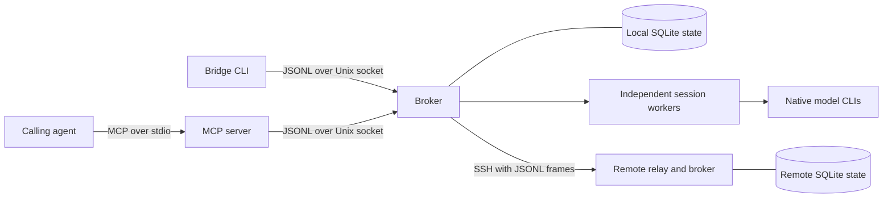

> Language: English | [中文](zh/design.md)

# Architecture

Bridge runs independent Codex, Claude Code, Pi, and Antigravity sessions on one computer or trusted SSH hosts. The calling agent chooses tasks and reviews results; the broker manages queues and stored state. No extra model is required to manage the broker.

## Components and communication

| Component | Responsibility |
| --- | --- |
| `mcp_server.py`, `cli.py` | Expose the same task and session operations to MCP clients and the command line. |
| `broker.py` | Validate requests, enqueue tasks, enforce revisions/dependencies, manage workers, and send registered parent notifications. |
| `worker.py` | Own one session's native connection, execute one turn at a time, and save events, usage, artifacts, and terminal results. |
| `runtimes.py`, `antigravity.py` | Translate native session, tool, permission, interruption, and result events. |
| `store.py` | Persist local sessions, tasks, attempts, receipts, and peer records in SQLite WAL. |
| `hosts.py`, `peer_transport.py`, `peer_api.py` | Maintain trusted remote hosts, verify node identity, and exchange bounded peer messages over SSH. |
| `monitor.py`, `web_monitor.py` | Read task/process/usage state for the terminal and authenticated HTTP/SSE monitor. |
| `updater.py`, `update_guard.py` | Stage verified releases and coordinate short broker maintenance with compatible running workers. |

Each host owns its database and processes. Remote execution does not use a shared SQLite file. The [peer interface](multi-machine-interface.md) defines supported remote methods, frame limits, identity checks, and unsupported operations.

| Native runtime | Interface |
| --- | --- |
| Codex | App Server JSON-RPC through the configured native connection. |
| Claude Code | Official Python Agent SDK controlling the local CLI. |
| Pi | JSONL RPC commands and events over stdio. |
| Antigravity | Headless stream-JSON input and output over stdio. |

## Task lifetime and recovery

- A session retains native context. A task describes work; an attempt records one execution. Retrying preserves earlier attempts and their usage.
- `agent_dispatch` enqueues work and returns IDs. It does not wait for model completion. A worker runs one turn per session; other sessions can run concurrently within configured limits.
- Repeating a `request_id` with identical parameters returns the original operation. Reusing it for different content is rejected. This prevents duplicate queue entries, not arbitrary external side effects.
- `completed` means the native turn finished. The calling agent checks files and actual test results before `agent_review`; dependent tasks wait for an accepted review.
- Workers run independently of the requesting MCP client. A disconnected client does not cancel their tasks. Unexpected process exits or unconfirmed external outcomes can require manual investigation through `recovery_needed`.
- Registered parent notifications preserve receipt/processing state. Group broadcasts target only explicit members. Unknown delivery outcomes must be inspected before resending.

Task/session controls, model discovery, selection, budgets, and optional Telegram integration are described in the [user guide](getting-started.md).

## Configuration and trust

Profiles reference existing native logins or private environment files. Model discovery does not perform inference; a listed model is not proof that the account can execute it. Explicit runtime/model choices are preserved.

Host entries and identity pins can [reload while the broker runs](dynamic-hosts.md). Profiles are loaded at broker startup; existing sessions retain their original configuration. [OTA updates](ota-updates.md) preserve compatible work and stop after uncertain restart outcomes.

Bridge is intended for one operating-system user and explicitly trusted peers. Worktrees separate file edits; they do not isolate malicious programs running under the same user. See [security](../SECURITY.md) and [checks and limits](production-readiness.md).

## Current interfaces

- [Multi-machine architecture decisions](multi-machine-design.md)
- [Current peer interface](multi-machine-interface.md)
- [Task checks and the external task ledger](agent-tiering.md)

## Design records and proposals

- [Phase C design record](multi-machine-phase-c-design.md): design decisions for groups, ordered delivery, workspaces, session names, and Web authentication. See the [current peer interface](multi-machine-interface.md) for supported methods.
- [Future multi-machine proposal](multi-machine-future-design.md): unimplemented designs, not available features.
