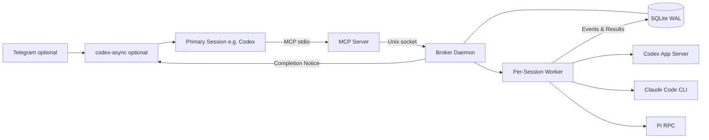

> Language: English | [中文](zh/design.md)

# Local Cross-Agent Bridge System Design

Architectural specification for running a local cross-agent coordinator system (`cli-agent-bridge`). By default a primary Codex session delegates work across Codex, Claude Code, and Pi, with support for multiple simultaneous models and independent sessions per runtime.

Uses a user-confirmed `balanced` objective by default: once candidate quality meets requirements, weights normalized cost and duration evenly. Coordinators may explicitly pin runtime, provider profile, model ID, and reasoning effort (explicit selections are never silently substituted).

## Runtimes and Models

Track four attributes independently: runtime, provider profile, exact model ID, and reasoning effort. Same model IDs run under different runtimes track separate metrics due to differing tools, prompts, prompt caches, and retry semantics.

| Example Role | Runtime | Provider Profile | Model |
| --- | --- | --- | --- |
| Primary coordinator & review | Codex | Current Codex login | Coordinator model (e.g., `gpt-6-astra`) |
| Bounded implementation task | Codex | Same/other Codex profile | `gpt-6.1-sol` |
| Independent edit review / task | Claude Code | Anthropic or compatible config | Exact supported model ID |
| Analysis, edits, or tests | Pi | DeepSeek profile | `deepseek-flash` or `deepseek-v4-pro` |
| Cross-runtime comparison | Pi | OpenAI API / Codex login | Discovered model ID |

One execution profile carries `runtime`, `provider_profile`, `model_id`, `reasoning_effort`, `service_tier`, `billing_mode`, and `quota_group`. Credentials stay referenced via logins or private `0600` JSON files rather than copied into tasks, logs, or MCP parameters. Profiles sharing upstream rate limits join the same `quota_group`.

Each attempt tracks requested model, runtime-reported model, provider profile, and verification confidence (note DeepSeek's Anthropic-compatible endpoint remaps certain Claude model aliases; see [DeepSeek Anthropic API docs](https://api-docs.deepseek.com/guides/anthropic_api/)). Existing sessions lock their runtime and provider; switching requires spawning a fresh session with explicit context/workspace handoff.

## Runtime Topology

Implemented with Python, local Unix domain sockets, SQLite WAL, and user-level `systemd` (`launchd`/detached on macOS/containers):



Each active session spawns an isolated worker managing native stdio/RPC streams inside an independent user service unit so broker or MCP restarts never drop running worker streams.

| Boundary | Transport | Purpose |
| --- | --- | --- |
| Coordinator <-> Bridge | MCP over stdio | Task submit, session control, inspection |
| Internal CLI/MCP <-> Broker | Versioned JSONL over Unix socket | Control, queries, recovery |
| Broker/Worker <-> Codex | App Server JSON-RPC (stdio or shared daemon socket) | Threads, turns, model choice, interrupt |
| Broker/Worker <-> Claude | Official `claude-agent-sdk` over stdio JSON | Streaming turns, interrupts, permission callbacks |
| Broker/Worker <-> Pi | `pi --mode rpc` JSONL | Execution, model switching, abort |

References: [Codex App Server](https://learn.chatgpt.com/docs/app-server), [Claude Python SDK](https://code.claude.com/docs/en/agent-sdk/python), [Pi RPC](https://github.com/earendil-works/pi/blob/main/packages/coding-agent/docs/rpc.md). Native Pi interactive terminals keep their extension locks cleanly untouched by running background workers with extensions disabled.

## Sessions, Tasks, Attempts, and Events

- **Session**: Persistent resumable context (`session_id`, `parent_session_id`, resolved config snapshot, native session ID / file, workspace dir, `desired_state`, `observed_state`, `revision`, `owner`).
- **Task**: Logical deliverable (`task_id`, `parent_session_id`, `assigned_session_id`, `request_id`, request hash, `instruction`, `dependencies`, `deliverables`, budget reservation, `status`, `validation_status`).
- **Attempt**: Single execution try (`attempt_id`, `task_id`, `execution_session_id`, `native_turn_id`, resolved config, timestamps, usage, exit cause).
- **Event**: Monotonic `event_seq` ledger entry deduplicated by ID.
- **Delivery**: Completion notifications tracking `native_status` (`enqueued`/`received`) vs coordinator acknowledgment (`processed`).

Caller-supplied `request_id` ensures transactionally idempotent creates; mismatched payloads conflict cleanly. Task lifecycle covers `queued`, `running`, `waiting_input`, `interrupted`, `completed`, `failed`, `cancelled`, and `recovery_needed`. Downstream dependencies wait until upstream tasks settle `accepted` via `agent_review`. Large outputs write privately (`0600`) and stream via paginated byte offsets.

## Coordinator MCP Surface

Nine core MCP tools (expanded later with `agent_hosts*`, `agent_operation`, `agent_delivery_resolve`, `agent_monitor`, and `agent_group*`): `agent_catalog`, `agent_open`, `agent_dispatch`, `agent_control`, `agent_cancel`, `agent_inspect`, `agent_wait`, `agent_result`, and `agent_review`. Also integrates autonomous model discovery via `agent_catalog(refresh=false, profile=null)` and on-demand `profile + model` targeting (see [Project Overview](../README.md#autonomous-model-discovery-and-selection)).

Example structured task payload:

```json
{
  "request_id": "fix-parser-001",
  "target": {
    "runtime": "codex",
    "provider_profile": "codex-default",
    "model_id": "gpt-6.1-sol",
    "reasoning_effort": "medium"
  },
  "task": {
    "kind": "code_edit",
    "instruction": "Fix reproduced parser bug and run targeted tests",
    "workspace": "registered-project",
    "base_snapshot": "snapshot-id",
    "depends_on": [],
    "deliverables": ["patch", "test-results"]
  },
  "policy": {
    "objective": "balanced",
    "allow_model_fallback": false
  }
}
```

Native input/approval prompts carry `question_id`, native request ID, and `expires`; expired or un-answered prompts reject rather than auto-approving.

## Lifecycle Controls (`open`, `pause`, `resume`, `close`)

Separating `desired` (`open`/`paused`/`closed`) from `observed` (`starting`/`idle`/`running`/`waiting_input`/`stopping`/`stopped`/`recovery_needed`) avoids optimistic UI states:
- `pause` interrupts active turn immediately; `pause_drain` finishes the active turn cleanly before pausing.
- `resume` advances subsequent queue items unless `continue_task_id` explicitly retries an interrupted task.
- `close` cancels unstarted items, retires owned OS processes via boot-ID + start-time verified PIDs/cgroups, and retains history/worktrees until explicit `reopen`.

## Balanced Selection & Budgets

Filters hard requirements (input type, tools, context, licenses, cooldowns, verification) -> checks historical quality pass rates -> prunes Pareto-dominated choices -> weights normalized USD (falling back cleanly to total tokens across all candidates if any lack comparable USD prices) and normalized latency `0.5 / 0.5`, returning `Unmeasured` in verified profile order until sample data suffices. Initial concurrency caps at 3 external workers globally and 2 per `quota_group`; SQLite `token_budget` reservations bound expected exposure with explicit vendor 429 cooldown backoff.

## Workspace Isolation & Checksums

Writable tasks isolate edits in per-session Git worktrees (`HEAD` + explicit `snapshot_files` whitelist) or explicit `workspace_mode=copy` directory clones, keeping source checkouts untouched (`git commit`/`stash`/`clean` are never invoked on the caller's repo). Patches diff strictly against the initial input `snapshot_tree`. Worktrees isolate edits, not OS same-UID permissions. `completed` never skips primary-agent `agent_review` + test checks.

## Resilience, Parent Cold Resume & Costs

Broker restarts recover live systemd/cgroups cleanly without re-sending unconfirmed CLI turns (`recovery_needed` demands manual inspection before `resolve`). Optional parent registration wakes exited coordinators via non-destructive native `thread/resume` without overriding approval policies or models, supporting owner-only `0600` `resume_config_file` for ephemeral MCP tools.

All metrics preserve cumulative vs incremental boundaries across resets (`actual_billed_usd` remains null until verified invoices; missing baselines yield `complete=false` partial stats).

## Design Acceptance Criteria (`R1`-`R6`, `E1`-`E12`)

- **R1-R6**: Live execution across runtimes, cross-runtime parent delegation, constraint filtering, multi-model per-runtime isolation, complete lifecycle controls, and controlled benchmark comparisons.
- **E1-E12**: Request idempotency, pause/revision concurrency guards, close/reopen isolation, crash recovery without duplicate execution, worktree/permission isolation, native terminal state parsing, cooldowns/no silent fallback, accurate non-zero cost baselines, bounded question expiry, non-destructive parent resume/Telegram safety, safe interrupt continuation, and attempt-locked `agent_review` dependency gating.

Lookups prior to implementation (2026-10-22) confirmed Codex `0.163.0`, Claude Code `2.1.307`, and Pi `1.3.0` schema discovery endpoints cleanly without sending paid inference prompts (see [OpenAI App Server docs](https://developers.openai.com/siwc/token-sharing-open-source/codex-app-server)).
