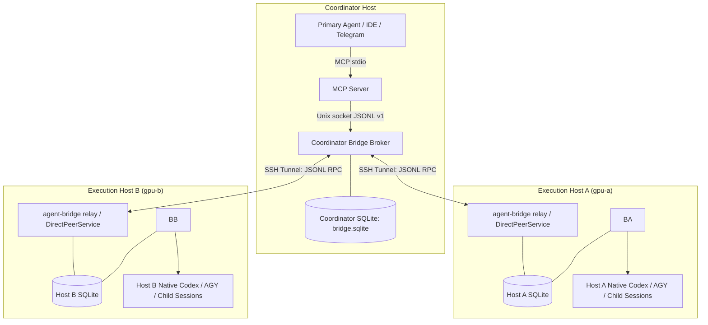
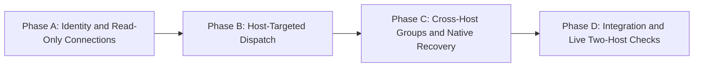

> Language: English | [中文](zh/multi-machine-design.md)

# Multi-Machine Access Design and Architecture Specification (Canonical)

> **Document status**: Final technical specification, 2026-11-04.
> **Design scope**: CLI agents running across physical machines or servers, with one coordinator and multiple execution nodes.
> **Review integration**: Incorporates the independent adversarial reviews by Antigravity (`gemini-4-argon-high`) and Pi (`deepseek-flash`): 16 key defects and their required protections.
> **Implementation status**: SSH relay, cross-host dispatch, groups, workspaces, and event synchronization are implemented in the codebase. This document retains architectural decisions and later plans; the [Interface Contract](multi-machine-interface.md) states current method support and unimplemented items. Requirements and verification scenarios below are not claims that every implementation has passed them. The original schema examples are design snapshots; the [Phase C specification](multi-machine-phase-c-design.md) provides the later ordered-delivery schema.

---

## 1. Goals, Scope, and Design Principles

### 1.1 Initial Delivery Goals

1. **One coordinator entry point**: A primary agent such as Codex, Claude, or Antigravity uses the coordinator's MCP interface to query model catalogs across hosts, dispatch to a selected server, and retrieve execution results incrementally as needed.
2. **Cross-host groups and broadcasts**: Groups can contain Bridge child sessions or native Codex and Antigravity sessions from multiple hosts. Broadcasts address a fixed recipient snapshot and enforce compare-and-swap (CAS) revision checks through `expected_revision`.
3. **Native session integration**:
   - Remote Codex uses that host's persistent queue (`thread/queue/add`), without taking over its terminal.
   - A remote native Antigravity session must fully close before its local Bridge resumes the same native ID to submit a message. An active console is never taken over.
4. **Recovery and idempotency across disconnects**: Accepted remote work continues independently when the network drops or the coordinator restarts. Recovery reconciles persisted `operation_id` records and the separate admission/receipt stages; a disconnect must never cause a task to run again or move to another machine.

### 1.2 Boundaries and Non-Goals

- **Trust assumption**: Linux hosts controlled by one administrator. Nodes remain separate, but this is not a sandbox against malicious root or another process with the same UID.
- **Excluded**: Public TCP/HTTP RPC ports, moving native process memory or context between hosts, cross-host task dependency DAGs (`dependencies`), automatic copying of the entire project, and distributed transactions such as 2PC or Raft.

---

## 2. Runtime Architecture and Network Topology



### 2.1 Connections Without Public RPC Listeners

1. **SSH transport only**: The coordinator initiates connections through existing SSH configuration, including aliases, ProxyJump, and an existing Tailscale VPN, and runs a fixed remote executable with the `relay` command.
2. **No external cluster ports**: The cluster must not listen on TCP ports for node RPC.
3. **No network-shared SQLite**: SQLite WAL relies on local POSIX shared memory and file locks (`*-shm` and `*-wal`). NFS, SMB, and SSHFS do not provide a supported shared database arrangement here. Every host must own an independent local SQLite database.
4. **Relay lifetime**: `agent-bridge relay` handles SSH stdin/stdout through `DirectPeerService` and accesses the execution host's local SQLite. Its Broker claims tasks from the same database and starts workers. A lost SSH process or exiting relay does not stop work already running remotely.

### 2.2 Coordinator-Initiated RPC and Pulled Requests (Review A1/D5/D6)

The design uses coordinator-initiated RPC so execution servers do not need reverse SSH credentials for the coordinator:

- **Forward requests**: The coordinator calls `DirectPeerService` through the relay, submitting work to the remote local database.
- **Outbound requests from execution hosts**: When a remote native primary session broadcasts to a cross-host group, its Broker writes only to its local `node_outbox`. By default, the coordinator requests one page every two seconds through `peer.pull_requests`, verifies the sender's permission, dispatches the broadcast, and persists acknowledgment through `peer.ack_request`. Execution servers need no reverse SSH connection.

---

## 3. Architecture Decision Records From the Two Independent Reviews

Before the specification was finalized, Antigravity (`gemini-4-argon-high`, review prefix A) and Pi (`deepseek-flash`, prefix D) performed independent adversarial reviews. The resulting 16 decisions are requirements of this specification:

| ID | Review source | Risk | Required design |
|---|---|---|---|
| **ADR-01** | A1, D5, D6 | Reverse pushes do not fit short-lived local Unix socket requests | Replace bidirectional persistent push with coordinator-initiated `peer.pull_requests`; retain normal short local Broker connections for relay requests. |
| **ADR-02** | A2, D1 | An agent can claim another session's `native_id` | A controlled member MCP wrapper receives a short-lived opaque binding from the local Broker, which checks caller PID, `starttime` ticks, and write locks. |
| **ADR-03** | A6, D2 | A database rollback also rolls back its generation and hides lost records | Keep an identity file and increasing acknowledgment counter outside SQLite backups. Compare generation and highest acknowledged sequence during handshakes; refuse new writes on rollback. |
| **ADR-04** | D6 | Equal `request_id` values on different nodes collide and reconnects cannot reconcile them | Use the global `(node_id, state_generation, operation_id)` namespace and look up the persisted operation after reconnecting. |
| **ADR-05** | D3 | SQLite and an external native process cannot commit together | Persist the intent, mark it `sending`, call the CLI, then save its receipt. Missing confirmation means `uncertain`, never an automatic resend. These are local stages, not distributed 2PC. |
| **ADR-06** | A3 | Single-host caching can turn `operation_pending` into a permanent conflict | Save an operation reference in `api_requests` for cross-host work; inspect that operation after recovery and save the final response only when its outcome is known. |
| **ADR-07** | A4, D8 | Remote members break local foreign keys and can share native UUIDs | Add `remote_group_members`, `peer_inbox`, and a `native_send_queue` without remote session foreign keys; include `(host_id, node_id, state_generation)` in identity keys. |
| **ADR-08** | A5 | Later native messages overtake an earlier pending message | Serialize each physical target with increasing local sequences. An unknown head blocks subsequent messages until an administrator supplies evidence. |
| **ADR-09** | D7 | Deleting an unsent item leaves a permanent sequence hole | Send a Cancel Tombstone at the original `target_seq`; subsequent items wait until the execution node acknowledges it. |
| **ADR-10** | A7, D4 | A remote `event_seq` conflicts with the parent host's foreign keys | Use `parent_ref`, deduplicate on the coordinator, create a local mirror `events.seq`, then use existing `deliveries` and `parent_ack`. |
| **ADR-11** | A8 | Source and destination directories are confused, and early cancellation lacks a task ID | Separate local source `cwd` from remote `project_id`; allow exactly one of `task_id`, `operation_id`, or `delivery_id` in `agent_cancel`. |
| **ADR-12** | D5, D8 | A permissive relay can forward unauthorized commands | Restrict relay requests to the declared `peer.*` allowlist; do not forward arbitrary commands or allow arbitrary remote quota changes. |
| **ADR-13** | A3 | Separate remote open and dispatch calls leave orphan sessions after a disconnect | Treat remote dispatch without `session_id` as one compound operation that creates and recovers its session under the same operation. |
| **ADR-14** | Combined review | Shared accounts make cross-host budgets misleading | Keep token budgets host-local (`budget_scope=host`); reject metered broadcasts containing remote native members. |
| **ADR-15** | Combined review | Large remote results and logs overwhelm notices | Return metadata references (`host_id`, `artifact_id`, `sha256`); read large bodies in pages from their original host. |
| **ADR-16** | Combined review | Reconnects and old notices regress confirmed state | Preserve durable event cursors across restarts; connection changes must not move confirmed receipt or processing states backward. |

---

## 4. Node Identity, Security, and Permissions

### 4.1 Node Identity Triple

Each node is identified by these fields:

- `host_id`: A stable administrator-configured coordinator alias, such as `gpu-a` or `cloud-node-1`.
- `node_id`: A random UUID created at installation and stored privately; service restarts preserve it.
- `state_generation`: A random string regenerated when rebuilding the database, restoring a cold backup, or reinitializing the node.
- **Global object reference**: `host_id + node_id + state_generation + local resource ID`.

### 4.2 Independent Identity File (Review A6/D2)

- Each node keeps `node_identity.json` outside SQLite, with mode `0600`, storing its current `state_generation` and highest locally acknowledged mutation sequence, `max_confirmed_seq`.
- **Write acknowledgment ordering**: Commit the database transaction, `fsync` the identity file, then return the ACK to the peer.
- **Rollback detection**: If a handshake finds the database's maximum sequence below the identity file or the peer's acknowledged value, the node has inconsistent restored state. Enter `state_corrupted` and refuse writes until an administrator inspects it and changes its generation.

### 4.3 Controlled Member Access (Review A2/D1)

- A primary session on an execution node uses the controlled MCP entry point: `agent-bridge mcp --role member`.
- Its local Broker issues a short-lived binding token tied to its verified process PID, start time, and authorized group membership.
- A model-supplied `sender_id` in JSON is never sufficient proof of identity. The wrapper must prevent a caller from impersonating another session within this trusted-host model.

---

## 5. Wire Protocol and RPC Allowlist (Review D5)

Only the explicitly declared `peer.*` methods below may pass between the coordinator and an execution relay. Reject all other methods. This list records the original design; `peer.lookup_delivery` and the later `peer.workspace`/`peer.resolve_delivery` additions are specified in the [Interface Contract](multi-machine-interface.md). A declared method does not imply an implemented handler; in particular, consult that contract for `peer.control`, `peer.review`, and `peer.inbox`.

```
peer.hello            # Authenticate, handshake, check identity, and negotiate versions
peer.catalog          # Read the redacted remote model catalog and configuration
peer.inspect          # Inspect remote sessions, tasks, and cgroup processes
peer.pull_requests    # Coordinator pulls queued outbound broadcasts from the node outbox
peer.ack_request      # Coordinator returns the outcome and durable state of an outbound request
peer.deliver          # Deliver one task or group broadcast to a remote node
peer.control          # Perform controlled pause/resume/close operations
peer.cancel           # Cancel a submitted operation or task that has not finished
peer.review           # Submit review evidence and a decision for a completed remote attempt
peer.events           # Read pages of durable remote events by cursor
peer.result           # Read a task result summary and artifact pages
peer.inbox            # Read the local inbox history of a native target
peer.notify_parent    # Deliver completion events to the parent mirror queue
```

---

## 6. Cross-Host Persistence (Review A4/A7/D8)

The original design adds these tables to each role's local SQLite. For later migration requirements and the ordered schema, see the [Phase C specification](multi-machine-phase-c-design.md#32-coordinator-ddl).

### 6.1 Execution Node Tables

```sql
-- Node outbound operations, periodically pulled by the coordinator
CREATE TABLE IF NOT EXISTS node_outbox (
    operation_id TEXT PRIMARY KEY,
    binding_id TEXT NOT NULL,
    request_id TEXT NOT NULL,
    method TEXT NOT NULL,
    payload TEXT NOT NULL,
    status TEXT NOT NULL DEFAULT 'pending', -- pending, pulled, acked
    result TEXT,
    created REAL NOT NULL,
    acked_at REAL,
    UNIQUE(binding_id, request_id)
);

-- Cross-host incoming deliveries
CREATE TABLE IF NOT EXISTS peer_inbox (
    delivery_id TEXT PRIMARY KEY,
    coordinator_id TEXT NOT NULL,
    coordinator_generation TEXT NOT NULL,
    group_id TEXT NOT NULL,
    target_kind TEXT NOT NULL,              -- bridge, native
    target_id TEXT NOT NULL,
    message TEXT NOT NULL,
    status TEXT NOT NULL DEFAULT 'received',
    created REAL NOT NULL
);

-- Shared native send queue for local and remote sends; avoids fake groups and repeated wakes
CREATE TABLE IF NOT EXISTS native_send_queue (
    id TEXT PRIMARY KEY,
    runtime TEXT NOT NULL,
    native_id TEXT NOT NULL,
    local_seq INTEGER NOT NULL,
    delivery_source TEXT NOT NULL,          -- local_broadcast, peer_inbox
    delivery_id TEXT NOT NULL,
    message TEXT NOT NULL,
    status TEXT NOT NULL DEFAULT 'pending', -- pending, sending, received, uncertain, failed
    receipt TEXT,
    native_turn_id TEXT,
    processing_status TEXT,                -- running, completed, failed, uncertain
    error TEXT,
    created REAL NOT NULL,
    last_attempt REAL NOT NULL DEFAULT 0,
    UNIQUE(runtime, native_id, local_seq)
);
CREATE INDEX IF NOT EXISTS native_send_queue_head ON native_send_queue(runtime, native_id, local_seq, status);
```

### 6.2 Coordinator Tables

```sql
-- Remote group members
CREATE TABLE IF NOT EXISTS remote_group_members (
    group_id TEXT NOT NULL REFERENCES session_groups(id),
    host_id TEXT NOT NULL,
    node_id TEXT NOT NULL,
    state_generation TEXT NOT NULL,
    runtime TEXT NOT NULL,
    native_id TEXT NOT NULL,
    cwd TEXT NOT NULL,
    label TEXT NOT NULL,
    PRIMARY KEY(group_id, host_id, runtime, native_id)
);

-- Cross-host outgoing deliveries
CREATE TABLE IF NOT EXISTS peer_outbox (
    delivery_id TEXT PRIMARY KEY,
    broadcast_id TEXT NOT NULL,
    group_id TEXT NOT NULL,
    host_id TEXT NOT NULL,
    node_id TEXT NOT NULL,
    state_generation TEXT NOT NULL,
    target_kind TEXT NOT NULL,
    target_id TEXT NOT NULL,
    message TEXT NOT NULL,
    target_seq INTEGER NOT NULL,
    status TEXT NOT NULL DEFAULT 'pending', -- pending, waiting_for_host, accepted_remote, cancelled, uncertain
    error TEXT,
    created REAL NOT NULL,
    last_attempt REAL NOT NULL DEFAULT 0
);
```

---

## 7. Broadcast Delivery, Cancel Tombstones, and Native Recovery

### 7.1 Ordering and Cancel Tombstones (Review A5/D7)

1. **Strict order**: The coordinator allocates increasing `target_seq` values for each remote session target. It must not send the next item before the previous one reaches `accepted_remote`.
2. **Cancel Tombstones**: Cancelling an unsent queued message requires sending a Cancel Tombstone carrying its original sequence. Release that sequence only after the execution node persists and acknowledges cancellation. Later messages cannot skip the hole, which would let a delayed cancelled instruction arrive after them.
3. **Evidence-based resolution**: A head in `uncertain` after a disconnect or crash blocks subsequent messages. An administrator uses `agent_delivery_resolve` with inspection evidence and the required revision to resolve it. No silent automatic retry is allowed. The later [Phase C resolution specification](multi-machine-phase-c-design.md#38-manual-resolution-agent_delivery_resolve) defines the group and delivery revisions precisely.

### 7.2 Remote Native Recovery Is Decided Locally

- **Codex queue**: The execution host's Broker uses its existing local shared App Server and `thread/queue/add`. The coordinator need not start a daemon.
- **Antigravity wake**:
  - Check local `/proc/locks` and `presence/<native_id>.lock`.
  - Start a separate Stream-JSON process with the original `--conversation` only after proving the original terminal instance has exited and no other active process owns the session.
  - Read local database `MAX(idx)` as the baseline; accept only a new `user_input/DONE` receipt with `index > baseline`.
  - The coordinator must not hold remote process locks across hosts. All lock decisions and process cleanup occur on the execution host.

---

## 8. Extended API Contract

| Interface | Change | Behavior and parameters |
|---|---|---|
| `agent_hosts` | New | Inspect registered nodes: connection state (`online`, `offline`, `identity_changed`), identity, and last contact time. |
| `agent_catalog` | Extended | Accept `host_id` for a host-specific or aggregate catalog; return host attribution and `stale` flags. |
| `agent_open` / `agent_dispatch` | Extended | Accept `host_id` and remote `project_id`. Remote dispatch without `session_id` is one compound operation to avoid orphan sessions after a disconnect. |
| `agent_group` | Extended | Add `remote_members=[{host_id,kind,runtime,native_id,cwd,label}]`; commit cross-host membership changes atomically on the coordinator. |
| `agent_operation` | New | Inspect asynchronous operation results by stable `operation_id` after an `operation_pending` response. |
| `agent_delivery_resolve` | New | Administrator-only: resolve a blocked delivery head using its reference, inspection evidence, and `expected_revision`. |
| `agent_cancel` | Extended | Accept exactly one of `task_id`, `operation_id`, or `delivery_id`, including cancellation before a remote task ID exists. |

---

## 9. Failure and Reconnect Recovery Table

| Failure | Execution host | Coordinator | Recovery |
|---|---|---|---|
| **Remote offline; message remains on coordinator** | Has not received it | Mark `waiting_for_host` | Resume the same `delivery_id` and sequence after the same generation reconnects. |
| **Remote accepted work; SSH ACK lost** | Task is saved and running | Outcome temporarily unconfirmed | Reconnect and call `peer.lookup_delivery` for the original record; never create another task. |
| **SSH drops during execution** | Local background worker continues | Show disconnected and waiting to refresh | Pull from the durable remote `peer_event` cursor after reconnecting. |
| **Process crashes after native input is written** | Preserve the send record and mark `uncertain` | Mark `uncertain` | Block subsequent sends; require administrator evidence through `agent_delivery_resolve`. |
| **Execution database rolls back inconsistently** | Detect sequence regression and enter `state_corrupted` | Refuse communication on generation/counter mismatch | Refuse new work until administrator inspection, generation replacement, and registration. |

---

## 10. Implementation Roadmap



### Phase A: Identity and Read-Only Connections

- Implement `hosts.py`, `peer_transport.py`, and the `agent-bridge relay` command.
- Implement `peer.hello` negotiation and the persisted `node_identity.json` identity.
- Expose `agent_hosts` so a coordinator can query registered remote configuration catalogs over SSH.

### Phase B: Host-Targeted Dispatch

- Extend `broker.py` to route tasks by `host_id`.
- Add `node_outbox`, `peer_inbox`, and compound operation handling in SQLite.
- Transfer explicitly selected `snapshot_files` with SHA-256 verification and prepare remote worktrees.

### Phase C: Cross-Host Groups and Native Recovery

- Extend `groups.py` with `remote_members` and fixed global recipient snapshots.
- Extract `native_send_queue` without remote session foreign keys.
- Implement coordinator polling (`peer.pull_requests`) and completion-event mirrors (`peer.notify_parent`).

### Phase D: Integration and Live Two-Host Checks

- Run the 13 failure and conflict scenarios below.
- Complete authorized live two-host disconnect/recovery checks and their documentation.

---

## 11. Required Verification Scenarios

1. **Equal resource names remain separate**: With equal profile names or identical native UUIDs on two hosts, deliver only to the selected host and target.
2. **Immutable recipient snapshots**: A cross-host group broadcast reaches only its saved members. Later group revisions do not alter already-created broadcasts.
3. **Disconnect at each stage**: Cut SSH before coordinator persistence, before remote admission, before native input, and during execution. After reconnecting, the same task runs only once and an unknown outcome is never reported as failure.
4. **Concurrent restarts**: Restart both sides; delayed or reordered events must not move confirmed `received` or `completed` states back to `pending`.
5. **Identity changes**: Reject new requests for forged `host_id`, changed `node_id`, inconsistent database rollback, or changed SSH host key.
6. **Safe remote AGY locking**: Keep the broadcast pending while AGY is active. After its process exits, resume the original session and assert the new receipt has `index > baseline`.
7. **Cancel Tombstones**: Cancel an unsent head, verify the execution node persists the tombstone, and verify subsequent sequences can proceed.
8. **Permission checks**: Reject member-role admin calls, forged `sender_native_id`, and use of an unauthorized group.
9. **Large results**: Retrieve large logs and patches through paginated artifacts; do not put multi-megabyte raw output into notices and risk exhausting memory.
10. **Single-host compatibility**: Without cross-host parameters, preserve existing scheduling, the then-existing 230-test suite, and Telegram status checks. That historical count does not prove current features pass.
11. **Compound dispatch recovery**: Disconnect during a remote dispatch without `session_id`. Recover the same session by stable `operation_id`, without orphan child processes.
12. **Evidence-based manual resolution**: Require nonempty evidence and exact revisions for an `uncertain` head; no automatic silent retry.
13. **Multi-node event deduplication**: Equal numeric event sequences from different nodes become distinct local mirror events on the parent host; parent ACKs cannot acknowledge each other's events.
