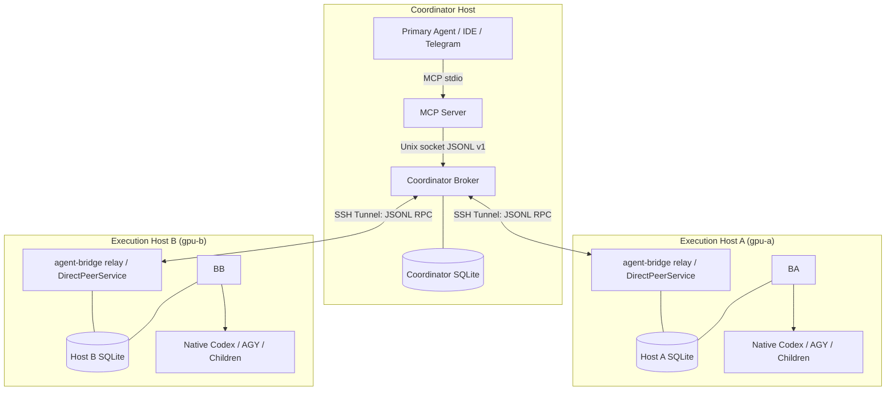

> Language: English | [中文](zh/multi-machine-design.md)

# Multi-Machine Access Design and Architecture Specification (Canonical)

> **Status**: Finalized Technical Specification (2026-11-04).  
> **Scope**: Distributed multi-host CLI agent orchestration across a coordinator and worker execution hosts.  
> **Review Integration**: Incorporates all 16 adversarial review findings from Antigravity (`gemini-4-argon-high`) and Pi (`deepseek-flash`) in Section 3.  
> **Implementation Status**: SSH relay, remote dispatch, groups, workspace transfer, and event mirroring are implemented; refer to [Multi-Machine Interface Contract](multi-machine-interface.md) for current method coverage vs unimplemented extensions (`peer.control`, `peer.review`, `peer.inbox`).

---

## 1. Goals, Scope, and Principles

### 1.1 Objectives
1. **Single coordinator entry**: Primary agent queries remote catalogs, dispatches host-targeted tasks, and paginates artifacts transparently through coordinator MCP tools.
2. **Cross-host groups and broadcasts**: Target mixed bridge/native members across hosts under CAS `expected_revision` snapshots.
3. **Non-disruptive native integration**: Enqueue Codex via existing shared daemon queues (`thread/queue/add`) and wake Antigravity strictly after confirming local instances have exited.
4. **Disconnect resilience & idempotency**: Remote accepted work continues running across SSH drops; recovery reconciles durable `operation_id` and two-phase receipts without blindly re-running or migrating tasks.

### 1.2 Boundaries & Non-Goals
- **Trust model**: Assumes single-administrator hosts (isolated per host, not hardened against malicious root or same-UID attackers).
- **Non-goals**: Public listening TCP/HTTP ports for RPC, live process/memory migration across hosts, cross-host `dependencies` DAGs, automatic whole-repo syncing, or distributed 2PC/Raft transactions.

---

## 2. Topology and Connectivity Model

1. **Outbound SSH only**: Coordinator connects over SSH (`Config` aliases, `ProxyJump`, VPN) invoking remote `<remote_executable> relay`.
2. **No listening cluster ports**: Zero exposed cluster TCP ports.
3. **Per-host SQLite WAL isolation**: Never place SQLite WAL/SHM over NFS/SMB/SSHFS; each node writes exclusively to its local SQLite DB.
4. **Decoupled relay lifetime**: SSH drops kill only the relay process while remote broker/workers continue undisturbed.
5. **Unidirectional RPC (`A1`/`D5`/`D6`)**: Remote hosts never need SSH access back to the coordinator; remote member broadcasts write local `node_outbox`, pulled periodically via `peer.pull_requests` and confirmed via `peer.ack_request`.

---

## 3. Architecture Decision Records (`ADR-01` to `ADR-16`)

| ID | Review Source | Risk Addressed | Canonical Architectural Solution |
|---|---|---|---|
| **ADR-01** | A1, D5, D6 | Reverse push breaks short-lived sockets & leaks reverse creds | Coordinator-initiated periodic `peer.pull_requests` polling over outbound SSH. |
| **ADR-02** | A2, D1 | Self-declared `native_id` spoofing | Broker-issued short-lived Binding validated against caller PID, `starttime`, and locks. |
| **ADR-03** | A6, D2 | DB rollback regresses generation silently | Independent `node_identity.json` (`0600`) synced post-commit; mismatch triggers `state_corrupted`. |
| **ADR-04** | D6 | Per-host `request_id` collisions on reconnect | Global `OperationKey = (node_id, state_generation, operation_id)` namespace. |
| **ADR-05** | D3 | External CLI writes vs local SQLite atomicity | Persist Intent -> mark `sending` -> run CLI -> write Receipt; unconfirmed becomes `uncertain`. |
| **ADR-06** | A3 | Cached `operation_pending` deadlocks | Store Operation ref in `api_requests`; inspect remote status on reconnect until terminal. |
| **ADR-07** | A4, D8 | Cross-host group FK errors & UUID collisions | Separate `remote_group_members`, `peer_inbox`, and FK-free `native_send_queue`. |
| **ADR-08** | A5 | Reordering past pending native messages | Strict FIFO per target stream; `uncertain` head blocks followers until admin Evidence resolution. |
| **ADR-09** | D7 | Cancelling un-dispatched items creates sequence holes | Deliver `Cancel Tombstone` preserving `target_seq` until ACKed on target. |
| **ADR-10** | A7, D4 | Remote `event_seq` FK conflicts on parent host | Deduplicate via `parent_ref` into coordinator mirror `events.seq` for `deliveries`/`parent_ack`. |
| **ADR-11** | A8 | Mixed local `cwd` / remote target & missing cancel keys | Separate source `cwd` from remote `project_id`; extend `agent_cancel` for `operation_id`/`delivery_id`. |
| **ADR-12** | D5, D8 | Permissive relay command injection | Enforce strict `peer.*` method allowlist banning shell/quota pass-through. |
| **ADR-13** | A3 | Split `open`+`dispatch` orphans sessions on drop | Merge omitted-`session_id` remote dispatches into one atomic compound Operation. |
| **ADR-14** | Coordinator | Cross-host shared quota drift | Keep `token_budget` strictly per host (`budget_scope=host`); forbid metered remote native broadcasts. |
| **ADR-15** | Coordinator | Huge diffs/logs bloat notifications | Transfer `ArtifactRef{host_id, artifact_id, sha256, size}` with paginated `peer.result`. |
| **ADR-16** | Coordinator | Reconnect replays reset confirmed progress | Monotonic durable cursors and immutable terminal/receipt monotonicity. |

---

## 4. Node Identity, Security, and Capabilities

- **Identity Triple**: `host_id` (admin alias), `node_id` (UUID at install), `state_generation` (regenerated on DB recreate/restore).
- **Out-of-DB Commitment Log (`node_identity.json`)**: Mode `0600`, stores `state_generation` and `max_confirmed_seq`; mutating handlers commit SQLite -> `fsync` identity JSON -> reply ACK. Regressing DB sequences lock writes into `state_corrupted` requiring manual admin replacement.
- **Controlled Member MCP (`agent-bridge mcp --role member`)**: Uses broker-issued bindings verified against live OS PID, boot start time, and group membership without trusting LLM-supplied `sender_id`.

## 5. Wire Methods Allowlist (`peer.*`)

Permitted RPCs: `peer.hello`, `peer.catalog`, `peer.inspect`, `peer.pull_requests`, `peer.ack_request`, `peer.deliver`, `peer.control`, `peer.cancel`, `peer.review`, `peer.events`, `peer.result`, `peer.inbox`, `peer.notify_parent` (plus `peer.lookup_delivery`, `peer.workspace`, `peer.resolve_delivery` documented in [Multi-Machine Interface Contract](multi-machine-interface.md)). Unknown methods fail with `peer_method_not_allowed`.

## 6. Persistent SQLite Extensions

Worker nodes persist `node_outbox`, `peer_inbox`, and `native_send_queue`; coordinator nodes persist `remote_group_members` and `peer_outbox` (see [Phase C Design Specification](multi-machine-phase-c-design.md) for updated strict ordered DDL).

## 7. Ordered Delivery, Cancel Tombstones, and Native Wake

- Strictly ordered `target_seq` per target; cancellations replace pending payloads with same-sequence Cancel Tombstones acknowledged cleanly on target; `uncertain` heads require `agent_delivery_resolve` with concrete `evidence` and revisions.
- Codex enqueue runs strictly against active local `thread/queue/add`; Antigravity wake acquires host-local `presence` + `flock` checks, verifies process exit, resumes `--conversation`, and requires `index > baseline` on `user_input/DONE`. Coordinator never holds remote locks.

## 8. MCP Tools & Recovery Matrix

Coordinator tools: `agent_hosts`, extended `agent_catalog`, extended `agent_open`/`agent_dispatch`, extended `agent_group`, `agent_operation`, `agent_delivery_resolve`, and extended `agent_cancel`. Disconnects distinguish `waiting_for_host`, ACK-loss reconciliation (`peer.lookup_delivery`), background worker continuity, `uncertain` head-of-line blocks, and `state_corrupted` rollbacks.

## 9. Verification Scenarios (13 Failure & Conflict Matrix Cases)

Covers identical UUID/profile isolation across hosts, broadcast snapshot immutability, SSH cuts at all 4 boundaries, out-of-order dual restarts, spoofed/rolled-back identity lockouts, AGY lock-safe remote resume, Cancel Tombstones, privilege-escalation blocks, paginated large artifacts, backward single-host compatibility, compound open/dispatch recovery, manual `uncertain` evidence resolution, and multi-node mirrored event isolation.
