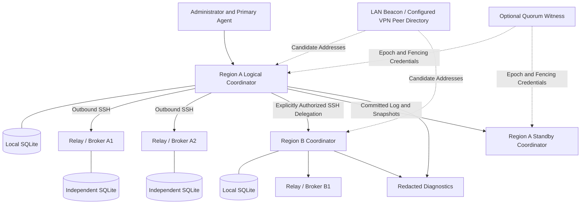
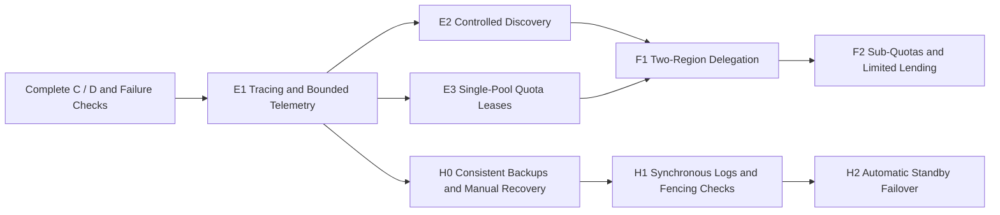

> Language: English | [中文](zh/multi-machine-future-design.md)

# Multi-Machine Future Evolution and Next-Phase Design Proposal

Document date: 2026-11-05. Status: Design proposal, not implemented and not verified on live hosts.

This continues the [Multi-Machine Design](multi-machine-design.md), [Interface Contract](multi-machine-interface.md), and [Phase C Design](multi-machine-phase-c-design.md). ADR-01 through ADR-28 remain in force. This proposal adds ADR-29 through ADR-38; changes to earlier restrictions require their own review and implementation. This document does not automatically add any RPC to the allowlist.

## 1. Background and Problems

The implementation baseline examined for this proposal had SSH Relay, node identity, HostRegistry, and remote dispatch. Phase C specified cross-host groups, ordered delivery, workspaces, event mirrors, and Web authentication; a design alone did not prove all those features existed. `peer_transport.py` already contained real SSH transport and a client, while some background components in `peer_api.py` were still Protocol definitions. Earlier claims of “no runtime wiring” or a “currently single-host” system were historical descriptions. Check individual implementation status against [Phase C Section 1.2](multi-machine-phase-c-design.md#12-implemented-and-pending-work), current code, and the current interface contract. An existing test count does not prove this proposal works.

Six problems motivate the next stage: maintaining temporary nodes through static hosts; continuously viewing incremental usage and progress; regional autonomy beyond one coordinator; safe takeover after coordinator failure; limiting a shared account beyond host-local budgets; and correlating errors across processes. These problems are related, but they do not justify introducing a complete distributed control system at once.

Complete Phase C and D failure checks before adding streaming telemetry, shared tracing, and controlled discovery. Enable federation and quota pooling only when the actual deployment needs them; implement automatic standby failover last. Keep recovery manual until state replication and execution-host rejection of old leaders are sufficient.

### 1.1 Rules That Must Remain

- Each group has one logical authority. Network mesh reachability grants no right to change arbitrary groups.
- Each host uses local SQLite. Do not share a database over NFS/SSHFS or copy live WAL files as a standby protocol.
- `NodeRef` contains `node_id` and `state_generation`; `host_id` is the registering coordinator's alias, not a global federation identity. Database generation, execution-node rebuild, and coordinator leadership epoch are separate concepts.
- `target_seq`, native `local_seq`, node `ack_seq`, telemetry cursors, and replication-log indexes have different jobs and are never interchangeable.
- Admission, native receipt, execution completion, and parent-model processing are distinct. A trace or telemetry event cannot prove either of the last two.
- An unreachable node is `unknown`. An `uncertain` native input still requires inspection on its original host or administrator evidence; never resend it automatically.
- Do not introduce cross-host 2PC. The review directives at the top of Phase C override its leftover prune hold/prepare/finalize descriptions. Federation pruning must not restore that rejected design.

## 2. Architecture and Topology



Connections in the diagram describe authorization, not a requirement for every pair of nodes to connect. Execution nodes still need no reverse SSH credentials. Telemetry returns through coordinator-initiated SSH requests. Regional coordinator access needs separate authorization and cannot inherit ordinary worker permissions. A passive standby runs no senders.

Define `cluster_id`, stable `authority_id`, the physical coordinator's NodeRef, and `leader_epoch` separately. In an ordinary deployment, authority_id is bound to the creator's NodeRef; only a standby deployment enables an authorized logical authority registry. Execution nodes save the binding from logical authority to physical leader: merely raising the requested epoch cannot appoint a new leader. Existing stream_id values retain their original authority identity; failover must not restart sequence allocation at 1.

## 3. Dynamic Discovery and Mesh Reachability

### 3.1 Discovery Produces Candidates Only

Static SSH hosts remain the default. An optional discoverer reads mDNS/LAN beacons or an administrator-provided VPN peer directory. It publishes only protocol version, installation ID, a public-key fingerprint digest, private address, and expiry; never project directories, session names, model accounts, or tokens. WireGuard itself does not perform application discovery: use an externally configured membership directory. This proposal does not implement a new VPN control service.

Discovery must not automatically accept SSH host keys, generate arbitrary SSH commands, change ProxyJump, or grant group membership. Addresses must belong to allowed LAN/VPN subnets, and remote_executable comes from local configuration. Only after administrator approval of the fingerprint and a pinned NodeRef may hello and read-only catalog requests proceed. Write permission, project_id, and quota pools need separate grants. Address changes do not change identity; identity changes require registration again.

### 3.2 Leases and State Changes

Suggested initial values are a 10-second heartbeat, suspect after 30 seconds, and a 60-second lease, with random jitter and configuration support. Use the local monotonic clock for leases within the current run. Persisted wall-clock times are for display; after restart, handshake again instead of carrying over the previous online status.

States are `discovered -> pending_approval -> verified -> online -> suspect -> offline`; record `revoked` and `identity_changed` separately. Expiry stops new dispatches and retains the queue; it neither moves running work nor removes group members. Static configuration takes precedence over discovery, and manual revocation takes precedence over new beacons. Limit candidate count, message size, and rate per source address so forged beacons cannot exhaust storage.

### 3.3 What No Public RPC Exposure Means

Bridge RPC remains on SSH/Unix sockets with no new public listener. LAN mDNS/beacons are new local UDP traffic: they require explicit enablement, binding to a chosen interface, and no public forwarding. This supplements the older “no cluster TCP listener” rule; it must not be described as having no network ports at all. If policy also forbids public VPN UDP access, use an existing private VPN or tunnel and leave unreachable nodes offline. This project does not automatically open ports or configure public relays.

## 4. Streaming Usage and Progress Telemetry

### 4.1 Protocol and Events

Add capability `telemetry_batch_v1`, initially through bounded long-poll `peer.telemetry_read`. The coordinator requests a batch and the execution host returns it in the same SSH response, so no reverse connection is needed. A later `telemetry_stream_v1` may support multiple response frames, but requires changing the current one-request/one-response transport reader and Relay. Do not send unsolicited frames into the existing JSONL channel.

Requests contain source NodeRef, subscription_id, after_seq, max_bytes, max_events, wait_ms, and filter_revision. Initial limits are 256 KiB, 128 events, and 20 seconds of waiting, with per-host limits. A read does not advance durable acknowledgment. Add mutating `peer.telemetry_ack` after the coordinator commits its mirror transaction; deduplicate by the existing OperationKey and follow ack_seq/fsync ordering. Multi-frame mode also carries frame_seq and an end marker, keeps the 1 MiB per-frame limit, and owns a separate connection so progress cannot crowd out cancellation or approvals.

The event key is `(source_node_id, source_generation, telemetry_seq)`. Contents include task_ref, attempt_id, kind, observed_at, elapsed_monotonic_ms, trace_id, span_id, and schema_version.

| kind | Required fields and meaning |
|---|---|
| usage | Cumulative input/output/cache token counters, metering source, revision, and is_final. Unknown values are null, never zero. |
| progress | Phase and optional completed_units/total_units with units. Do not show a percentage without a reliable total. |
| tool_delta | tool_call_id, delta_index, start/update/end, and a redacted summary or ArtifactRef. |
| task_state | Reference to independent task state. The durable task result still determines the authoritative terminal state. |
| gap | Missing sequence range, reason, and latest snapshot reference. Never present this as a complete history. |

Usage uses cumulative snapshots per attempt, provider, and metering category. Receivers replace by revision rather than adding replayed deltas. Save estimates separately from provider settlement; final values may correct earlier estimates. Unknown provider usage does not imply free service. If a CLI exposes no tool deltas, report only observed stages; do not guess by parsing terminal screen text.

### 4.2 Backpressure, Persistence, and Recovery

The source saves recoverable events before sending. The coordinator saves mirrors and cursor in one transaction, then ACKs. Limit each subscription's window and bytes; a slow subscriber affects only itself. Rotate fairly across hosts, and use a separate connection and allowance for control RPCs. Cancelling a subscription does not cancel a task.

Start with a configurable 128 MiB telemetry disk allowance per node and 24-hour retention for ordinary deltas. Under pressure, combine progress/usage before assigning sequences; numbered events remain immutable. Retention may prune ordinary deltas only if queries return a gap record. Keep task terminal states, approvals, delivery receipts, and budget ledgers in separate reliable tables that telemetry cleanup cannot delete. When reliable storage is full, refuse new tasks while reserving space for cancellation and inspection; an offline monitor does not stop a running CLI. On reconnect, inspect the earliest available sequence; after a gap, import a current snapshot before continuing and mark the displayed history incomplete.

```mermaid
sequenceDiagram
    participant C as Coordinator
    participant R as Relay
    participant W as Remote Broker
    participant DB as Remote SQLite
    W->>DB: Save usage/progress and sequence
    C->>R: telemetry_read(after, max_bytes, wait_ms)
    R->>W: Allowlisted Call
    W-->>C: events + next_seq + earliest_seq
    C->>C: Save mirrors and cursor in one transaction
    C->>R: telemetry_ack(subscription, cursor, operation)
    R->>W: Persist acknowledgment
    Note over C,W: Lost ACKs can be acknowledged again; no task restart
```

## 5. Regional and Federated Coordinators

Each region owns its local tasks, workspaces, approvals, and quotas. A parent coordinator sees only authorized catalogs and delegation results. Catalogs expire; stale capacity does not guarantee admission. Federated GroupRef is `(cluster_id, authority_id, group_id)`, while physical targets retain full NodeRefs. Two authorities must never both write the same group.

Proposed capability `federation_v1` adds `peer.federation_catalog`, `peer.delegate`, `peer.lookup_delegation`, and `peer.delegation_events`. Mutations require OperationKey, request_hash, delegation_id, authority_ref, path, hop_limit, deadline, a budget sublease, and explicit permissions. These method names are proposals; update the interface and allowlist when implementing them.

The parent first persists a delegation outbox entry. In one local transaction, the child deduplicates, freezes its recipients, queues local deliveries, and saves a delegation receipt before returning accepted. If the parent's ACK is lost, look up the original delegation_id. Cancellation follows the original delegation through every level, saving requests and outcomes. A timeout proves neither non-execution nor permission to dispatch again in another region.

For cascading groups, the parent freezes direct members plus child-group references and revisions. Each child freezes its own members at that revision and returns a snapshot digest. Reject only a branch whose revision differs; other accepted branches continue. Do not promise simultaneous delivery across regions or all-or-nothing success. The full recipient list is available only after each branch accepts; show `awaiting_expansion` separately from `accepted`. Work that needs a complete list at submission must first fetch and fix all member references, then dispatch individually; this still is not a cross-host atomic commit.

Check path for repeated cluster/authority entries; start with hop_limit=4. Publish only authorized child groups across regions, without recursively copying all groups. Save a cursor for each delegation edge and suppress duplicate parent notices. Multiple authorities addressing one native target still share execution-host local_seq; there is no global submission order across authorities. Only the original approval authority receives approvals; delegated permissions cannot elevate member to admin.

## 6. Coordinator Availability and Failover

### 6.1 Backups and Automatic Standby Are Different

Keep local SQLite WAL. Use a consistent backup API to create snapshots and send them to the standby over SSH. A snapshot includes database digest, log position, and identity acknowledgment records; do not copy active db/wal/shm files directly. Asynchronous snapshots are disaster-recovery backups and cannot guarantee preservation of every ACKed write. Missing logs require manual recovery and a reported loss range, not automatic leader replacement.

Automatic standby uses one writer, sequential replay of a logical commit log, and an independent quorum service holding leadership epoch and committed position. Raft election alone does not preserve SQLite contents: before an external RPC, its intent, operation, stream sequence, and request fingerprint must be durably applied on the standby and marked committed by the quorum. Writes acknowledged externally need the same protection. Stop new writes when no synchronous replica is available; do not silently fall back to asynchronous replication.

This adds substantial overhead compared to local transactions. A suggested arrangement is two data replicas and an independent witness, giving three voters. The witness is not a data copy: after losing the primary, verify the surviving replica has reached the committed position. If deterministic log replay cannot bind transaction results to identity-file confirmation, keep takeover manual; periodic WAL copies are not a substitute.

### 6.2 Leader Leases and Rejecting Stale Leaders

Before admitting every mutation, the execution host checks authority_id, leader_epoch, verified leadership credentials, and expiry, and persists its highest seen epoch. Comparing only the highest seen epoch does not protect a node that has not yet seen the new leader. Automatic mode therefore requires online verification of a quorum-issued short lease, or expiry verification with a defined clock-error bound. Refuse new writes if verification is unavailable. A new leader waits for safe expiry of the previous lease and registers its epoch on required targets before resuming each target's sender. Targets that cannot be confirmed remain paused.

Leadership epoch is not part of the business operation_id and changes neither stream_id nor target_seq. Retrying a delivery under a new epoch still refers to the old record. A recovered former leader is read-only and cannot send from its uncommitted local outbox.

```mermaid
sequenceDiagram
    participant P as Original Coordinator
    participant S as Standby
    participant Q as Quorum Witness
    participant W as Execution Host
    P->>S: Replicate commit log n (delivery intent)
    S-->>P: n durably applied
    P->>Q: Confirm committed n
    P->>W: deliver(epoch e, original operation)
    Note over P: Crash; admission ACK may be lost
    S->>Q: Request epoch e+1 and verify log position
    Q-->>S: New lease after the old lease safely expires
    S->>W: Register authorized leader at epoch e+1
    S->>W: lookup_delivery(original operation)
    W-->>S: Original receipt or uncertain
    Note over S,W: Keep uncertain paused; do not repeat native input
```

### 6.3 Takeover Order

Verify logs, database identity, and the external ack_seq lower bound. After obtaining legitimate leadership, begin with read-only reconciliation. Restore inbox/outbox, unacknowledged source requests, broadcast snapshots, target_streams, event-mirror cursors, quota leases, and approval revisions. Look up sending records first and adopt their original receipts. Retry an original operation only when non-delivery is confirmed and its existing queue rules allow it. Approval replies still check the original request_id and revision; never approve automatically. Recover ready/attached workspaces through the Phase C journal. An identity counter ahead of the database still means state_corrupted; standby mode cannot bypass generation checks.

## 7. Fine-Grained Quota Leases and Budget Lending

### 7.1 Budget Objects and Accounting

A pool is defined by tenant, an irreversible provider_account reference, model_class, window_id, and unit. Units distinguish tokens, integer micro-currency, concurrency slots, and request counts; do not add unlike units. Each pool has one ledger authority. A federated parent may reserve allowance for a child pool, which issues subleases only from durably received allowance. Losing the parent does not stop already-authorized execution or permit the child to increase its allowance.

Money budgets and concurrency leases are separate. The pool invariant is `settled + outstanding reservations <= hard_limit`. A child's allowance remains reserved in the parent, rather than being charged twice. Deduplicate settlement by usage_source, attempt_id, and metering revision. Fix the price version in each lease; corrections add ledger entries instead of overwriting history.

Proposed capability `quota_lease_v1` adds `peer.quota_reserve/renew/settle/release`, each deduplicated by business lease ID and OperationKey. Reserve checks balance and persists the reservation in one transaction before ACK. Admission binds that lease to the original task/attempt; dispatch retries do not reserve again. Before launching the model, the execution host checks the lease and remaining allowance.

### 7.2 Disconnects, Expiry, and Lending

Lease expiry prohibits starting new work; it does not prove an existing CLI stopped. Return a concurrency slot only after a verifiable stop/completion record; disconnected slots become `held_unknown`. Do not release the full spending reservation merely because the lease expired. Hard budgets require an interface that can limit maximum output and stop additional calls, plus worst-case allowance for unreported spending. Where a native CLI's provider spending cannot be controlled, label the budget soft and make no account-wide hard-limit promise. Keep existing `budget_scope=host` and `peer_budget_scope` behavior until the new mode is explicitly selected and its conditions hold.

Implement lending within one pool authority first: move lendable reserves into borrower reservations and record lender, borrower, amount, return rules, expiry, approvals, and limits. Cross-pool lending uses prepaid sub-allowances, never a transfer that lets both sides spend the same amount at once. Revocation affects future launches; a running task does not become unspent because revocation arrived late. On provider 429 responses, honor the provider's wait requirement and lower concurrency; a lease is no guarantee from the provider.

## 8. Distributed Tracing and Diagnostic Aggregation

Create trace_id at entry and separate span_id values for Broker, SSH Relay, remote Broker, Worker, CLI interaction, approval waits, and parent notices. Carry them in optional trace_context. Retries use new spans linked through operation_id/delivery_id and span links; trace_id is neither an idempotency key, authorization credential, nor state confirmation. Federation may retain a trace_id but forwards only allowed fields to authorized regions.

If a native CLI cannot carry context, its local wrapper records the observed call span and native turn ID. Do not modify raw chats or invent internal CLI spans. For approvals that span days, retain the wait span and request_id; a response creates a linked span recording stale-revision or expiry outcomes, never approval tokens.

Use structured fields: cluster_id, NodeRef, authority_id, leader_epoch, operation_id, delivery_id, stream_id, target_seq, attempt_id, trace/span, event_seq, error_code, and duration_ms. Cross-host wall clocks are approximate and for display only. Measure duration with each host's monotonic clock, and determine ordering from messages and sequences, not timestamps alone.

By default save tool name, state, size, and summary, not prompts, tool argument bodies, command output, environment variables, keys, or raw database contents. Redact at source and filter aggregation by cluster/project permission. Normal spans may be sampled; retain errors and delivery-state changes. Diagnostic sampling never deletes business ledgers. Start aggregation through the same coordinator-pull channel; a later optional local collector may export data, but no unconfigured public service is added.

A diagnostic query should return the last confirmed state, current reason for waiting, original host reachability, missing event ranges, linked approvals, budget reservations, and specific read-only checks. A finished span alone cannot mark a task completed.

## 9. Proposed SQLite Additions

These are incremental schema drafts, not runnable repository migrations. Store full references as canonical JSON in `*_ref_json`, while still checking fields and permissions at receipt; JSON is not proof of authority. Keep Phase C business tables, idempotency records, and tombstones. Foreign keys refer only to local rows, never remote sessions.

```sql
CREATE TABLE discovery_candidates (
    candidate_id TEXT PRIMARY KEY,
    node_id TEXT NOT NULL,
    state_generation TEXT NOT NULL,
    source TEXT NOT NULL,
    endpoint_json TEXT NOT NULL,
    fingerprint TEXT NOT NULL,
    status TEXT NOT NULL,
    observed_at REAL NOT NULL,
    expires_at REAL NOT NULL,
    UNIQUE(node_id, state_generation, source, fingerprint)
);
CREATE TABLE node_leases (
    node_id TEXT NOT NULL,
    state_generation TEXT NOT NULL,
    authority_id TEXT NOT NULL,
    lease_revision INTEGER NOT NULL,
    status TEXT NOT NULL,
    last_seen_at REAL NOT NULL,
    PRIMARY KEY(node_id, state_generation, authority_id)
);
CREATE TABLE telemetry_log (
    source_node_id TEXT NOT NULL,
    source_generation TEXT NOT NULL,
    seq INTEGER NOT NULL CHECK(seq > 0),
    task_ref_json TEXT NOT NULL,
    attempt_id TEXT NOT NULL,
    kind TEXT NOT NULL,
    payload_json TEXT NOT NULL,
    trace_id TEXT,
    created_at REAL NOT NULL,
    PRIMARY KEY(source_node_id, source_generation, seq)
);
CREATE TABLE telemetry_cursors (
    subscription_id TEXT PRIMARY KEY,
    source_ref_json TEXT NOT NULL,
    filter_revision INTEGER NOT NULL,
    committed_seq INTEGER NOT NULL DEFAULT 0,
    acked_seq INTEGER NOT NULL DEFAULT 0,
    CHECK(acked_seq <= committed_seq)
);
CREATE TABLE federation_delegations (
    delegation_id TEXT PRIMARY KEY,
    parent_authority TEXT NOT NULL,
    child_authority TEXT NOT NULL,
    request_hash TEXT NOT NULL,
    snapshot_json TEXT NOT NULL,
    path_json TEXT NOT NULL,
    status TEXT NOT NULL,
    receipt_json TEXT,
    revision INTEGER NOT NULL,
    UNIQUE(parent_authority, delegation_id)
);
CREATE TABLE authority_epochs (
    authority_id TEXT PRIMARY KEY,
    max_epoch INTEGER NOT NULL,
    leader_ref_json TEXT NOT NULL,
    grant_digest TEXT NOT NULL,
    committed_index INTEGER NOT NULL
);
CREATE TABLE replication_log (
    log_index INTEGER PRIMARY KEY,
    epoch INTEGER NOT NULL,
    transaction_id TEXT NOT NULL UNIQUE,
    previous_hash TEXT NOT NULL,
    entry_hash TEXT NOT NULL,
    changes_json TEXT NOT NULL,
    status TEXT NOT NULL CHECK(status IN ('prepared','committed','applied'))
);
CREATE TABLE quota_pools (
    pool_id TEXT PRIMARY KEY,
    authority_id TEXT NOT NULL,
    window_id TEXT NOT NULL,
    unit TEXT NOT NULL,
    hard_limit INTEGER NOT NULL CHECK(hard_limit >= 0),
    settled INTEGER NOT NULL DEFAULT 0 CHECK(settled >= 0),
    reserved INTEGER NOT NULL DEFAULT 0 CHECK(reserved >= 0),
    revision INTEGER NOT NULL,
    CHECK(settled + reserved <= hard_limit)
);
CREATE TABLE quota_leases (
    lease_id TEXT PRIMARY KEY,
    pool_id TEXT NOT NULL REFERENCES quota_pools(pool_id),
    parent_lease_id TEXT,
    borrower_ref_json TEXT NOT NULL,
    task_ref_json TEXT,
    reserved_amount INTEGER NOT NULL CHECK(reserved_amount >= 0),
    settled_amount INTEGER NOT NULL DEFAULT 0,
    expires_at REAL NOT NULL,
    state TEXT NOT NULL,
    revision INTEGER NOT NULL
);
CREATE TABLE quota_ledger (
    entry_id TEXT PRIMARY KEY,
    lease_id TEXT NOT NULL REFERENCES quota_leases(lease_id),
    metering_key TEXT NOT NULL,
    metering_revision INTEGER NOT NULL,
    delta INTEGER NOT NULL,
    reason TEXT NOT NULL,
    UNIQUE(lease_id, metering_key, metering_revision)
);
CREATE TABLE diagnostic_spans (
    trace_id TEXT NOT NULL,
    span_id TEXT NOT NULL,
    parent_span_id TEXT,
    source_ref_json TEXT NOT NULL,
    operation_id TEXT,
    duration_ms INTEGER,
    status TEXT NOT NULL,
    attributes_json TEXT NOT NULL,
    PRIMARY KEY(trace_id, span_id)
);
CREATE INDEX telemetry_task ON telemetry_log(attempt_id, seq);
CREATE INDEX delegation_pending ON federation_delegations(status, child_authority);
CREATE INDEX quota_lease_state ON quota_leases(pool_id, state, expires_at);
CREATE INDEX spans_operation ON diagnostic_spans(operation_id);
```

Allocate sequences in the same transaction as events. Do not use `MAX(seq)+1` after deletions; use durable counters or an existing safe counter facility. Fix a subscription's filters at filter_revision; changed filters require a new subscription so an old ACK cannot skip data. Record gaps in retention-range metadata; an empty query page does not prove no events were lost. Store latest usage separately under `(full task_ref, attempt_id, provider, category)`, replacing by revision.

Check quota_pools balance and update lease/ledger in the same `BEGIN IMMEDIATE` transaction. Preserve lending-source subleases separately, without foreign keys across databases. Replication entries contain fixed business IDs, results, and counter changes: the standby cannot regenerate UUIDs, timestamps, or send sequences. Sensitive lease credentials belong in restricted files or process memory; tables keep digests only.

Upgrade by schema_version in steps. Back up database and identity file, stop local writes, then add tables, indexes, and constraints. New features are disabled by default. Do not change old target_seq, clear old uncertain records, or migrate remote tasks to other machines. Enabling logical standby authority needs per-node registration and stopping the previous senders; it is a separate operation, not an automatic startup migration.

## 10. Failure and Recovery Table

| Failure | Saved facts | Recovery | Prohibited action |
|---|---|---|---|
| Forged beacon or reused IP | Candidate, pinned fingerprint, NodeRef | Reject mismatch and wait for registration | Automatically trust a new host key |
| Expired heartbeat while CLI still runs | Original task and target reference | Show unknown and inspect the original host after reconnecting | Run it on another host |
| Lost telemetry ACK | Receiver cursor and source log | Reread from the cursor and deduplicate by unique key | Add replayed token counters |
| Slow consumer or full telemetry storage | Retention range, gap, business results | Throttle, prune ordinary deltas, restore a snapshot | Delete receipts or approvals |
| Tool delta exceeds frame limit | Artifact digest | Retrieve pages | Enable unbounded memory buffers |
| Repeated delegation or lost ACK | request_hash and receipt | Look up the original delegation | Create new child work |
| Changed child-group revision or regional disconnect | Original branch snapshot and admission state | Refuse or wait for that branch; accepted branches continue | Claim whole-group atomic failure |
| Cycle or elevated permissions | path, hop_limit, granted scope | Reject with a specific reason | Recursively broadcast to every discovered node |
| Primary fails while standby log is behind | committed_index and digests | Pause takeover; catch up or recover manually | Start sending solely because an election was won |
| Partition with old leader still alive | Epoch and verifiable lease | Refuse unverifiable writes and wait for safe replacement | Claim outbox on both leaders |
| Unknown native-send outcome during takeover | Original inbox/outbox, operation, sequences | Look up on the original host; retain uncertain pause | Generate a new delivery ID for the new epoch |
| Identity file ahead of database | ack_seq lower bound | state_corrupted; inspect and change generation manually | Skip checks in standby mode |
| Expired quota lease with offline worker | Unsettled reservations and held_unknown slots | Retain reservation until worker stop is confirmed | Immediately allocate it again |
| Repeated settlement or provider correction | Metering revision and ledger | Deduplicate or append a difference entry | Overwrite history and charge again |
| Lost trace or clock skew | State tables and message sequences | Show incomplete diagnostics and query business state | Decide task success from span timing |
| Duplicate or late approval after takeover | request_id, revision, original authority | Return original result or reject stale revision | Fetch a fresh revision and approve automatically |

## 11. Proposed Architecture Decisions

| ID | Proposed decision | Alternative and cost |
|---|---|---|
| ADR-29 | Separate discovery from authorization; retain static configuration | Automatic enrollment saves steps, but candidate network messages cannot grant writes. |
| ADR-30 | Mesh describes reachability; each group keeps one authority | Multi-writer groups break revision and target order; reject this option. |
| ADR-31 | Start with bounded long polling, then negotiate multi-frame streams | Changes to ADR-01 transport restrictions require separate implementation; no reverse SSH is required. |
| ADR-32 | Telemetry may have gaps; receipts and budget ledgers cannot be pruned with telemetry | Permanent full deltas have unbounded cost; users must see gaps. |
| ADR-33 | Persist federation delegation per branch, without atomic cross-region broadcast | Reject global 2PC; branches independently succeed or wait. |
| ADR-34 | Standby needs synchronous business logs, election, and execution-host fencing together | WAL copying or Raft election alone is insufficient; new writes stop without a synchronous replica. |
| ADR-35 | Logical authority stays stable; epochs do not alter business idempotency keys | Changing streams at takeover would bypass old uncertain records. |
| ADR-36 | One pool authority reserves allowance and grants subleases | Extending ADR-14 requires explicit selection; uncontrolled native CLI spending remains a soft budget. |
| ADR-37 | Expiry does not prove a resource is reclaimable | Holding unknown reservations lowers utilization but prevents over-allocation and overspend. |
| ADR-38 | Traces correlate diagnostics; business records are authoritative for state and permissions | Keep no raw chats and do not use trace ID as authority or completion proof. |

## 12. Staged Implementation and Verification



| Stage | Files or components | Required evidence |
|---|---|---|
| E1 | peer_protocol/transport, Relay, Worker event normalization, EventMirror, Web | No duplicate usage after reconnect; slow subscriptions do not delay cancellation/approval; overflow produces gaps; no raw chats or keys. |
| E2 | hosts, discovery plugin, configuration and registration commands | Forged beacons, IP reuse, restart, revocation, and generation changes never authorize automatically; no new public listener. |
| E3 | Store budget transactions, execution launch checks, provider metering | Concurrent reserve does not exceed limits; repeated settlement is not charged twice; unknown slots stay reserved; hard and soft budgets are distinct. |
| F1 | Federation protocol, group branch snapshots, delegation outbox/inbox | Two-region duplicate delegation, cycles, revision conflict, partial acceptance, and cancellation have definite records. |
| F2 | Subleases, lending ledger, approvals | Disconnects do not create allowance; overdue unknown spending stays reserved; one prepaid grant is never spendable by both sides simultaneously. |
| H0 | Local snapshots, SSH backup and recovery tools | Check backup consistency, identity lower bounds, and missing-log reporting in isolated state; manual recovery does not resend uncertain work. |
| H1 | Replication log, standby applier, witness interface, execution-host epoch checks | Crash at every commit/replication/ACK window: uncommitted intents are not sent, acknowledged state is retained, and a partitioned old leader cannot write. |
| H2 | Broker start/stop order, leadership leases, every background sender | Preserve streams, tombstones, approvals, and quota during takeover; senders, OutboxPuller, parent notices, and control calls all verify leadership. |

Start with temporary databases, simulated CLIs/peers, controlled clocks, and fault injection. Cover two authorities addressing the same native target, telemetry-source rebuilds, subscription filter changes, simultaneous loss of primary and replica, and corrected quota settlement. Set throughput/latency thresholds after E1 measurements rather than inventing verified capacity. Record at least event bytes per second, P95 visibility latency, ACK backlog, database growth, control RPC latency, and recovery duration.

At every stage update interface definitions, TypedDicts, capabilities, Relay allowlist, migrations, and permission tests, then run the full unittest suite and Ruff. Document checks do not prove those implementation tests passed. Arrange real multi-host, native CLI, VPN, and automatic takeover tests separately within authorized scope; distinguish simulated and live results.

## 13. Configuration Decisions Before Implementation

Before E1, identify the actual usage fields each runtime exposes, telemetry retention, and redaction rules. Before E2, choose discovery interfaces and allowed subnets. Before E3, establish shared-account ownership, price versions, and which calls can enforce spending limits. Federation requires group authority, approval ownership, and regional data permissions. H1 requires a quorum service, clock-bound or online lease verification, a synchronous replica policy, and acceptable write downtime.

Until those choices are made, keep the affected new features disabled while existing single-host, static SSH, and host-budget operation continues. Prioritize E1 for the next actual delivery: it improves the information available during execution and supplies inspectable records for later discovery, quotas, and takeover.
