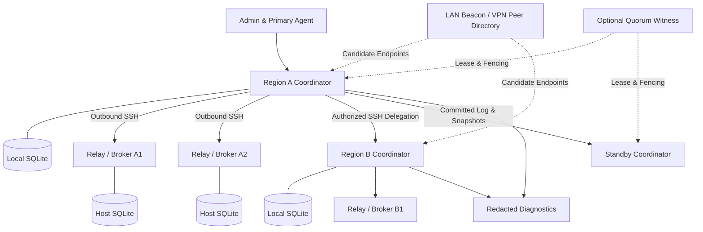

> Language: English | [中文](zh/multi-machine-future-design.md)

# Multi-Machine Future Evolution & Next-Phase Design Proposal

Date: 2026-11-05. Status: Design proposal (unimplemented and untested across live hosts).

Continues [Multi-Machine Design](multi-machine-design.md), [Interface Contract](multi-machine-interface.md), and [Phase C Design](multi-machine-phase-c-design.md). Existing `ADR-01` through `ADR-28` stay intact; adds proposals `ADR-29` through `ADR-38` (never enabling unallowlisted RPCs implicitly).

## 1. Six Next-Phase Challenges & Rollout Principles

Addresses dynamic ephemeral node onboarding, streaming progress/usage telemetry, regional federation, coordinator failover/HA, fine-grained pooled quota leases, and distributed tracing—recommending incremental rollout (telemetry/tracing first, then controlled discovery, single-pool leases, federation, and hot standby last only with full fencing).

### 1.1 Non-Negotiable Invariants
- Single logical group authority per group; mesh reachability never grants group write access to arbitrary peers.
- Local SQLite WAL only per node (never NFS/SSHFS or copying live WAL files as standby sync).
- Keep `NodeRef` `(node_id, state_generation)` distinct from human `host_id` aliases and leadership `leader_epoch`.
- Never interchange `target_seq`, native `local_seq`, node `ack_seq`, telemetry cursors, and replication log indexes.
- Separate admission (`enqueued`), native receipt (`received`), execution end, and coordinator acknowledgment (`parent_ack`).
- Unreachable = `unknown`; `uncertain` native delivery always stops for host inspection/evidence rather than auto-resending.
- No distributed 2PC across hosts (including for cluster pruning).

## 2. Logical Topology

Execution nodes keep zero reverse SSH credentials; standby coordinators run no active senders while passive. Separate `cluster_id`, stable `authority_id`, physical coordinator `NodeRef`, and `leader_epoch` (preserving existing `stream_id` across failover).

## 3. Controlled Node Discovery (`ADR-29`, `ADR-30`)

- Static `hosts` remain default. Optional mDNS/LAN beacons or admin-provided VPN peer inventories emit **candidates only** (protocol version, install ID, fingerprint digest, private IP, expiry—no paths, session names, accounts, or tokens; allowlisted subnets only).
- Discovery never auto-trusts SSH host keys or mutates `remote_executable`; admin approval + key pinning promotes `discovered -> pending_approval -> verified -> online -> suspect -> offline` using monotonic leases (e.g. 10s heartbeat, 30s suspect, 60s expiry, re-handshaken across restarts).
- Bridge RPCs remain SSH/Unix-socket only with zero public listening ports (explicit opt-in LAN UDP beacons stay non-routable).

## 4. Streaming Usage & Progress Telemetry (`ADR-31`, `ADR-32`)

- Capability `telemetry_batch_v1`: bounded long-poll `peer.telemetry_read` (256 KiB / 128 events / 20s max wait; optional future `telemetry_stream_v1`) over outbound SSH + durable `peer.telemetry_ack`.
- Per-event key `(source_node_id, source_generation, telemetry_seq)` classifying `usage`, `progress`, redacted `tool_delta`, `task_state`, and explicit `gap` markers (`null` when unknown, monotonic monotonic-clock deltas, never replacing authoritative task settlement receipts/approvals).
- Bounded per-node telemetry storage (e.g. 128 MiB / 24h delta retention) may prune old verbose deltas leaving explicit `gap` markers while preserving receipts, approvals, and budget ledgers untouched.

## 5. Federated Sub-Coordinators (`ADR-33`)

- Regional coordinators manage local workspaces/approvals/quotas independently (`federation_v1`: proposed `peer.federation_catalog`, `peer.delegate`, `peer.lookup_delegation`, `peer.delegation_events`).
- Group references scope to `(cluster_id, authority_id, group_id)` with cycle checks (`hop_limit=4`); cascading groups freeze direct/child snapshot revisions independently per branch without distributed 2PC all-or-nothing rollback.

## 6. Coordinator HA & Failover (`ADR-34`, `ADR-35`)

- Separate cold consistent snapshots from active HA failover. Safe active failover requires **three** simultaneous guarantees before issuing external RPCs: synchronous standby replication apply, quorum witness epoch lease (`committed_index`), and worker-side leader-epoch + lease fencing (rejecting stale writers without changing `operation_id`/`stream_id`/`target_seq` or resetting `uncertain` blocks).

## 7. Pooled Quota Leases & Lending (`ADR-36`, `ADR-37`)

- Pool dimensions `(tenant, opaque_provider_account, model_class, window_id, unit)` separating tokens, integer micro-currency, concurrency slots, and request counts under `settled + reserved <= hard_limit` (`quota_lease_v1`).
- Expired leases block new launches while holding unknown slots (`held_unknown`) until stopped processes are confirmed; external CLIs without vendor spend-caps stay clearly labeled soft budgets.

## 8. Distributed Tracing & Redacted Diagnostics (`ADR-38`)

- Propagate `trace_id` / `span_id` across broker/relay/worker/wait steps with redacted attributes (never logging raw prompts, tool bodies, env vars, tokens, or chat transcripts); causal order follows protocol sequences rather than cross-host wall clocks.

## 9. Proposed Incremental Schema Additions

Proposed SQLite additions (`discovery_candidates`, `node_leases`, `telemetry_log`, `telemetry_cursors`, `federation_delegations`, `authority_epochs`, `replication_log`, `quota_pools`, `quota_leases`, `quota_ledger`, `diagnostic_spans`) remain draft proposals using durable sequence counters, `BEGIN IMMEDIATE` balance checks, and separate migration versioning.

## 10. Failure Matrix & ADR Summary (`ADR-29`..`ADR-38`)

Enforces key safety boundaries: reject spoofed beacons; query rather than cross-host re-run on expired heartbeats; dedupe replayed telemetry without double-billing tokens; expose explicit `gap` records instead of silently dropping data; preserve stale epoch write fences; retain `uncertain` gates across leader failover; never reclaim `held_unknown` leases blindly; and keep tracing strictly diagnostic rather than authoritative completion proof.

## 11. Phased Rollout Roadmap (`E1`-`E3`, `F1`-`F2`, `H0`-`H2`)

Recommended sequence: **E1** (tracing & bounded telemetry) -> **H0** (consistent snapshot backups) & **E2/E3** (controlled discovery & single-pool leases) -> **F1/F2** (federation & sub-quotas) -> **H1/H2** (fenced sync HA failover). Prioritize E1 first for immediate runtime observability while leaving new features disabled by default until prerequisites settle.
