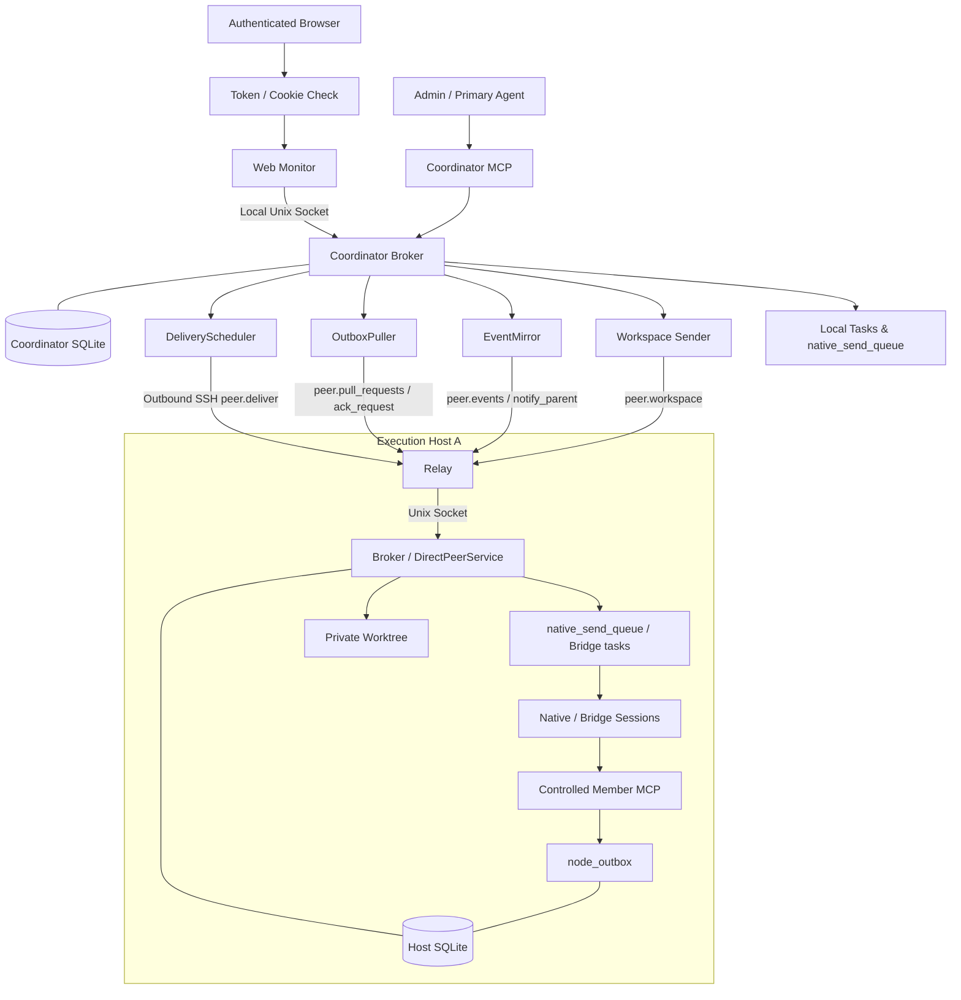

> Language: English | [中文](zh/multi-machine-phase-c-design.md)

# Phase C Design Specification: Cross-Host Groups, Workspace Sync, Group Pruning, Session Naming & Web Security

> **Architectural Review & Filter Directives (2026-11-05)**:
> 1. **No Distributed 2PC for Group Pruning**: Rejected distributed two-phase hold/prepare RPCs (`peer.group_guard`). The coordinator is the sole group authority: it verifies stopped/completed invariants read-only via `peer.inspect`, validates local delivery receipts, and performs single-host CAS soft-delete (`deleted=1`), returning `group_deleted` to any late `OutboxPuller` items.
> 2. **Streamlined Outbox Pull Validation**: Coordinator `OutboxPuller` enforces strict `remote_group_members` allowlists and `group_revision` checks on pull alongside broker-issued process-bound `member_bindings`.
> 3. **Strict Two-Layer Ordered Delivery Core Approved**: `target_streams`, monotonic `target_seq`, `Cancel Tombstone`, evidence-backed `agent_delivery_resolve`, and stream-scoped `peer_inbox` unique indexes.
> 4. **Immutable Workspace Sync Approved**: Patch + Snapshot transfer into private worker worktrees without ever mutating caller repositories.
> 5. **Transactional Session Naming & Hardened Web Auth Approved**: Atomic `session_names` creation and admin-token + cookie + CSRF + broker-proxied Web approvals.

Date: 2026-11-05. Status: Approved Specification continuing [Multi-Machine Design](multi-machine-design.md) and [Interface Contract](multi-machine-interface.md) (`ADR-17` through `ADR-28`). "Atomic" denotes single-host SQLite transactions or same-filesystem file swaps, never cross-host 2PC.

---

## 1. Goals, Baseline Separation & Non-Goals

- **Five Phase C deliverables**: (1) mixed local + remote groups with ordered snapshot broadcasts, (2) pull-based remote member broadcasts without reverse SSH, (3) immutable incremental `patch`/`snapshot` workspace sync into remote private worktrees (`project_id`-resolved), (4) `active_only` lifecycle classification & safe batch pruning (`agent-bridge group prune`), and (5) creation-time `session_names` plus hardened Web authentication/approvals.
- **Explicit exclusions**: Multi-coordinator group writes, Raft/2PC, migrating live OS/Antigravity processes, silent dirty sync over host checkouts, cross-host `dependencies` DAGs, or exposing node RPC over public HTTP.

---

## 2. Core Architecture, Canonical Refs & Separate Counters

Canonical references (`NodeRef = {host_id, node_id, state_generation}`, `GroupRef = authority NodeRef + {group_id}`, `TargetRef = destination NodeRef + {kind, runtime, target_id}`).

Three strictly separated counters (`ADR-18`):
- `target_seq`: monotonic per `(authority NodeRef, TargetRef)` stream (`stream_id = SHA256(canonical_json(authority_ref, target_ref))`; initial session-less remote `open+dispatch` uses `ordering_mode=bootstrap, target_seq=0, stream_id=NULL`, promoting to `ordered-only`).
- `local_seq`: per physical native target `(runtime, native_id)` serializing local broadcasts, remote deliveries, and parent notifications.
- `ack_seq`: monotonic node-wide peer mutation counter persisted in `peer_commit_log` and `fsync`ed out-of-DB via `NodeIdentityStore.advance(ack_seq)`.

Capabilities negotiated in `peer.hello`: `groups_v1`, `ordered_delivery_v1`, `member_outbox_v1`, `event_mirror_v1`, `workspace_v1`, `session_name_v1`, `prune_guard_v1`.

---

## 3. Topic 1: Cross-Host Groups, Ordered Delivery, Outbox Pull, Resolution & Event Mirror

- **`remote_members`**: `agent_group` atomically validates remote targets/identities outside write locks before committing coordinator `remote_group_members`; removals require exact `(node_id, state_generation)` targeting.
- **Coordinator DDL**: `remote_group_members`, `group_broadcasts`, `broadcast_recipients`, `target_streams`, `peer_outbox`, `delivery_resolutions`, `pulled_request_receipts`.
- **Execution DDL**: Migrates `peer_inbox` via clean table rebuild supporting partial unique indexes (`peer_inbox_legacy_seq` vs `peer_inbox_ordered_seq`), plus `incoming_streams`, `ordered_targets`, `peer_commit_log`, `native_send_queue`, and `native_target_counters`.
- **`DeliveryScheduler` (`ADR-19`)**: Two-layer ordering—network order (prior item must reach `accepted_remote` or tombstone ACK) AND native queue admission (`received` or confirmed cancel before releasing `target_seq`). `uncertain` head pauses only that target's stream cleanly.
- **Cancel Tombstones**: Unsent queued items convert to `tombstone_pending` (`seq_kind=tombstone`) preserving sequence numbers so late messages cannot reorder past cancels.
- **`OutboxPuller` (`ADR-20`)**: Bound member sessions (`member_bindings` validating PID, process start time, and group revision) write `node_outbox`; coordinator polls `peer.pull_requests` every `pull_interval` (default 2s) up to `scan_upper_seq` from `after=0`, deduplicating via `pulled_request_receipts` before calling `peer.ack_request`.
- **`agent_delivery_resolve` (`ADR-21`)**: Admin-only triple-CAS (`expected_revision` + `expected_delivery_revision` + `expected_remote_revision`) with non-empty `evidence` (`<= 16 KiB`) calling `peer.resolve_delivery` (`received` or permanent non-resending `not_received` cancel).
- **`EventMirror` (`ADR-22`)**: Polls `peer.events`, deduplicates `(NodeRef, remote_seq) -> local_seq` cleanly in `peer_event_mirrors`, enforces `peer_parent_routes`, and delivers locally or via outbound `peer.notify_parent`.

---

## 4. Topic 2: Incremental Cross-Host Workspace Sync (`ADR-23`, `ADR-24`)

- Dispatch targets remote `project_id` configured locally in destination `config.json.projects` rather than caller `cwd`. Existing session IDs reject re-supplying workspace setup (`workspace_already_attached`).
- **Dual delivery modes**:
  - `patch`: When `peer.inspect(kind='workspace', section='base')` confirms `source_base_commit` exists on destination, uploads binary diffs + missing selected blobs + exact modes (`0000`-`0777` without symlinks/setuid) and builds an isolated Git worktree.
  - `snapshot`: Reconstructs full base files + selected modifications deduplicated by SHA-256 content blobs into an initialized private Git repo preserving an exact `input_digest` and `snapshot_tree`.
- **Chunked upload RPC (`peer.workspace`)**: `prepare` -> `chunk` (e.g. 256 KiB aligned chunks) -> `seal` -> `abort`, using `O_NOFOLLOW` + relative descriptors, `workspace_transfers`/`workspace_chunks`/`workspace_blobs` tables, and atomic rollback cleanly preserving caller host checkouts on any failure.

---

## 5. Topic 3: Group Lifecycle & Safe Pruning (`ADR-25`)

- **Derived states**: `active`, `inactive`, `completed` (all members proven closed/stopped & all historical/current deliveries settled), `unknown` (conservatively returned when `active_only=True`), and `deleted`.
- **Safe CLI & MCP (`agent-bridge group prune --older-than <dur> [--dry-run]`, `agent_group_prune`)**: Enforces Authoritative Coordinator Verification (read-only `peer.inspect` across local & remote members -> verify all broadcasts/deliveries settled -> single atomic `UPDATE session_groups SET deleted=1 ... WHERE revision=:expected AND deleted=0` CAS) reserving soft-deleted audit history without 2PC deadlocks.

---

## 6. Topic 4: Creation-Time Session Naming (`ADR-26`)

- Optional `name` parameter on `agent_open` and `agent_dispatch` (trimmed 1-128 Unicode chars; rejects NUL/newlines/control chars; hashed cleanly into request fingerprint while stripping `name=None` for pre-upgrade compatibility). Persists atomically into `session_names` inside session creation transactions across local and compound remote opens.

---

## 7. Topic 5: Web Monitor Authentication & Broker-Proxied Approvals (`ADR-27`)

- Binds `127.0.0.1:8080` by default; reuses mode-`0600` same-UID `state/admin.token` (checked live per request to honor token rotations). Explicitly clarifies that raw HTTP LAN (`0.0.0.0`) traffic requires SSH tunneling or a reverse TLS proxy (`public_origin` / `allowed_hosts`) for confidentiality.
- Auth flows: public static `GET /login`, `POST /auth/login` (constant-time `hmac.compare_digest` issuing `HttpOnly; SameSite=Strict; Path=/` random 256-bit `bridge_session` cookie + per-session CSRF token), authenticated reads (`Cookie` or `Authorization: Bearer`), strict Host/Origin/CSP (`default-src 'self'`, nonces/no `unsafe-inline`), safe DOM escaping (`textContent`), and `POST /api/respond` proxying strictly through `broker` `agent_control(action='respond', expected_revision=..., request_id=<uuid>)` returning `409`/`503` cleanly without ever bypassing Broker directly into `Store`.

---

## 8. RPC & Verification Matrix Summary

Completes the 16-method `peer.*` allowlist (`peer.workspace` and `peer.resolve_delivery` added; `peer_protocol`, `PeerClient`, Relay allowlist, `DirectPeerService`, enums `workspace_*`/`group_prune_blocked`/`native_stop_unverifiable`/`parent_route_conflict`) across work packages `C0`-`C7` with explicit offline migration, concurrency, cancel-tombstone, workspace crash-recovery, prune safety, naming, and Web security verification tests prior to Phase D multi-machine fault testing.
