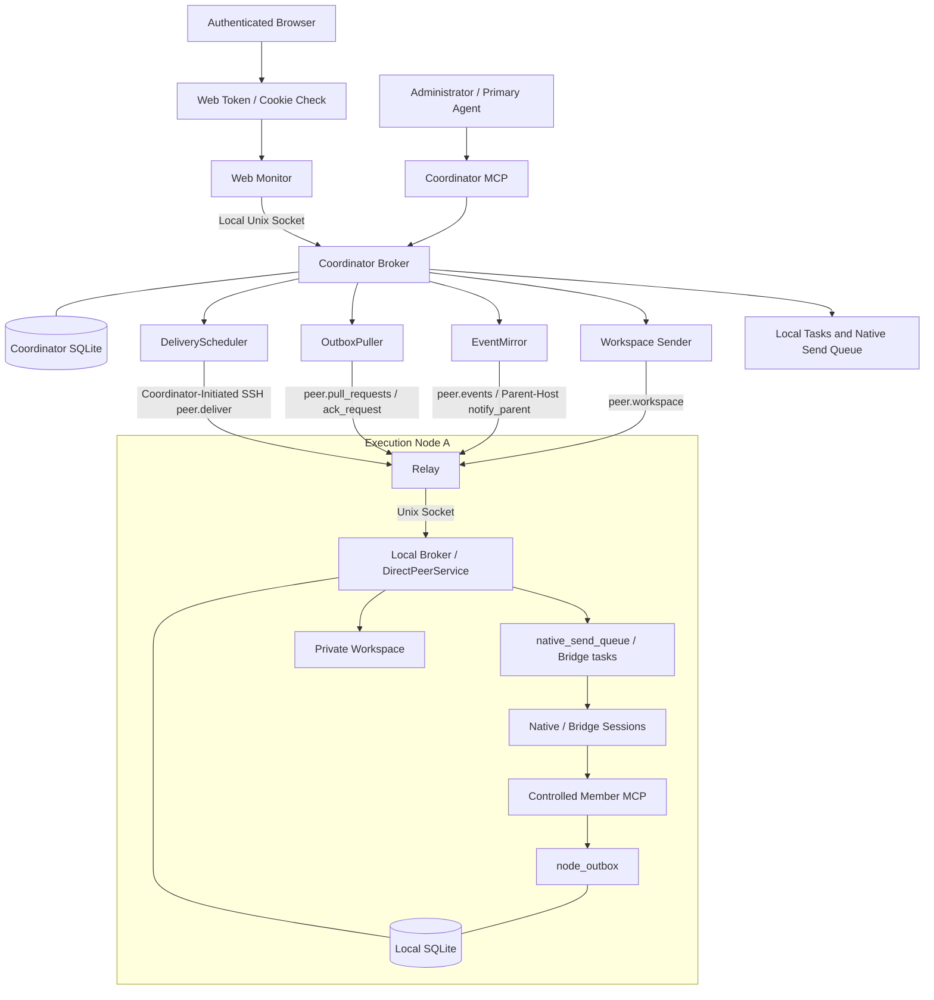
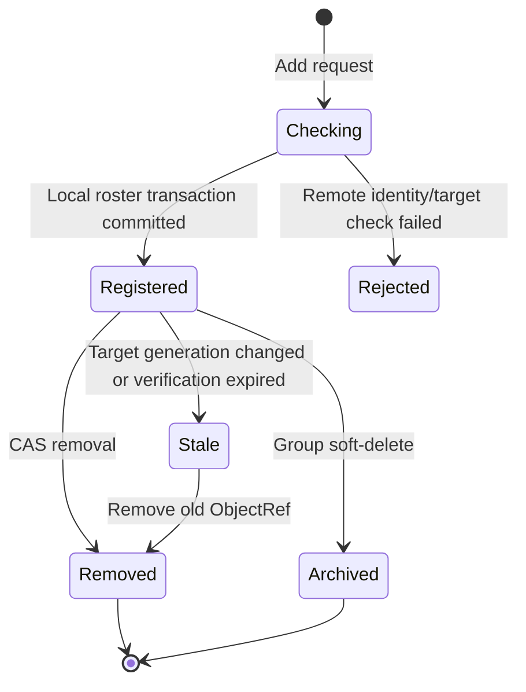
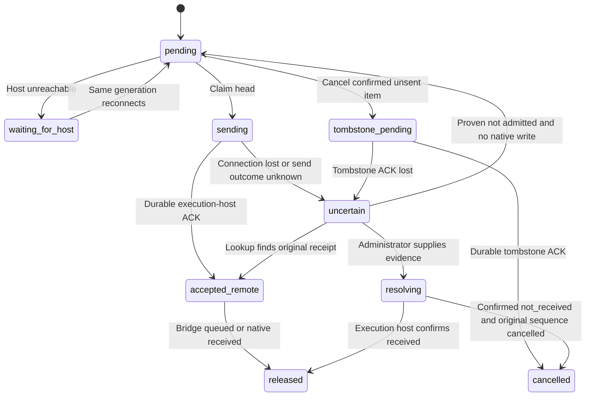
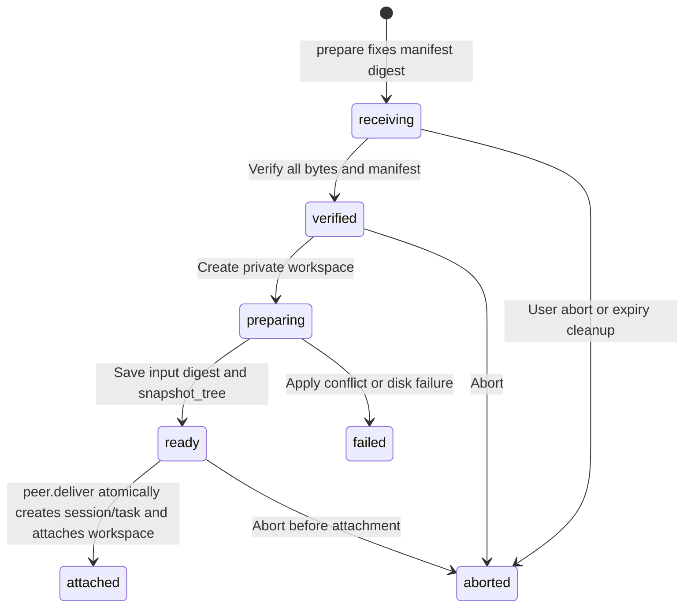
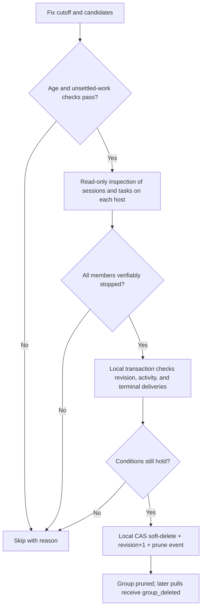

> Language: English | [中文](zh/multi-machine-phase-c-design.md)

# Phase C Design Specification: Cross-Host Groups, Workspace Sync, Historical Group Pruning, Session Naming, and Web Authentication

> **Architectural review status**: Technical review and scope reduction by Antigravity, 2026-11-05.
>
> **Filter directives**:
> 1. **No distributed 2PC for pruning**: Reject the Sol 6.1 proposal for `peer.group_guard(acquire/validate/prepare/finalize)` and remote `group_prune_holds`. The coordinator is the group's sole authority. Following ADR-01, it uses standard read-only `peer.inspect` to check that every member is closed/stopped and every broadcast recipient is terminal. It then CAS soft-deletes the group (`deleted=1`) in one local transaction. Any later pulled request for that group receives `group_deleted`. Do not add distributed locks or orphan lease recovery.
> 2. **Simpler outbound-request verification**: An execution host's local Broker writes its agent's broadcast to `node_outbox`. When pulling, the coordinator's `OutboxPuller` checks the `remote_group_members` allowlist and current group revision. The approved simplification does not require complex short-lived token-binding infrastructure on remote nodes.
> 3. **Strict ordering retained**: Keep `target_streams`, increasing `target_seq`, Cancel Tombstones, evidence-based `agent_delivery_resolve`, and execution-side `peer_inbox` uniqueness by stream.
> 4. **Immutable workspace delivery retained**: Keep Patch/Snapshot modes, immutable manifests, and chunk verification. Prepare and attach only private execution worktrees; never overwrite the host checkout.
> 5. **Creation-time names and Web security retained**: Write `session_names` in the creation transaction and protect the Web Monitor with Token/Cookie/CSRF checks and Broker-mediated approvals.

Document date: 2026-11-05. Status: Approved design specification.

This follows the [Multi-Machine Design](multi-machine-design.md), [Interface Contract](multi-machine-interface.md), and the code examined at the time. ADR-01 through ADR-16 remain valid; new decisions start at ADR-17. Interface and database changes require matching interface definitions, types, and tests; implementations must not leave old signatures in place.

“Must” identifies implementation and test requirements; “must not” prohibits an action. Unless qualified, “atomic” means one host's SQLite transaction or a file replacement on one filesystem, never a cross-host transaction. Section 1.2 is the historical implementation baseline from the design date, not a current support inventory. The top review directives take precedence over retained older binding and prune-hold descriptions below; those descriptions are not permission to implement the rejected alternatives. Check the current interface contract and code for actual support.

## 1. Goals, Boundaries, and Implementation Baseline

### 1.1 Deliverables

1. One coordinator manages groups of local and remote members, persisting a fixed recipient list before dispatch. Messages cannot overtake earlier messages for the same target.
2. Remote members submit cluster broadcasts locally. The coordinator pulls them without granting execution nodes reverse SSH access.
3. Remote writable tasks use explicitly selected uncommitted source changes in an isolated workspace, including when the destination lacks the source Git commit.
4. Queries distinguish active and ended groups. Administrators can soft-delete old groups in batches only after safety checks pass.
5. A new session has a readable name as soon as it appears in the database. Web reads and approvals require authentication.

### 1.2 Implemented and Pending Work

The user supplied a Phase A/B result of 335 passing tests. This records an earlier check and does not prove the Phase C requirements below passed. The code baseline examined for this design was:

| Object | Implementation at the design baseline | Required change |
|---|---|---|
| Transport, identity, host configuration | `peer_transport.py`, `hosts.py`, and `node_identity.py` had SSH/Relay, identity files, and HostRegistry; `HostConfig.pull_interval` defaulted to 2.0 seconds | Keep independent local SQLite and coordinator-initiated RPC. |
| Execution RPC | `DirectPeerService` handled hello, inspect, catalog, deliver, lookup_delivery, cancel, result, and events: eight methods | An allowlisted name alone is not a handler; implement remaining required handlers and capability negotiation. |
| Remote dispatch | `Broker._remote_deliver()`, compound remote session/task creation, and `agent_operation` existed | Preserve operation deduplication; add ordered delivery and workspace preparation. |
| Delivery sequence | `Broker._target_seq()` hashed an operation ID; `peer_inbox` sequences were unique across the node | Hashes are not counters. Migrate to target-specific streams rather than keeping the old unique constraint. |
| Groups | `groups.py` supported local Bridge/native members and saved local tasks/deliveries in one transaction | Add remote members and durable broadcasts, without remote session foreign keys in local member tables. |
| Phase C components | `DeliveryScheduler`, `OutboxPuller`, and `EventMirror` were only Protocols | Implement them and Broker background tasks. |
| Outbound requests | `node_outbox` had seq, operation_id, group_id, native_id, method, payload, and status | Add binding_id, request_id, and result; `ack_outbox(result=...)` must save its then-ignored result. |
| Member identity | Earlier design required member MCP bindings | No controlled binding implementation could be assumed. Original body required it before member broadcasts; the top review directive simplifies the remote infrastructure. |
| Project roots | `HostConfig.projects` parsed `project_id -> path` | Execution still used `open.cwd`; use the execution node's allowed project mapping for the new protocol. |
| Workspaces | Local `workspace.worktree()` supported `snapshot_files`/`snapshot_tree`; `capture_patch()` captured result changes | Add remote upload/application. A result patch is not a source input patch. |
| Group query/delete | Lists filtered `deleted=0`; soft delete removed current member rows | Add activity classification and pruning that preserves membership history. |
| Session names | `monitor.set_session_name()` created `session_names` on demand | Move it into schema; write a name in the session creation transaction. |
| Web | `WebMonitorHandler` had no auth; snapshot allowed `Access-Control-Allow-Origin: *`; respond called Store directly | Add Token/Cookie, CSRF, and source checks; route approvals through Broker using the page's revision. |

This corrects old implementation descriptions without denying completed Phase A/B dispatch work. Use the named functions and concrete behavior, rather than a historical test count, when checking implementation.

### 1.3 Exclusions

- No concurrent coordinators writing one group, coordinator election, cross-host database, or distributed commit.
- No process-memory migration or takeover of a running Antigravity terminal.
- No automatic copying of all dirty files, overwriting execution project roots, applying results to the source, or automatic Git commits.
- No cross-host dependency DAG, cross-host hard budget, or public node RPC service.
- LAN Web listening is an explicit monitor choice; node RPC still uses SSH only.

## 2. Architecture, References, and Runtime Rules

### 2.1 Topology



Each group has one authority: its creator coordinator. Execution hosts retain authorized member credentials and delivery records, not another independently writable roster. A `group_id` is meaningful only alongside its authority `NodeRef`; identical names under different authorities do not identify the same group.

### 2.2 Reference Definitions

```text
NodeRef   = {host_id, node_id, state_generation}
ObjectRef = NodeRef + {local_id}
GroupRef  = authority NodeRef + {group_id}
TargetRef = destination NodeRef + {kind, runtime, target_id}
```

- `host_id` is the coordinator's configured alias. A payload cannot change source identity; the handshaken connection determines it.
- Bridge uses `kind=bridge, runtime='', target_id=session_id`; native uses `kind=native, runtime=codex|antigravity, target_id=native_id`.
- Every global reference includes node_id and state_generation. A new generation cannot inherit old membership even if host_id and the local UUID match.
- User-facing `cwd` always names the caller's source directory. A remote member's cwd is display/verification information; execution uses the destination's verified session record.

The coordinator must load its own NodeIdentity. Do not use the old `_peer_node()` fallback of `socket.gethostname()` and `coordinator_generation='local'` as an ordered-stream identity. After authority authorization, the execution host binds that NodeRef to the approved access. A changed coordinator generation requires re-registration, not merely a different authority_ref in JSON.

### 2.3 Keep Three Sequences Separate

| Field | Scope | Purpose |
|---|---|---|
| `target_seq` | One coordinator generation to one full TargetRef | Allocate consecutive values from 1; broadcasts and ordinary dispatch to that existing session share order. group_id is excluded. |
| `local_seq` | One physical native target `(runtime,native_id)` on the execution host | Serialize actual writes from local broadcasts, remote broadcasts, and parent notices. |
| `ack_seq` | All committed peer mutations in the node's current database | Confirm `NodeIdentity.max_confirmed_seq` outside the database; unrelated to a message target. |

`stream_id = SHA256(canonical_json(authority NodeRef, TargetRef))`. Use canonical encoding, not ambiguous string concatenation. A target generation change creates a new stream; different groups addressing the same target share one stream to prevent overtaking through another group. The first compound open has no session_id: use `ordering_mode=bootstrap, target_seq=0, stream_id=NULL`, only for a Bridge creation request with empty target.id and complete open parameters. Deduplicate by operation ID. Its creation transaction marks the resulting target ordered-only and returns its TargetRef; the coordinator then starts that stream at 1. The initial task precedes every later stream task. Existing targets and tombstones cannot use bootstrap.

Allocate ack_seq in the database transaction. After commit, call `NodeIdentityStore.advance(ack_seq)` and complete fsync before returning success. On startup compare the database's real maximum with the identity file; a peer's last_acked_seq is an extra lower bound, not a replacement for querying the database. A database behind either confirmed value enters state_corrupted and refuses writes. If the database is ahead of the file, inspect its committed log before advancing the file.

Even a cached duplicate response must ensure its mutation's ack_seq reached the identity file before returning; an idempotency hit cannot bypass fsync. Keep the existing global operation_id primary key in peer_operations, but derive all new IDs from canonical full source identity, receiver generation, method, and business request ID. Do not use possibly colliding user request_id values directly. Every lookup also verifies receiver identity fields.

Preserve old max_confirmed_seq as the migration floor and allocate above it; never reset a high value. Counters use SQLite signed 64-bit integers; refuse writes at the maximum and require an administrator generation change. Old hashed target_seq values cannot start new streams or be sorted to invent historical send order.

### 2.4 Negotiation and Compatibility

Retain JSONL envelope `v=1` and the 1 MiB frame limit. Advertise new features through `peer.hello.capabilities`: `groups_v1`, `ordered_delivery_v1`, `member_outbox_v1`, `event_mirror_v1`, `workspace_v1`, `session_name_v1`, and `prune_guard_v1`. Keep existing method names; new implementations advertise both supported methods and feature flags.

`agent_operation.status=completed` still means the RPC has a definite result. Admission of remote dispatch does not mean its task completed. Keep task_id and independent task/send/processing states; never settle a task or broadcast from RPC completed alone.

Send new fields/RPCs only after capability checks. Missing support returns `peer_not_implemented`, without fallback to unordered sending, source cwd, or unauthenticated access. Retain legacy Phase B request handling. Before switching an existing target to ordered mode, inspect old outcomes and mark it ordered-only, then reject legacy writes to it. New Phase C writable sessions require a prepared workspace.

## 3. Topic One: Cross-Host Groups and Broadcasts

### 3.1 remote_members and Membership Lifecycle

Keep `agent_group` create/add/remove/delete, expected_revision, and request_id; add `remote_members`. It may be combined with session_ids and native_members. Commit all membership changes in one coordinator transaction.

```json
{
  "group_id": "review-42", "action": "add", "expected_revision": 3,
  "request_id": "add-gpu-reviewers",
  "remote_members": [
    {"host_id": "gpu-a", "kind": "native", "runtime": "codex",
     "native_id": "11111111-1111-4111-8111-111111111111", "cwd": "/srv/project", "label": "Remote review"},
    {"host_id": "gpu-b", "kind": "bridge", "session_id": "remote-session-uuid", "label": "Tests"}
  ]
}
```

The earlier RemoteMember type described only native members; the Bridge branch above is an explicitly proposed tagged union and requires updating types first. native_id and session_id are mutually exclusive. Bridge entries do not accept runtime/cwd; the execution host returns them. On create/add, omitted node_id/state_generation are verified and filled by the coordinator; supplied values must match exactly. Remove requires the original node_id/state_generation, host_id, kind, and native_id/runtime or session_id. It must allow removal of an offline old-generation member without re-resolving host_id and deleting a replacement.

Addition steps in the original detailed design:

1. Outside the transaction, resolve HostRegistry, handshake, check pinned identity, target existence, runtime/directory, and that native is not Bridge-owned. A coordinator-side `Path(cwd).is_dir()` cannot check a remote directory.
2. The original detailed proposal had the execution host issue short-lived native/member bindings and the local Broker verify Bridge sender ownership. Bindings grant specific GroupRef/methods, never admin.token. Read this retained step subject to top directive 2, which rejects unnecessary remote token infrastructure.
3. Start `BEGIN IMMEDIATE`, recheck group revision, deleted state, and applicability of the identity check; save every member and grant together or none.
4. Return the new revision after commit. Remote checks and local commit are not one transaction: a session closing between them cannot produce partial roster writes. Delivery rechecks execution conditions; membership does not guarantee execution.

Adding an identical full member is an idempotent no-op. Conflicting label/cwd for the same identity follows existing remove-then-add behavior. Removal changes future recipients and sender permissions; saved broadcasts keep their snapshots. Cancel existing deliveries separately. Soft-deleted groups cannot broadcast, add members, or reuse group_id; history remains queryable.

The retained binding design requires local Broker verification of PID, start ticks, and session lock, rather than trusting sender fields in MCP JSON. Recheck ownership per call and save verified identity/authorization version in node_outbox; the coordinator also checks roster, permission, and revision. This is one administrator's trust domain, with no promise against a remote root or same-UID administrator forging local records.



`Stale` is derived for queries and does not rewrite an existing broadcast target. Registering a new generation requires a new membership change.

### 3.2 Coordinator DDL

These are new tables; keep existing local membership tables. Time remains REAL Unix seconds and JSON uses canonical `encode()`. Application and migration tests must enforce the states defined here.

```sql
CREATE TABLE remote_group_members (
    group_id TEXT NOT NULL REFERENCES session_groups(id),
    host_id TEXT NOT NULL, node_id TEXT NOT NULL, state_generation TEXT NOT NULL,
    target_kind TEXT NOT NULL CHECK(target_kind IN ('bridge','native')),
    runtime TEXT NOT NULL DEFAULT '', target_id TEXT NOT NULL,
    cwd TEXT NOT NULL DEFAULT '', label TEXT NOT NULL DEFAULT '',
    joined_revision INTEGER NOT NULL, verified_at REAL NOT NULL,
    verification_receipt TEXT NOT NULL, created REAL NOT NULL,
    CHECK((target_kind='bridge' AND runtime='') OR
          (target_kind='native' AND runtime IN ('codex','antigravity'))),
    PRIMARY KEY(group_id,host_id,node_id,state_generation,target_kind,runtime,target_id)
);

CREATE TABLE group_broadcasts (
    id TEXT PRIMARY KEY, group_id TEXT NOT NULL REFERENCES session_groups(id),
    group_revision INTEGER NOT NULL, sender_ref TEXT, message TEXT NOT NULL,
    recipient_snapshot TEXT NOT NULL, request_key TEXT UNIQUE NOT NULL,
    created REAL NOT NULL, settled_at REAL
);
CREATE TABLE broadcast_recipients (
    broadcast_id TEXT NOT NULL REFERENCES group_broadcasts(id),
    recipient_key TEXT NOT NULL, target_ref TEXT NOT NULL,
    delivery_id TEXT UNIQUE, task_id TEXT, status TEXT NOT NULL,
    send_status TEXT, processing_status TEXT, error TEXT,
    updated REAL NOT NULL,
    PRIMARY KEY(broadcast_id,recipient_key)
);
CREATE TABLE target_streams (
    stream_id TEXT PRIMARY KEY, authority_ref TEXT NOT NULL, target_ref TEXT NOT NULL,
    next_seq INTEGER NOT NULL DEFAULT 1 CHECK(next_seq>=1),
    released_seq INTEGER NOT NULL DEFAULT 0 CHECK(released_seq>=0),
    CHECK(next_seq>released_seq)
);
CREATE TABLE peer_outbox (
    delivery_id TEXT PRIMARY KEY,
    broadcast_id TEXT REFERENCES group_broadcasts(id),
    group_id TEXT REFERENCES session_groups(id), group_revision INTEGER,
    stream_id TEXT NOT NULL REFERENCES target_streams(stream_id),
    target_seq INTEGER NOT NULL CHECK(target_seq>=1),
    host_id TEXT NOT NULL, node_id TEXT NOT NULL, state_generation TEXT NOT NULL,
    target_kind TEXT NOT NULL, runtime TEXT NOT NULL DEFAULT '', target_id TEXT NOT NULL,
    operation_id TEXT NOT NULL UNIQUE, payload TEXT NOT NULL, fingerprint TEXT NOT NULL,
    seq_kind TEXT NOT NULL CHECK(seq_kind IN ('message','tombstone')),
    status TEXT NOT NULL DEFAULT 'pending',
    send_status TEXT, processing_status TEXT, receipt TEXT, error TEXT,
    revision INTEGER NOT NULL DEFAULT 0, cancel_requested INTEGER NOT NULL DEFAULT 0,
    blocked_by TEXT, created REAL NOT NULL, updated REAL NOT NULL,
    last_attempt REAL NOT NULL DEFAULT 0,
    UNIQUE(stream_id,target_seq)
);
CREATE INDEX peer_outbox_head ON peer_outbox(stream_id,target_seq,status);

CREATE TABLE delivery_resolutions (
    id TEXT PRIMARY KEY, delivery_id TEXT NOT NULL REFERENCES peer_outbox(delivery_id),
    request_id TEXT NOT NULL UNIQUE, fingerprint TEXT NOT NULL,
    group_revision INTEGER NOT NULL, delivery_revision INTEGER NOT NULL,
    remote_revision INTEGER NOT NULL, request_json TEXT NOT NULL,
    resolution TEXT NOT NULL CHECK(resolution IN ('received','not_received')),
    evidence TEXT NOT NULL, actor TEXT NOT NULL, status TEXT NOT NULL,
    remote_result TEXT, created REAL NOT NULL, updated REAL NOT NULL
);
CREATE TABLE pulled_request_receipts (
    host_id TEXT NOT NULL, node_id TEXT NOT NULL, state_generation TEXT NOT NULL,
    operation_id TEXT NOT NULL, source_seq INTEGER NOT NULL,
    fingerprint TEXT NOT NULL, outcome TEXT NOT NULL,
    result TEXT NOT NULL, acked_at REAL, created REAL NOT NULL,
    PRIMARY KEY(host_id,node_id,state_generation,operation_id)
);
```

`broadcast_recipients.task_id` has no local tasks foreign key because it may name remote work; interpret it with target_ref. Record local recipients here too, so status and pruning do not depend only on a mutable roster or requests.result. peer_outbox has no local foreign key for a remote resource ID.

### 3.3 Atomic Broadcast Fan-Out

`agent_broadcast` success means the coordinator durably saved the broadcast and every recipient record, not that every host executed it. Perform all of this in one coordinator transaction:

```text
BEGIN IMMEDIATE
  Check request_id + fingerprint; replay returns the original broadcast without rereading members
  Check group.deleted=0, expected_revision, sender permission, message, and budget
  Freeze and deduplicate complete local/remote TargetRefs; write group_broadcasts
  Local Bridge: use enqueue_task or record a skipped reason
  Local native: write compatibility delivery + native_send_queue
  Remote: allocate next_seq per stream; write peer_outbox without network calls
  Write broadcast_recipients for every recipient; update group last_activity_at
  Write group_broadcast event and idempotent response
COMMIT
After commit, wake local senders and DeliveryScheduler
```

Keep network checks outside SQLite write transactions. An offline registered host does not prevent saving a broadcast: its deliveries stay in `waiting_for_host`. A changed identity retains the old reference and blocks sending. Reject the entire broadcast for no members, revision conflict, unauthorized sender, or unsupported budget before any fan-out; do not send part and then claim no broadcast was created. Keep existing skipped records for closed local sessions. A remote execution refusal fails that recipient without rolling back others already accepted.

Budget remains `budget_scope=host`. With budgeting enabled, any remote native member rejects the whole broadcast with `peer_budget_scope`; local native retains `native_budget_unsupported`. Reserve budget only on the host admitting the task. Do not add multiple host balances or promise a global hard limit.

### 3.4 Ordered Admission and Native Send DDL

Replace the current node-wide target_seq unique constraint by creating a new peer_inbox table, copying data, and rebuilding indexes; adding columns alone is insufficient. The final table remains named peer_inbox:

```sql
CREATE TABLE peer_inbox_c (
    delivery_id TEXT PRIMARY KEY,
    host_id TEXT NOT NULL, node_id TEXT NOT NULL, state_generation TEXT NOT NULL,
    target_seq INTEGER NOT NULL,
    seq_kind TEXT NOT NULL, operation_id TEXT NOT NULL,
    payload TEXT NOT NULL, status TEXT NOT NULL, receipt TEXT, created REAL NOT NULL,
    ordering_mode TEXT NOT NULL DEFAULT 'legacy' CHECK(ordering_mode IN ('legacy','bootstrap','ordered')),
    stream_id TEXT,
    authority_ref TEXT, target_kind TEXT, runtime TEXT, target_id TEXT,
    revision INTEGER NOT NULL DEFAULT 0,
    ack_seq INTEGER,
    CHECK(ordering_mode='legacy' OR
          (ordering_mode='bootstrap' AND stream_id IS NULL AND target_seq=0) OR
          (ordering_mode='ordered' AND stream_id IS NOT NULL AND target_seq>=1))
);
-- After copying, DROP the old table and RENAME this one; mark all old rows legacy.
-- Create these indexes on the new table; they remain when it is renamed.
CREATE UNIQUE INDEX peer_inbox_legacy_seq ON peer_inbox_c(host_id,node_id,state_generation,target_seq)
    WHERE ordering_mode='legacy';
CREATE UNIQUE INDEX peer_inbox_ordered_seq ON peer_inbox_c(stream_id,target_seq)
    WHERE ordering_mode='ordered';

CREATE TABLE incoming_streams (
    stream_id TEXT PRIMARY KEY, authority_ref TEXT NOT NULL, target_ref TEXT NOT NULL,
    admitted_seq INTEGER NOT NULL DEFAULT 0 CHECK(admitted_seq>=0)
);
CREATE TABLE ordered_targets (
    target_kind TEXT NOT NULL, runtime TEXT NOT NULL DEFAULT '', target_id TEXT NOT NULL,
    authority_ref TEXT NOT NULL, enabled_at REAL NOT NULL,
    PRIMARY KEY(target_kind,runtime,target_id)
);
CREATE TABLE peer_commit_log (
    ack_seq INTEGER PRIMARY KEY AUTOINCREMENT,
    mutation_key TEXT NOT NULL UNIQUE, method TEXT NOT NULL, created REAL NOT NULL
);
CREATE TABLE native_send_queue (
    id TEXT PRIMARY KEY, runtime TEXT NOT NULL, native_id TEXT NOT NULL,
    local_seq INTEGER NOT NULL,
    delivery_source TEXT NOT NULL,
    delivery_id TEXT NOT NULL, message TEXT NOT NULL,
    status TEXT NOT NULL DEFAULT 'pending',
    receipt TEXT, native_turn_id TEXT, processing_status TEXT,
    error TEXT, revision INTEGER NOT NULL DEFAULT 0,
    created REAL NOT NULL, last_attempt REAL NOT NULL DEFAULT 0,
    UNIQUE(runtime,native_id,local_seq), UNIQUE(delivery_source,delivery_id)
);
CREATE INDEX native_send_queue_head ON native_send_queue(runtime,native_id,local_seq,status);
CREATE TABLE native_target_counters (
    runtime TEXT NOT NULL, native_id TEXT NOT NULL, next_seq INTEGER NOT NULL DEFAULT 1,
    PRIMARY KEY(runtime,native_id)
);
```

Migration must keep table and index targets consistent: these indexes are created on the new table and SQLite updates their references on rename. Do not also create the same index on a nonexistent peer_inbox. peer_commit_log.mutation_key includes receiver generation, method, and full operation identity; natural-key methods also include their business key. Before migrating, check the database's committed counter against the identity file and peer confirmations using the old rules. Mark rollback state_corrupted immediately; a larger floor must not hide it. Only after that check insert migration_floor at the verified old maximum, then let AUTOINCREMENT continue.

Accept a new message only at `target_seq=admitted_seq+1`. Replaying the same delivery, sequence, and original parameters returns its original result without another task. An occupied sequence with different ID/parameters returns operation_conflict. A value beyond the next sequence returns peer_sequence_gap with expected_seq. A lower/equal sequence without an inspectable original record is refused, not guessed to be done. Keep inbox rows required for deduplication.

In the same transaction save peer_inbox, the Bridge task or native_send_queue item, incoming_streams.admitted_seq, the peer operation result, and peer_commit_log; fsync identity before ACK. Local native broadcasts and parent notices must also use this queue; no older sender may bypass it.

### 3.5 DeliveryScheduler: Two Levels of Ordering

For each stream, take its smallest unreleased target_seq. Only one network write may be in flight per stream; different streams may run concurrently. Claim sending through a database revision CAS, not just an in-process lock. On restart, move sending to uncertain and look up its outcome before sending again.

Both conditions must hold:

1. **Network admission order**: The previous item has a durable accepted_remote result or tombstone ACK before the next item is sent.
2. **Actual native-write order**: A native predecessor also needs send_status=received or confirmed cancellation before the coordinator releases its target sequence. The execution native_send_queue must not skip a pending/sending/uncertain head either.

A Bridge accepted_remote means its task is in a durable queue, so network order may be released; that session's Worker serializes later tasks. A native accepted_remote only means a pending-send row exists, not native receipt. After native receipt, sending may continue, but processing_status=running/uncertain still prevents broadcast settlement. Unknown receipt and unknown execution are different; unknown execution never authorizes resending the message.



Add coordinator statuses tombstone_pending, sending, resolving, released, and failed to PeerDeliveryStatus. Add cancelled to native SendQueueStatus only for cancellation proven not to have written input. An explicit receiver refusal with no external effect becomes failed, but release its sequence only after same-sequence cancellation confirmation; failed alone does not erase a sequence. For subsequent items, return blocked_by, head state, reason, and revision. New messages may queue but cannot pass the head.

An offline host affects only that host; target A's uncertain does not stop target B on the same host. Backoff, timeout, and restart never clear uncertain automatically. Claim at most one item per eligible target per round, with per-host concurrency limits. Do not serialize a whole group and delay unrelated targets.

### 3.6 Cancel Tombstones and Late Requests

Keep cancellation by exactly one of task_id, operation_id, or delivery_id. Cancelling an unsent ordered message must not delete peer_outbox or decrement next_seq. Change the logical delivery to tombstone_pending with the same delivery_id, stream_id, and target_seq; never send its message body.

- Message and tombstone operation IDs differ, but both are fixed derivatives of the logical delivery_id. Reusing one operation ID with altered parameters would violate idempotency.
- `peer.deliver(seq_kind=tombstone)` for a missing original delivery writes cancelled peer_inbox, advances admitted_seq, and saves its acknowledgment log in one transaction. It creates no task or native queue item.
- Replay of an existing tombstone returns the original cancellation. A late message for the same cancelled delivery/stream/sequence returns cancelled regardless of operation ID and cannot execute its body.
- Do not directly turn sending/uncertain into an unsent tombstone. First call peer.lookup_delivery. If the original is admitted, use peer.cancel on the execution host with the same transaction/CAS rules as queue claiming. Cancel only when no external write can be proven.
- Cancelling native sending can record a request but cannot erase the recorded send. A later native receipt remains received; an unknown outcome remains uncertain. Cancelling running work requests stopping and cannot undo file changes already made.

Recover a lost tombstone ACK by querying the original delivery or replaying its tombstone. Advance released_seq only after confirmed execution-host persistence. Keep tombstones and fingerprints at least as long as the whole stream's retry/deduplication period. Phase C does not automatically delete them.

### 3.7 OutboxPuller: Broadcasts Submitted Remotely

When an execution-node member calls agent_broadcast, member MCP verifies its binding under the retained detailed design, writes node_outbox locally, and returns `{operation_id,status:"pending"}`. It makes no direct RPC to another host. Apply top directive 2 when choosing the required remote authorization infrastructure. Run one coordinator poller per host at HostConfig.pull_interval, default two seconds. This is a healthy-connection check interval, not a delivery deadline. Back off offline hosts and periodically handshake; an offline flag must not stop checks forever.

Extend the current tables as follows. Legacy fields may be NULL; old requests without verified sender information cannot automatically execute with member permission:

```sql
ALTER TABLE node_outbox ADD COLUMN binding_id TEXT;
ALTER TABLE node_outbox ADD COLUMN request_id TEXT;
ALTER TABLE node_outbox ADD COLUMN sender_ref TEXT;
ALTER TABLE node_outbox ADD COLUMN authority_ref TEXT;
ALTER TABLE node_outbox ADD COLUMN authorization_revision INTEGER;
ALTER TABLE node_outbox ADD COLUMN fingerprint TEXT;
ALTER TABLE node_outbox ADD COLUMN result TEXT;
ALTER TABLE node_outbox ADD COLUMN outcome TEXT;
CREATE UNIQUE INDEX node_outbox_member_request
    ON node_outbox(binding_id,request_id) WHERE binding_id IS NOT NULL;

CREATE TABLE member_bindings (
    id TEXT PRIMARY KEY, token_digest TEXT NOT NULL UNIQUE,
    sender_ref TEXT NOT NULL, authority_ref TEXT NOT NULL, group_id TEXT NOT NULL,
    allowed_methods TEXT NOT NULL, authorization_revision INTEGER NOT NULL,
    pid INTEGER NOT NULL, process_start TEXT NOT NULL,
    expires_at REAL NOT NULL, revoked_at REAL, created REAL NOT NULL
);
```

Give binding plaintext only to the controlled client; never include it in receipts, logs, or recipient snapshots. Revocation forbids new requests. Admission of an already-saved request depends on the coordinator's current roster and its expected_revision. A binding expiring later does not invalidate an earlier locally verified, persisted request, but reject not-yet-admitted requests from removed members.

```mermaid
sequenceDiagram
    participant A as Remote Agent
    participant R as Remote Broker
    participant C as Coordinator OutboxPuller
    participant D as Coordinator Database
    A->>R: member agent_broadcast(binding, request_id, group revision)
    R->>R: Verify process and permission; write node_outbox
    R-->>A: pending + operation_id
    C->>R: peer.pull_requests(after=0, limit<=100)
    R-->>C: pending/pulled page with seq and fixed sender_ref
    C->>D: Deduplicate by source NodeRef + operation_id
    C->>D: Save fan-out and pulled_request_receipts in one transaction
    C->>R: peer.ack_request(accepted, broadcast_id)
    R->>R: Save result/outcome and mark acked
    R-->>C: Durable ACK
    A->>R: agent_operation(operation_id)
    R-->>A: accepted + broadcast_id (broadcast result remains queryable)
```

Connect peer.pull_requests to existing pull_outbox. It may mark rows pulled, but pulled remains repeatable, not complete. Filter by the authenticated connection's authority_ref; ack_request may acknowledge only that authority's outbox. One coordinator cannot pull and reject another's requests. Start each full scan at after=0, advance only an in-memory cursor to the largest page sequence, and return to zero after the scan. Do not persist a cursor that skips unacknowledged rows. Process items independently; transient failures stay unacknowledged, while permanent refusal also gets a saved result and ACK.

Bound pages and processing time per two-second check. Continue an unfinished scan from its in-memory `after` cursor on the next cycle until it reaches the upper sequence fixed when the scan began, then reset to zero to retry earlier unacknowledged rows. Add `scan_upper_seq` to pull responses and keep it fixed through the scan. New requests wait for the next scan. Restart discards the temporary cursor and starts at zero. This preserves old failures without letting an unsuccessful first page block every later request.

Save pulled_request_receipts in the same transaction as broadcast creation. A matching fingerprint reuses outcome/result and resends ACK without rebroadcasting. A new node generation cannot match old receipts. peer.ack_request deduplicates naturally by source outbox operation_id: equal outcome/result succeeds on replay, changed results return operation_conflict. Actually persist result rather than ignoring it.

Add OutboxItem fields seq, sender_ref, authority_ref, authorization_revision, and fingerprint. Initially method allows only agent_broadcast, not arbitrary Broker/admin calls. On the execution host, agent_operation must expose its local outbox state and acknowledged result. accepted means coordinator admission, not completed broadcast execution.

Broadcast includes its own sender by default, retaining “all members.” Do not silently exclude it. Whether the agent broadcasts again follows its task instructions; receiving a broadcast never automatically creates another.

### 3.8 Manual Resolution: agent_delivery_resolve

Keep resolution=received|not_received. Under the existing AgentDeliveryResolveParams comment, expected_revision is the group revision, not session revision. Add required expected_delivery_revision and expected_remote_revision so unchanged group revision cannot hide a changed delivery; update the type too.

```text
agent_delivery_resolve(
  delivery_id: str,
  resolution: Literal['received','not_received'],
  evidence: str,
  expected_revision: int,              # Current group revision
  expected_delivery_revision: int,     # Current peer_outbox revision
  expected_remote_revision: int,       # Current execution-host delivery revision
  request_id: str
) -> {resolution_id, status, delivery_id, revision, blocked_by?, receipt?}
```

Trim evidence and require nonempty content up to 16 KiB. It identifies the inspected object, time, native turn/queue receipt or controlled file location, and result. “It probably did not arrive” is not valid evidence. Record actor, time, and fingerprint; do not require raw chats or credentials in evidence.

1. Available to administrators only, for an uncertain head blocking its target. Reject deleted group, changed identity, incorrect revisions, non-head, or contradictory known receipt with an identifiable error.
2. Persist a pending delivery_resolutions decision and CAS-claim the delivery in one transaction, then call the execution host outside that transaction.
3. received repairs confirmed native receipt only. It neither marks processing completed nor writes the original message again.
4. not_received **cancels the message**, without resending. Persist verified non-write and cancellation at the original sequence. Any later desired message needs a new request and sequence.
5. Save the final decision and release sequence only after the execution host confirms. Offline resolution remains resolving/pending and blocked; administrator text alone cannot release the coordinator's head.

Add peer.resolve_delivery with operation, delivery_id, resolution, evidence, and expected_delivery_revision; that last parameter is the caller's expected_remote_revision. Use inbox.revision as the whole delivery's execution-side version. Increment it in the same transaction whenever associated native queue state, receipt, or a decision changes; an isolated queue-row version is insufficient. Atomically update queue/cancellation and persist the decision, returning final receipt state, execution revision, and receipt. Reject contradictory known facts and recheck after a concurrent sender finishes; never overwrite with stale revision. This is an admin operation distinct from peer.review task acceptance.

Queries return both sides' revisions. Require the administrator's inspected execution revision and save it in resolution intent remote_revision/request_json; do not substitute the coordinator revision. After timeout, query the same resolution operation instead of creating another decision. Repeating the same request_id and parameters returns the existing resolution_id; changing a decision under the same ID returns operation_conflict. This tool handles broadcast heads with group_id only. Ordinary uncertain dispatch still uses agent_operation; do not invent a group revision for it.

### 3.9 EventMirror and Parent Wake

Remote events.seq cannot be used directly in coordinator deliveries.event_seq, nor remote task_id as a local task foreign key. Add these mappings:

```sql
CREATE TABLE peer_event_mirrors (
    host_id TEXT NOT NULL, node_id TEXT NOT NULL, state_generation TEXT NOT NULL,
    remote_seq INTEGER NOT NULL, local_seq INTEGER NOT NULL UNIQUE REFERENCES events(seq),
    fingerprint TEXT NOT NULL, created REAL NOT NULL,
    PRIMARY KEY(host_id,node_id,state_generation,remote_seq)
);
CREATE TABLE peer_event_cursors (
    host_id TEXT NOT NULL, node_id TEXT NOT NULL, state_generation TEXT NOT NULL,
    after_seq INTEGER NOT NULL DEFAULT 0,
    PRIMARY KEY(host_id,node_id,state_generation)
);
CREATE TABLE peer_parent_routes (
    host_id TEXT NOT NULL, node_id TEXT NOT NULL, state_generation TEXT NOT NULL,
    child_id TEXT NOT NULL, parent_ref TEXT NOT NULL,
    created REAL NOT NULL,
    PRIMARY KEY(host_id,node_id,state_generation,child_id)
);
CREATE TABLE mirrored_parent_notifications (
    local_seq INTEGER PRIMARY KEY REFERENCES events(seq), parent_ref TEXT NOT NULL,
    operation_id TEXT NOT NULL UNIQUE, status TEXT NOT NULL,
    receipt TEXT, updated REAL NOT NULL
);
```

Persist parent_ref routing when creating remote child work. Add optional parent_ref to peer.deliver; the execution host retains it for event attribution, never as local sessions.parent. Here parent_ref.local_id identifies the destination's parents.id, not an arbitrary native_id or sessions.id. The existing parents table represents native parent-notification registrations; clarify earlier “parent session” protocol comments accordingly. Each child has one fixed parent, preserving deliveries.event_seq's one-event/one-parent rule. Phase C adds no multiple-parent notices. A remote event cannot choose any parent; it must match its dispatch-time route.

Poll peer.events(after=cursor). Within each page, one transaction deduplicates, writes local events, updates delivery state, registers notices, and advances the cursor. Failure anywhere leaves the cursor unchanged. The same source sequence with a different fingerprint is a conflict: pause that source rather than overwrite. Remote sequences may legitimately have filtered gaps; follow the page's durable cursor without requiring consecutive event numbers.

Mirror data retains the full remote ObjectRef, original event type, receipt, and ArtifactRef. Populate events.session_id/task_id/attempt_id only for actual local objects, otherwise NULL. Do not copy large result bodies. Late pending cannot replace a confirmed receipt; old running cannot replace processing completed/failed.

```mermaid
sequenceDiagram
    participant E as Execution Node
    participant C as Coordinator EventMirror
    participant D as Coordinator SQLite
    participant P as Parent Host
    C->>E: peer.events(after=durable_cursor)
    E-->>C: Completion event with remote seq=18
    C->>D: Deduplicate to local events.seq=407; save notice and cursor
    alt Parent is on coordinator
        C->>C: Call the same local notify_parent handler
        C->>D: deliveries(event_seq=407,parent_id=local-parent-record)
    else Parent is on another node
        C->>P: Coordinator initiates peer.notify_parent(parent_ref,event)
        P->>P: Persist local deduplicated mirror and parent notice
        P-->>C: mirror_seq + duplicate
    end
    P->>P: Native Send Queue / Existing parent_ack
```

peer.notify_parent is a receiver handler, not reverse connectivity from execution host to coordinator. For a coordinator-local parent, EventMirror calls the same service function locally; for another parent host, the coordinator initiates that RPC. Its operation identifies the receiving host while event.ref retains the original source, never rewritten as the coordinator. Each parent host allocates its own mirror_seq.

Combining the mirror sequence with the route prevents duplicate deliveries for the same event. Reject routing an existing event to another parent. parent_ack acknowledges only local events.seq. Keep transport ACK, native queue submission, and parent-model processing separate in queries.

## 4. Topic Two: Cross-Host Projects and Incremental Workspace Sync

### 4.1 Inputs and Use

Writable input is the fixed base content plus current content/deletions explicitly selected by snapshot_files. Preserve existing behavior: None or [] means base only, without unselected dirty/untracked files. Do not transfer index state; selected files use current working-tree bytes. Callers must list uncommitted changes they want included.

```text
agent_dispatch(
  host_id='gpu-a', project_id='bridge', cwd='/home/user/bridge',
  profile='...', access='workspace-write', workspace_mode='git',
  base='HEAD', snapshot_files=['src/example.py','tests/test_example.py'],
  instruction='...', request_id='...'
)
```

The execution host must not use source cwd as destination or fall back to `.` without project_id. project_id selects only a locally administrator-approved project and may resolve to different paths on different hosts. HostConfig.projects is the coordinator's configuration view and cannot alone authorize a destination write. Add the execution Config's own root-level projects mapping and verify real directories. Handshake/catalog may expose project IDs, not sensitive paths.

Follow-up dispatch to an existing session_id uses its attached workspace. Re-supplying base/snapshot_files/project_id or other input-reset fields returns workspace_already_attached and requires a new session. Never reapply source input to a running workspace. Read-only sessions may use a destination project directory, still resolved by project_id rather than arbitrary remote cwd.

### 4.2 Two Preparation Modes

| Mode | Requirement | Transfer | Destination preparation |
|---|---|---|---|
| Patch | Allowed destination project contains the exact source base commit and supported file types | Selected binary patch/content, deletions, permission manifest; missing blobs only | Detached worktree at the final private path; check old file digests, then apply input. |
| Snapshot | Base is absent, or administrator chooses not to use host Git objects | Complete tracked base content plus selected changes, deduplicated by SHA-256 blobs | Recreate full input privately; initialize local Git at its final path and fix the input tree. |

Neither requires git fetch, access to the source origin, or a central Git service. A first Snapshot may transfer a full project: report file count and total size before transfer. “Incremental” describes content-cache deduplication, not a promise of no full initial transfer. Transferring a project does not transfer every dependency, compiler, or dataset; remote profile still determines runtime environment.

Before fixing the manifest, read `peer.inspect(kind='workspace',section='base',project_id,base_commit)` to choose Patch or Snapshot. Add project_id/base_commit fields and return base availability plus project configuration digest. This does not authorize arbitrary upload destinations. Once recorded in a manifest, delivery mode is immutable. If base/config disappears later, fail explicitly. A new request may reuse captured content and choose Snapshot; never alter the old manifest and call it the same retry.

The destination proves a complete base through its object database, not a branch name. Snapshot creates a destination-local Git commit/tree and does not claim it is the source commit; source_base_commit is recorded for provenance only. Both modes set workspace.snapshot_tree correctly so existing capture_patch computes task output relative to **delivered input**.

Generate source input patch from fixed base to fixed selected snapshot, never from a task's final capture_patch. Patch transfer cannot expand scope: the manifest constrains every path, old/new digest, and mode. Apply binary patches with normal Git checks, without --unsafe-paths, fuzzy merging, or attached commands. Conflict returns workspace_conflict, without silently switching to three-way merge.

### 4.3 Immutable Manifest

```json
{
  "schema": 1, "workspace_id": "ws-<stable-id>", "project_id": "bridge",
  "workspace_mode": "git", "source_base_commit": "<resolved commit>",
  "delivery_mode": "patch", "selected_files": ["src/example.py", "old.py"],
  "input_digest": "sha256:<canonical full input manifest>",
  "files": [
    {"path": "src/example.py", "op": "put", "size": 247,
     "before_sha256": "<base file digest>", "sha256": "<new bytes digest>", "mode": 420},
    {"path": "old.py", "op": "delete", "before_sha256": "<base digest>"}
  ],
  "patch": {"sha256": "<optional binary patch digest>", "size": 512},
  "total_bytes": 759, "file_count": 2
}
```

This illustrates structure; digest placeholders are not valid requests. Compute manifest_sha256 by hashing the canonical JSON without the manifest's own digest field. Verify chunks and file contents separately. Canonical encoding is existing encode: UTF-8, sort_keys=True, ensure_ascii=False, separators=(',',':'), no trailing newline, and no floating-point manifest values. Full input_digest hashes the `{path,sha256,size,mode}` array sorted by UTF-8 path bytes using the same encoding and SHA-256, including every allowed permission bit. Git SHA does not replace SHA-256. Preserve byte-for-byte line endings and do not normalize Unicode paths automatically.

In Patch mode, `files` lists differences only, and every path must be in `selected_files`. Reject changes or deletions outside the manifest, and compute the full input digest from a verified base-file manifest. In Snapshot mode, `files` describes the complete final input; unselected base paths retain base bytes. Deletions describe provenance, not files to create. Transfer and verify the base-file manifest as a blob too, rather than deriving it only from a mutable destination checkout.

Reuse snapshot()'s explicit selection and capture-time change detection to save immutable source bytes/manifest. After request_id binds a snapshot, retries read it instead of rereading the source. Resolve base to a fixed commit on the first request, not a later HEAD on each retry. A file changing during capture returns snapshot_changed and requires a new request.

Version one permits ordinary files and deletion entries only. mode is ordinary permission bits 0 through 0777; reject sticky/setuid/setgid, devices, FIFOs, directories-as-files, symlinks, and submodules. Base defaults use Git's 0644/0755; selected files preserve their captured ordinary bits; directories are private 0700. Unsupported tracked base items reject the whole preparation, never silently disappear. Paths are canonical UTF-8 relative paths without `..`, NUL, absolute form, `.git`, duplicates, or conflicting parent/child file paths. Sensitive source files still require explicit selection; do not collect all ignored files automatically.

### 4.4 Upload RPC and Database

peer.result downloads task output and is not an upload entry point. Add allowlisted peer.workspace with prepare/chunk/seal/abort actions; all actions carry operation. Query with peer.inspect(kind='workspace'). Page missing-content lists instead of putting tens of thousands of paths in a frame.

| action | Parameters | Result and guarantee |
|---|---|---|
| prepare | workspace_id, project_id, manifest_sha256, manifest_size, base description, mode, estimated bytes | Fix transfer record; return missing manifest chunks and limits. Final missing file blobs are not yet knowable. |
| chunk | workspace_id, blob_sha256, offset, data_base64, chunk_sha256 | Equal offset/bytes succeeds on replay; different bytes conflict. Bound both content and chunk. |
| seal | workspace_id, manifest_sha256, expected_revision | Verify chunks, full manifest, and final input digest; return ready and receipt after preparation. |
| abort | workspace_id, reason, expected_revision | Only before attachment; abandon this workspace without deleting shared cached content. |

Upload the manifest itself as a chunked SHA-256-protected blob; prepare contains only authorization/preflight headers. Validate the whole manifest before using file paths. prepare/seal/abort each have stable operation IDs. Derive chunk operation IDs from workspace_id, blob_sha256, and offset; do not generate new IDs on retry.

After manifest upload, `peer.inspect(kind='workspace',id=workspace_id,section='missing',after=...,limit<=100)` returns missing blobs/chunk positions and current revision; add these optional pagination fields. An idempotent prepare returns its original application result; inspect provides current progress. Before manifest verification, missing describes manifest chunks only, not unverified file blobs.

```sql
CREATE TABLE workspace_transfers (
    workspace_id TEXT PRIMARY KEY, authority_ref TEXT NOT NULL,
    project_id TEXT NOT NULL, project_config_digest TEXT NOT NULL,
    project_root TEXT NOT NULL, manifest_sha256 TEXT NOT NULL,
    source_base_commit TEXT, delivery_mode TEXT NOT NULL,
    status TEXT NOT NULL, input_digest TEXT,
    metadata TEXT NOT NULL, ready_path TEXT, attached_session_id TEXT REFERENCES sessions(id),
    revision INTEGER NOT NULL DEFAULT 0, error TEXT,
    created REAL NOT NULL, updated REAL NOT NULL
);
CREATE TABLE workspace_chunks (
    workspace_id TEXT NOT NULL REFERENCES workspace_transfers(workspace_id),
    blob_sha256 TEXT NOT NULL, offset INTEGER NOT NULL CHECK(offset>=0),
    size INTEGER NOT NULL CHECK(size>0), chunk_sha256 TEXT NOT NULL,
    stored_path TEXT NOT NULL,
    PRIMARY KEY(workspace_id,blob_sha256,offset)
);
CREATE TABLE workspace_blobs (
    sha256 TEXT PRIMARY KEY, size INTEGER NOT NULL CHECK(size>=0),
    stored_path TEXT NOT NULL, verified_at REAL NOT NULL
);
```

Proposed initial defaults: raw chunks at most 256 KiB (about 342 KiB base64, leaving room within 1 MiB frames), file limit 64 MiB, workspace limit 1 GiB, 100000 files, manifest limit 32 MiB, and two concurrent preparations per host. These are new design defaults, not claims about current code. Check before admission, chunk writes, and decoding. Administrators may raise totals locally but not the frame limit. Empty files need no nonempty chunk, but still require digest verification. Return definite states for disk limits, timeouts, and expiry of unattached transfers.

Require fixed-size aligned chunks except the final short one. Reject overlaps, data beyond manifest lengths, oversized base64, compressed extraction, and archive paths. Do not publish a blob to shared cache before SHA verification. fsync the temporary file, replace on the same filesystem, fsync its directory, then mark verified. Cache content for deduplication, not authentication files, chats, or runtime databases; sharing is confined to one administrator's trust domain.

Receive/apply files from trusted directory descriptors with non-following relative opens/creates, such as dir_fd and O_NOFOLLOW, checking every parent. A selected_path check followed by an ordinary absolute-path open is insufficient. Workspace/staging directories belong to the current UID and are not writable by other users.

### 4.5 Preparation, Publication, and Rollback



workspace_transfers is the durable preparation journal. Only ready workspaces may appear as `peer.deliver.open.workspace_ref={workspace_id,manifest_sha256,input_digest}`. In one transaction, verify ownership and non-use, create session/name and task, save operation result, and mark attached. Complete slow file preparation beforehand, without holding a SQLite write lock while Git runs.

prepare fixes the destination project's canonical root, ownership, and relevant config digest. Recheck allowed status and the same digest before seal and attach. Revocation or changed project root rejects an old ready workspace; never redirect it automatically. An attached session's private directory survives changes to the project mapping; stopping it requires an explicit close.

Each upload/query/attach checks workspace_transfers.authority_ref. Guessing workspace_id cannot read or overwrite another authority's input. The Git tree used by native capture_patch represents contents and executable bits only; keep full ordinary permissions in workspace metadata and verify input_digest against actual mode. Report non-Git-representable permission changes separately in a result artifact; do not claim Git diff preserves them.

seal/abort share a per-workspace preparation lock and transfer revision CAS. Save intent before claiming preparing, then recheck state/revision after slow work and before ready. Aborting a preparing workspace first records abort_requested and waits for preparation to stop; the lock owner then cleans up. Do not delete a directory while Git uses it. Final attach/abort updates exclude one another under the same SQLite write lock. Crash recovery also takes the preparation lock so two recoverers cannot publish together.

Derive private paths from trusted workspace_id under state, not absolute destinations supplied in manifests. Patch creates its Git worktree at the final path and publishes via ready marker/database reference. **Do not directly rename a registered Git worktree**, whose metadata still points at its original location. Snapshot may build ordinary staging files, atomically rename to final, then git init and fix the input tree. No task is visible before ready.

Filesystem and SQLite have no shared transaction. “Atomic rollback” here means **no task is published before preparation succeeds, failure never changes the host project, and a new preparation reuses only verified identical input or creates another workspace**. It is neither a two-resource atomic commit nor a way to undo external effects after model execution.

- Crash in receiving/verified: retain verified chunks and resume; digest conflicts fail.
- Crash in preparing: inspect journal/directory and remove/rebuild only this unattached private workspace. Remove Git worktrees through Git, without reset/clean on the host project.
- Ready marker fsynced before the database records ready: on restart, verify the manifest and input digest and repair the ready state without starting a task.
- Database attached but RPC ACK lost: look up the original session/task by the same operation, without recreation or input reapplication.
- After attachment, prohibit abort, reseal, and overwriting. Session close and workspace cleanup are separate later administrator actions, never age-based automatic deletion.

Retain session.workspace kind/snapshot_tree and other capture_patch fields; add source_base_commit, workspace_id, manifest_sha256, and input_digest. Retrieve result patches through existing artifacts, never automatically apply them to the source. State result SHA, source, and base explicitly.

## 5. Topic Three: Group Lifecycle and Historical Pruning

### 5.1 States and Queries

session_groups.deleted remains the authoritative soft-delete flag. Derive activity from current members and unsettled work; idle groups do not delete themselves.

| activity_state | Definition | active |
|---|---|---|
| active | An open Bridge session allowed to continue, a running native session, or unsettled work | true |
| inactive | Paused/stopped members or an empty group, with no unsettled work but without completed proof | false |
| completed | Every member verifiably closed/stopped and all work settled; empty groups remain inactive | false |
| unknown | Offline host, identity change, stale check, or unreliable native process state, unless a stronger active signal is present | true; conservatively include in active lists |
| deleted | Administrator soft-deleted it | false; omitted from default lists |

Open but idle Bridge is active; paused with a live process is active too. Unknown is not stopped. completed is derived and returns to active if a member reopens; add no manual completed flag that can contradict task state.

```text
agent_groups(group_id: str | None = None, active_only: bool = False)
```

Default False preserves listing all nondeleted groups. Add activity_state, active, activity_reasons, last_activity_at, checked_at, stale, unsettled_count, and remote member count. active_only=True returns active/unknown. An explicit group_id still returns its details and active field, without hiding an administrator's target through filtering. Direct deleted-group lookup may return deleted details.

Unsettled work includes at least Bridge queued/assigned/running/waiting_input/interrupted/recovery_needed or tasks requiring review, pending questions, native pending/sending/uncertain, received items with processing running/unknown, unacknowledged member outbox, unreleased/unfinished peer_outbox, unfinished cancellation/manual decisions, and parent notices. Accepted-but-running broadcasts are not settled. Only explicit skipped/failed/cancelled or a definite terminal result with required review may settle a recipient.

Include **historical broadcast recipients**, not only current members. Removing a member must not hide old running work. Enforce the same unsettled-work check on ordinary group.delete so it cannot bypass pruning safeguards.

### 5.2 Lifecycle DDL

```sql
ALTER TABLE session_groups ADD COLUMN updated_at REAL;
ALTER TABLE session_groups ADD COLUMN last_activity_at REAL;
ALTER TABLE session_groups ADD COLUMN deleted_at REAL;
ALTER TABLE session_groups ADD COLUMN delete_reason TEXT;
CREATE INDEX session_groups_prune ON session_groups(deleted,last_activity_at);

CREATE TABLE group_prune_runs (
    id TEXT PRIMARY KEY, request_id TEXT NOT NULL UNIQUE, fingerprint TEXT NOT NULL,
    cutoff REAL NOT NULL, status TEXT NOT NULL, created REAL NOT NULL, finished REAL
);
CREATE TABLE group_prune_items (
    run_id TEXT NOT NULL REFERENCES group_prune_runs(id),
    group_id TEXT NOT NULL REFERENCES session_groups(id),
    expected_revision INTEGER NOT NULL, member_snapshot TEXT NOT NULL,
    check_result TEXT NOT NULL, status TEXT NOT NULL, reason TEXT,
    PRIMARY KEY(run_id,group_id)
);
```

For old groups, compute last_activity_at from group_changed/group_broadcast events and the last associated task/delivery state time. If incomplete history cannot prove the time, use migration time conservatively rather than immediately deleting by created. Unknown member state remains independently unknown. New groups initialize updated_at/last_activity_at to created; business writes update them in the same transaction. Reads and periodic queries do not refresh activity time.

### 5.3 Prune Command and Conditions

```bash
agent-bridge group prune --older-than 7d --dry-run
agent-bridge group prune --older-than 7d
```

The second command explicitly authorizes batch soft deletion without adding another confirmation prompt by default. Show pruned/skipped and reasons per group. dry-run is read-only, creating neither holds nor deletion records. --older-than accepts a positive integer plus h/d/w; 7d=604800 seconds. Fix the UTC cutoff at command start and compare last_activity_at without moving it inside the loop.

Add administrator tool `agent_group_prune(older_than, dry_run=True, request_id)` for the CLI; an applying command passes dry_run=False. Persist fixed candidates and each group's revision in one run and process independently; failure for one does not undo others. A repeated request_id returns the same run without expanding candidates. There is no force option to skip these conditions:

1. Not deleted, last activity strictly before cutoff, no unknown state; current members and historical unsettled targets are inspectable.
2. Every Bridge member has desired=closed, observed=stopped, no owned PID/cgroup processes, and no restartable task. paused is not closed.
3. Every native member has reliable host-local stopped proof, with no unread queue, active process, or send lock. Skip if the host cannot verify this.
4. All broadcasts and the related work listed above are settled. Execution hosts must ACK cancellation tombstones; uncertain is not settled failure.
5. Group revision, member snapshot, last activity, member state, and unsettled count remain unchanged before deletion commits.

Use **Authoritative Coordinator Verification (ACV)**, retaining ADR-01's prohibition on distributed transactions:

1. **Read-only inspection**: Query local Store or remote peer.inspect for each member's session/task state. Offline, timeout, still running, or inability to prove stopped skips the group with group_prune_blocked.
2. **Settlement checks**: Inspect local broadcast_recipients and peer_outbox for terminal delivery status (released/cancelled/failed), with no uncertain/pending/sending. These transport states do not replace the task/processing settlement requirements above.
3. **Local CAS soft-delete**: In one coordinator write transaction, verify deleted=0 and unchanged revision, then execute:
   ```sql
   UPDATE session_groups
   SET deleted=1, deleted_at=:now, delete_reason='pruned', revision=revision+1
   WHERE id=:group_id AND revision=:expected_revision AND deleted=0;
   ```
4. **Authority invariant**: After deleted=1 commits:
   - Reject new broadcasts, dispatches through the group, and membership changes.
   - OutboxPuller rejects later execution-node requests for that group with group_deleted.
   - Do not introduce peer.group_guard two-phase locks, distributed deadlocks, orphan leases, or split leadership for pruning.

Soft-delete retains remote/local member rows, broadcasts, tasks, reviews, and delivery records; queries filter deleted. Unlike the earlier delete that removed members, preserve the deletion-time snapshot, while not inventing members already removed by old versions. Pruning does not close sessions, remove workspaces, or delete deduplication records. Skip a group that gains activity before deletion; later additions/broadcasts return group_deleted.



## 6. Topic Four: Creation-Time Session Names

### 6.1 Interface and Meaning

```text
agent_open(..., name: str | None = None)
agent_dispatch(..., name: str | None = None)
```

`name` applies only when this operation creates a new Bridge session. It is not `native_id`, does not force a CLI title change, and does not rename a group. Passing a non-None `name` with an existing `session_id` returns `invalid_request`; use the separate rename command instead. Passing `None` leaves the session unnamed. Trim strings to 1–128 Unicode characters, rejecting NUL, newlines, and control characters while allowing Chinese text and duplicates. IDs remain unique identity.

Include name in the request fingerprint: same request_id with a changed name conflicts and cannot silently rename an existing session. None and omission are equivalent. Before Broker.api_call, Store.open, and remote stable-operation-ID hashing, remove newly added name=None fields so MCP locals() defaults do not break retries of pre-upgrade requests. Use the validated canonical string for nonempty names. Both hosts validate, without trusting the client alone. Include name when present in session_opened.data so the first monitor view need not infer instruction text or wait for rename.

### 6.2 Table and Transaction

```sql
CREATE TABLE IF NOT EXISTS session_names (
    session_id TEXT PRIMARY KEY,
    name TEXT NOT NULL,
    created REAL NOT NULL
);
```

Keep monitor's existing table shape, without a sessions foreign key, for historical compatibility. Existing set_session_name names only known Bridge sessions, not arbitrary external native IDs. Move table creation to Store schema. Store checks session existence for a new name; existing set_session_name uses the shared validation/write helper and preserves its overwrite rules.

Add name to Store.open and Store.create_session. In the same database connection/transaction, write sessions, optional session_names, session_opened, and the idempotent response. Local Broker open, internally created dispatch sessions, and execution compound dispatch must all call the shared logic.

For remote creation, add name to Broker._remote_open_spec and write it inside the execution compound transaction. Return session_id/name. Cache remote display names by ObjectRef without creating a fake local session. If remote task creation fails, session and name roll back together; a ready workspace may remain. Local dispatch currently opens in a separate agent_open transaction before queuing work. This requirement makes session/name atomic, not the subsequent dispatch: if that dispatch fails, report the already-open empty session accurately.

## 7. Topic Five: Web Monitor Authentication and Approval Safety

### 7.1 Listening and Threat Scope

Keep default `127.0.0.1:8080`. --host 0.0.0.0 explicitly enables LAN access and requires authentication. Sensitive loopback reads/writes follow the same rules so a malicious browser page cannot approve local requests.

Reuse state/admin.token without another permanent password. Before reading, require a nonempty regular file owned by the current UID with mode 0600. Refuse Web startup when missing/invalid and direct the user to existing init/Broker initialization. Do not create a different token just to start Web. Never place it in command arguments, URL queries, HTML, localStorage, Referer, or access logs.

This token grants the existing administrator permission. This design has a single administrator role. Serve the static login page without authentication. For `POST /auth/login`, read only a tightly size-limited body to check the token. Authenticate other requests before collecting runtime data, reading their bodies, or calling the Broker.

Protect against unauthenticated LAN access, cross-site request forgery, and approval triggered by page content. Do not claim protection against same-UID/root access or HTTP sniffing. Raw HTTP can expose tokens/cookies to someone able to observe that network. State this limit for LAN HTTP; use SSH forwarding or HTTPS reverse proxy when confidentiality is required. Do not implement TLS inside Python http.server in this phase or confuse token checks with encryption.

### 7.2 Headers and Cookies

| Request | Authentication | Response |
|---|---|---|
| GET /login | None | Static login page only, with no runtime data. |
| POST /auth/login | Token in same-origin JSON body | Constant-time comparison with admin.token; issue short-lived cookie on success. |
| POST /auth/logout | Logged in plus CSRF | Revoke session and clear cookie. |
| GET /auth/session | Valid cookie | Return this session's CSRF value and expiry for page refresh, not session ID or admin.token. |
| GET /, GET /api/snapshot, other runtime pages/data | Cookie or Authorization: Bearer <admin.token> | Invalid returns 401; a page may redirect to static login. |
| POST /api/respond and all later writes | Same; cookie also requires CSRF header | 401 when unauthorized; 403 for Origin/CSRF mismatch. |

Cookie contains a random 256-bit web session ID, **never the permanent admin.token**. In memory keep only session-ID digest, random CSRF value, token-version digest, and absolute expiry. Default eight hours; restart invalidates sessions, with no new database. Set `HttpOnly; SameSite=Strict; Path=/` and no Domain; HTTPS requires Secure. HTTP cannot claim Secure Cookie confidentiality.

Compare bearer tokens using hmac.compare_digest. Check token-file changes on every request: rotation invalidates old cookies and headers; missing/corrupt files deny access instead of using cached credentials. Broker's earlier startup-only self.token read must adopt the same safe live reading/rotation so Web and Broker agree. Rotation does not revoke committed approvals; new calls use the new file. Logs contain route, outcome, and request ID, never auth headers, cookies, login bodies, or token digests.

Add allowed_hosts and public_origin Web configuration. Binding 0.0.0.0 is not a browser Origin. The administrator names the real hostname/IP and port. Without configuration, accept loopback Host only; wildcard bind must not permit arbitrary Host. At startup explain how to configure the actual LAN address. Reverse-proxy HTTPS requires explicit public_origin; do not trust arbitrary client X-Forwarded-* headers.

### 7.3 CSRF, Page Content, and HTTP Handling

- Cookie writes require Content-Type: application/json, Origin exactly matching configured scheme/host/port, and this session's X-CSRF-Token. Reject cookie writes without Origin. Login checks Origin too, preventing cross-site login.
- Bearer scripts may omit Origin; when present, verify it. Do not let third-party pages use a token through cross-origin headers. Remove Access-Control-Allow-Origin: *, permit no credentialed cross-origin CORS, and grant no write permission through preflight.
- Validate Host for every request, limit URL/headers/Content-Length, default write body to at most 64 KiB, and set read timeout. Never read unbounded bytes. Unsupported methods return 405; do not match sensitive routes with broad startswith.
- Rate-limit login failures and return generic errors without revealing correct token prefixes. snapshot includes paths/task information and remains private.
- Do not concatenate names, instructions, events, or errors into innerHTML. Use textContent and explicit DOM attributes. Change current embedded scripts to per-response nonces or fixed hashes; CSP allows no unsafe-inline/unsafe-eval.
- Return Cache-Control: no-store, X-Content-Type-Options: nosniff, Referrer-Policy: no-referrer, and CSP including at least default-src 'self', frame-ancestors 'none', and base-uri 'none'. script-src/style-src allow self and nonce/hash-approved embedded code, including existing inline styles. Cookies and errors are noncacheable too.

### 7.4 Approvals Must Go Through Broker

The earlier Web path called Store.respond directly and read the latest revision automatically, bypassing Broker administration checks and allowing an old page to approve newer state. Instead send the snapshot's session revision, question_id, explicit decision, and stable request_id from the page. After authenticating, the handler calls existing `agent_control(action='respond',session_id,question_id,answer,expected_revision,request_id)` over the local Unix socket with the server-side token. User JSON cannot override that token.

```mermaid
sequenceDiagram
    participant U as Browser
    participant W as Web Monitor
    participant B as Local Broker
    U->>W: POST /auth/login(token), same origin
    W-->>U: HttpOnly Cookie + CSRF value
    U->>W: GET /api/snapshot(cookie)
    W-->>U: question_id + session revision
    U->>W: POST /api/respond(cookie, CSRF, expected_revision, request_id)
    W->>W: Check authentication, Host, Origin, size, and fields
    W->>B: agent_control(action=respond, ...), local socket + token
    B->>B: Check admin, revision, question ownership; save result
    B-->>W: Success / stale_revision / saved result
    W-->>U: 200 / 409; refresh on conflict, never auto-retry approval
```

Do not create approval request_id from a millisecond timestamp. Generate one random UUID per user action and reuse it if the response is unknown. Show the actual approval options; no default decision=allow. Broker unavailability returns 503, without direct Store fallback. Return concise errors processed by existing safe_error; do not send tokens, configuration, or full tracebacks to the browser.

## 8. RPC Changes and Permissions

Keep the 14 existing allowlisted methods and add peer.workspace plus peer.resolve_delivery, for 16 total. Register each addition in peer_protocol, PeerClient, Relay allowlist, DirectPeerService, and contract tests. Every action carries operation identifying the receiver generation.

| Method | Addition/change | Permission and idempotency |
|---|---|---|
| peer.inspect | Exact session/native/workspace/delivery queries, revision, reliable stopped/unknown, capability | Node read permission; empty items does not mean stopped. |
| peer.deliver | ordering_mode, stream_id, authority_ref, parent_ref, open.workspace_ref, open.name; actual Bridge/native/tombstone branches | Fixed operation/delivery/sequence; bootstrap only for initial creation. |
| peer.cancel | Same transaction as inbox/native claim; return actual cancel/stop state | Controlled caller; marking an operation cancelled alone cannot prove no message effect. |
| peer.lookup_delivery | Receipt, processing state, execution revision, cancel/manual decision receipt | Query without resend. |
| peer.pull_requests | Implement handler/source checks; add seq/fixed sender and scan_upper_seq | Filter authenticated authority; pulled rows remain pullable. |
| peer.ack_request | Persist outcome/result, conflicts, commit log, identity fsync | Outbox operation_id is the natural idempotency key. |
| peer.events | Bounded pages, durable cursor, full source reference | Read only; reconnect does not reset cursor. |
| peer.notify_parent | Persist local mirror/parent notice and verify route | Deduplicate operation, source event, then parent record. |
| peer.workspace | prepare/chunk/seal/abort | Authorized coordinator and allowed project only; operation/natural chunk-key deduplication. |
| peer.resolve_delivery | Evidence-based head decision | Admin, execution delivery revision, plus group/coordinator delivery CAS in the public tool. |

Group membership, pruning, and manual decisions are administrative. Pin allowed coordinator identities and management permissions in trusted SSH access configuration. OperationKey node_id/state_generation identifies the **receiver**, providing deduplication/generation checks rather than caller-admin proof. A relay using the local socket cannot obtain admin permission merely by sending method=peer.control. Use a separately authorized peer entry/credential and existing Unix caller-process checks. Do not let member channels call management RPC before those restrictions exist.

peer.bind_member cannot issue a valid sender merely from a coordinator-supplied arbitrary PID. After group authorization, the execution member wrapper must still check the real process before granting a binding, subject to top directive 2's infrastructure reduction. Existing peer.control/review/inbox definitions require real handlers and capabilities before Phase C paths may use them; do not ignore peer_not_implemented.

### 8.1 Errors

Keep peer_identity_mismatch, peer_state_corrupted, operation_conflict, delivery_uncertain, delivery_blocked, peer_sequence_gap, peer_permission_denied, and peer_not_implemented. Keep stale_revision for local groups/sessions; peer CAS uses existing revision_conflict. Return an inspectable current version; Web maps revision conflict to HTTP 409.

Add these codes to formal types and tests: workspace_conflict (input/apply/attach conflict), workspace_already_attached, workspace_limit_exceeded, workspace_project_changed, group_prune_blocked, native_stop_unverifiable, and parent_route_conflict. Log only request ID, object reference, and brief reason. Credentials, message/file bodies, and admin tokens must not enter generic error text or logs.

## 9. Failure and Recovery Table

The three rows explicitly marked superseded preserve the source document's older proposal for completeness. They are rejected by top directive 1; approved pruning uses Section 5.3 ACV, without remote acquire/prepare/finalize.

| Failure/conflict | Durable facts | Recovery | Prohibited action |
|---|---|---|---|
| Failure inside broadcast transaction | No half-committed broadcast | Roll back locally; retry original request_id | Send over network then roll back roster. |
| Coordinator restarts after fan-out commit | All recipients/outbox and sequences | Recover heads and look up sending outcomes | Allocate another broadcast_id or target_seq. |
| Remote offline | waiting_for_host, original generation/sequence | Resume original delivery after handshake recovery | Move work to another host or call it failed. |
| Admission succeeds but ACK is lost | Remote inbox/task/queue and operation | Look up and adopt original receipt | Create a task without lookup. |
| Higher-than-next sequence | Unchanged admitted_seq | Return expected_seq; inspect predecessor | Skip a hole or lower a saved sequence. |
| Tombstone ACK lost | Cancelled original sequence | Query or replay the same tombstone | Delete local queued row and release blindly. |
| Crash after native write without receipt | sending becomes uncertain; intent retained | Inspect original host; check group and both delivery revisions | Automatically repeat native input. |
| Native received but processing unknown | received plus processing uncertain | Inspect original execution/termination evidence, no resend | Treat accepted_remote as completed. |
| Outbound broadcast ACK lost | Source receipt and broadcast in one coordinator transaction | Pull returns old result; ACK again | Advance cursor permanently past unacknowledged work. |
| Member removed or group revision changes | Original recipient_snapshot | Keep old broadcast; reject new sender request against new revision | Rewrite old recipients from new roster. |
| Node generation changes | Old full TargetRef | Stop old-generation sends; register manually | Send merely because host_id matches. |
| Database/counter rollback | External identity file and commit log | state_corrupted; administrator inspection/generation change | Reset counters on reconnect. |
| Upload disconnect or duplicate chunk | Offset/SHA and fixed manifest | Resume missing chunks; reject conflicts | Reread changed source files. |
| Git base missing | Fixed full input manifest | Explicit Snapshot with transfer limits | Implicit git fetch or substitute HEAD. |
| Apply conflict or full disk | Failed journal, unattached | Clean this private unattached workspace; retain verifiable input | Change host project or still create task. |
| Crash between ready and attachment | Ready marker and journal | Verify digest and reuse directory/operation | Create second session or overwrite attached directory. |
| Duplicate/reordered events | NodeRef+remote_seq mapping, monotonic cursor | Reuse mirror_seq; keep definite state monotonic | Use remote seq as local foreign key. |
| Parent notice ACK lost | Per-parent operation and mirror | Retry same notify_parent; deduplicate on parent host | Treat transport ACK as parent-model processing. |
| New dispatch/resume during prune — superseded hold wording | Original draft: hold, revision, candidate snapshot | Original draft: skip on acquire/recheck failure; approved ACV rechecks local state/revision | Stop sessions merely to make prune pass. |
| Prune remote unavailable/acquire expired — superseded | Original draft: skipped reason | Original draft: save aborted, finalize other holds, keep group; approved ACV skips unavailable groups | Treat an unreachable host as stopped. |
| Prepared prune with coordinator disconnected — superseded | Original draft: durable prepared and run/item identity | Original draft: keep stopped and finalize recovered decision; no such distributed hold is approved | Automatically resume on prepared expiry. |
| Name or compound dispatch failure | sessions/name/task in one transaction | Roll back together; retry same request | Create name before an asynchronous session. |
| Token missing/rotated | Current file state | Deny; rotation invalidates old cookies | Retain old token or allow anonymous access. |
| Stale/duplicate/disconnected Web approval | Request UUID and original revision | 409/refresh; reuse UUID for unknown result | Fetch latest revision then approve automatically. |

Disaster recovery needs consistent database/identity backup instructions. This document provides no command to bypass generation checks. Group pruning never removes deduplication tables, tombstones, or event mappings.

## 10. Architecture Decisions Starting at ADR-17

| ID | Decision | Reason and cost |
|---|---|---|
| ADR-17 | One coordinator per group; freeze recipients and all intents in a local transaction | No cross-host transaction. Success means durable arrangements; show each recipient independently. |
| ADR-18 | Separate target_seq, native local_seq, and node ack_seq; migrate hashes as legacy | Prevent target collisions and false confirmation counts; requires table rebuild and controlled switch. |
| ADR-19 | Two-level ordering; persist unconfirmed cancellation as same-sequence tombstone | Admission differs from native receipt; an unknown head blocks its target until handled. |
| ADR-20 | Pull each host every two seconds by default; save broadcast/source receipt together | No reverse SSH, no duplicate broadcasts, no permanent cursor advance past unacknowledged rows. |
| ADR-21 | Resolve with group/delivery revisions, evidence, and execution confirmation; not_received cancels | Coordinator-only edits cannot bypass unknown external writes; intentional resend is a new request. |
| ADR-22 | Map remote events to each parent host's local sequence; coordinator initiates notices | Preserve parent_ack foreign keys and separate event/notice deduplication. |
| ADR-23 | Immutable manifest, content chunks, Patch/Snapshot modes | No central Git dependency; first missing-base transfer may be complete and needs size limits. |
| ADR-24 | Apply only in private workspaces; journal and ready publication precede execution | SQLite/filesystem have no shared transaction; remove unattached failures without overwriting projects. |
| ADR-25 | Derived activity, conservative unknown, read-only authority verification plus local CAS soft-delete | No distributed 2PC locks; deletion rejects new broadcasts/outbound requests and avoids cross-host lock recovery. |
| ADR-26 | Optional name in session creation transaction; retain session_names shape | Visible immediately and stable on retry; display name is neither identity nor native rename. |
| ADR-27 | Reuse admin.token, short cookie plus CSRF, approvals through Broker | Remove unauthenticated approval and Store bypass; HTTP confidentiality still needs TLS/SSH. |
| ADR-28 | Capabilities and explicit allowlisted RPC additions | Old nodes cannot claim support they lack; update protocol/client/Relay/permission tests together. |

## 11. Implementation Order and Required Checks

### 11.1 Work Packages and Files

| Order | Work | Main files and dependencies |
|---|---|---|
| C0 | Counter separation, schema migration, capabilities, controlled peer/member permission | store.py, node_identity.py, peer_protocol.py, peer_transport.py; required by later cross-host components. |
| C1 | Extract native_send_queue; retain old delivery queries and native lock rules | native_broadcast.py, codex_queue.py, agy_wake.py, notifications.py; old/new senders cannot process one message together. |
| C2 | remote_members, durable broadcasts, DeliveryScheduler, cancel/manual decisions | groups.py, broker.py, peer_api.py, mcp_server.py; depends on C0/C1. |
| C3 | Binding, OutboxPuller, event mirrors, parent notices | Broker background tasks, peer_api handlers, MCP member wrapper; depends on C2 transactions, with top directive 2 applied. |
| C4 | Workspace manifests/upload, both modes, compound attachment | workspace.py, store.py, peer_api.py, broker.py, config.py; no reliance on an unimplemented upload API. |
| C5 | Activity query and prune CLI/tool | groups.py, cli.py, mcp_server.py; depends on settlement records. The source row's remote-hold proposal is rejected by top directive 1. |
| C6 | name parameter and formal schema | Store.open/create_session, Broker creation branches, MCP, monitor; independent work. |
| C7 | Web Token/Cookie, source checks, DOM escaping, Broker approvals | web_monitor.py, cli.py; independent work. |

Back up local database/identity before migration. Stop writes, migrate and check constraints, then start senders. Upgrade scripts never resend uncertain work. Keep native_broadcast_deliveries query compatibility and import once by durable source ID. Preserve received, sending, and uncertain states rather than resetting them to pending. When historical order cannot be proven, block that target for inspection instead of inventing UUID sort order.

Rebuild provable historical broadcast/recipient records from group_broadcast events, requests receipts, tasks.details, and native_broadcast_deliveries. Never infer old members from today's roster. If reconstruction is incomplete, keep legacy queries and make pruning inspect old tables. Skip unverifiably settled history; empty new tables do not prove a group is safe to delete.

Broker manages separate DeliveryScheduler, OutboxPuller, and EventMirror background tasks. During shutdown stop claiming and persist unfinished state. Isolate one host's network errors rather than exiting the Broker. Monitor backlog, oldest wait, head ID/reason, unacknowledged outbox, event cursors, and workspace preparation, without bindings/tokens or raw chats.

### 11.2 Required Verification

| Category | Checks |
|---|---|
| Migration | Upgrade current SCHEMA and a database whose name table was created only by monitor; rerun migration safely; retain old sequences as legacy; two targets may each start at 1; ack_seq never regresses; foreign-key checks pass. |
| Groups/transactions | Fail any mixed local/two-remote fan-out step without leaving partial state; retry retains recipients; equal UUIDs across host/generation remain distinct; history remains after member removal. |
| Order/cancel | Same-target cross-group/ordinary work cannot overtake; native local/remote sends share queue; uncertain blocks only its target; lost tombstone ACK, late message, and sending races do not duplicate work. |
| Manual decisions | Reject nonadmin, empty evidence, any stale revision, non-head, conflicting receipt; offline resolving does not release; not_received never resends; repeated request saves one decision. |
| Outbox pulling | Broadcast without reverse SSH; lost ACK/re-pull creates one broadcast; a transient first failure is not lost; duplicate/conflicting ACK, removed sender, forged identity, and expired process are handled. |
| Events/parents | Equal remote_seq from two nodes creates separate local events; replay does not wake twice; local/remote parent needs no reverse SSH; parent ACK never uses remote seq; terminal state does not regress. |
| Workspace | Selected dirty/untracked/deleted/binary/executable changes; exclude unselected dirty; missing-base Snapshot runs; result patch is relative to input tree; disconnect, repeated/conflicting chunks, traversal, symlink/submodule, disk full, seal/attach crashes never change the host project. |
| Lifecycle | Classify open-idle, paused-stopped, empty, offline-unknown; preserve active_only default; conservatively migrate old activity time; unsettled removed members block prune; concurrent resume/new broadcast skips; unverifiable native stop skips. The source's hold-expiry test is historical and superseded by ACV. |
| Names | Names in first creation transaction for open, dispatch, remote compound creation; rollback leaves no orphan name; retry pre-upgrade unnamed requests by original ID; None compatible, Chinese/duplicate names valid, controls rejected; changed name conflicts under same request. |
| Web | No unauthenticated snapshot/approval; headers/cookies work; reject wrong Origin/CSRF/Host/oversized body; rotation invalidates; malicious DOM name never executes; stale revision returns 409; disconnected retries reuse request_id without approving twice; Broker offline never writes Store. |

Run the full existing unittest suite and Ruff, then the added fault-injection checks above. Use isolated state and simulated peers/CLIs, without messaging real sessions. Phase D separately performs authorized live two-host disconnect, native queue/AGY locks, workspace differences, and LAN browser checks. Passing simulations is not live two-host verification.

### 11.3 Completion Criteria

Each of the five deliverables needs implementation, migration, interface documentation, and its automated tests. New test counts cannot replace the existing 335-test historical record or be described as proof of Phase C completion. Before cross-host groups are enabled, complete ordering, member authorization under the review directives, cancellation/manual resolution, and event recovery; a remote_members parameter alone does not make broadcasts usable.

This is a design document. Publishing it changes no service, database, session, or CLI behavior.
