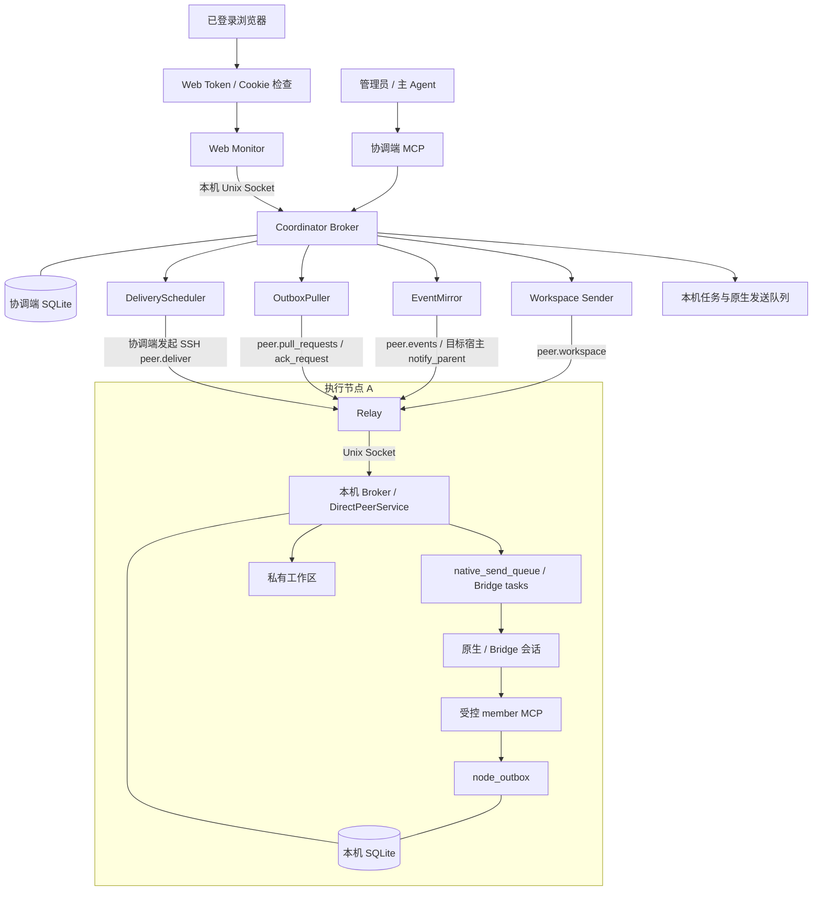
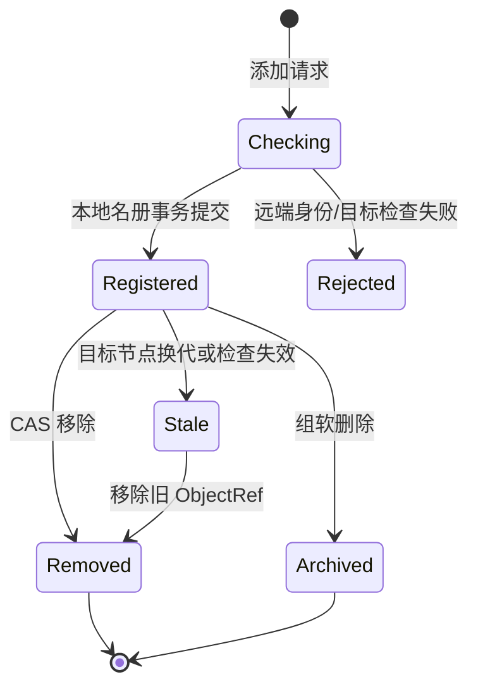
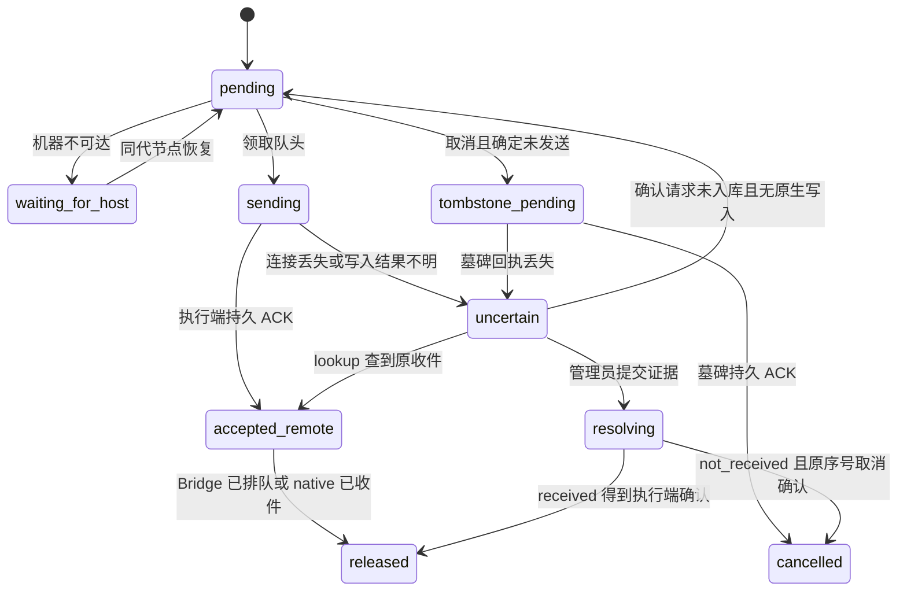
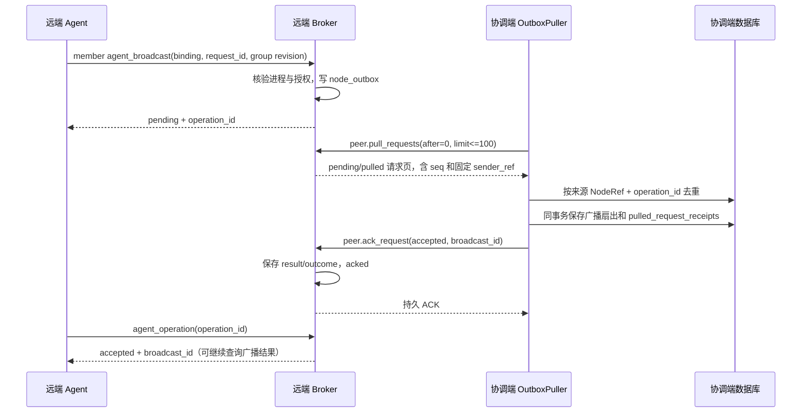
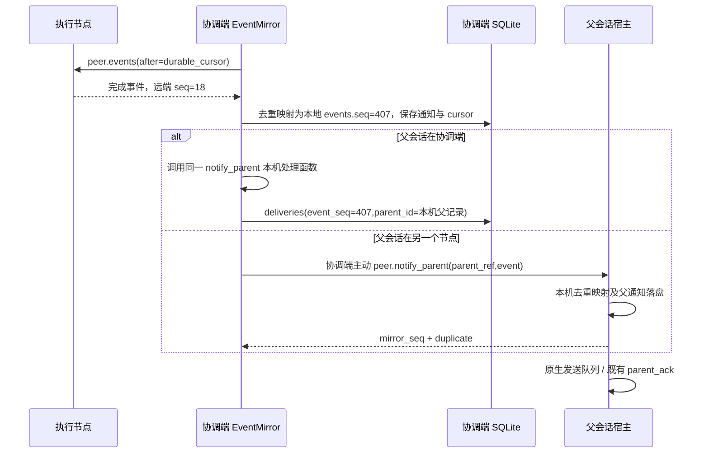
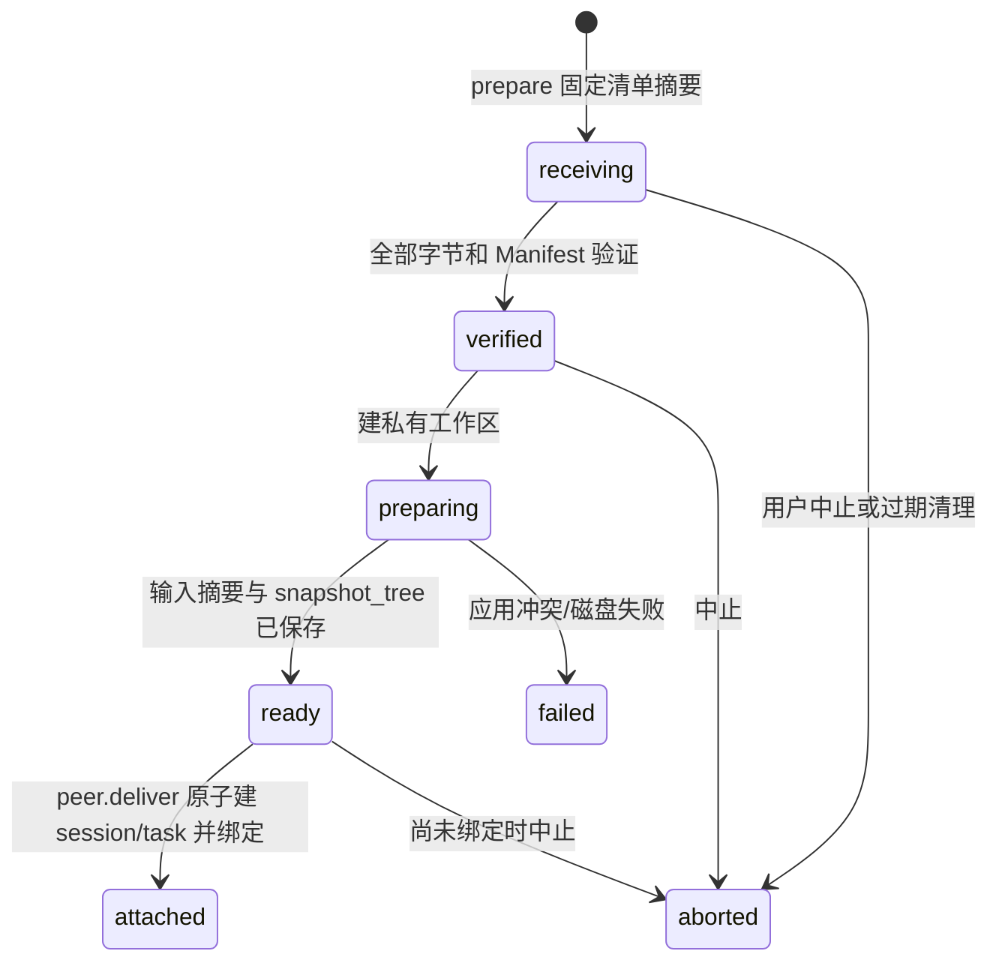
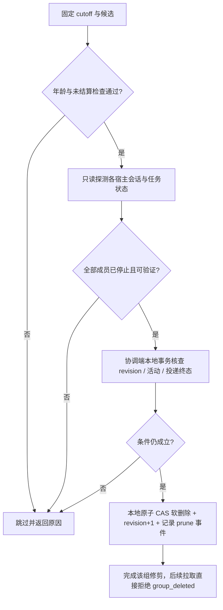
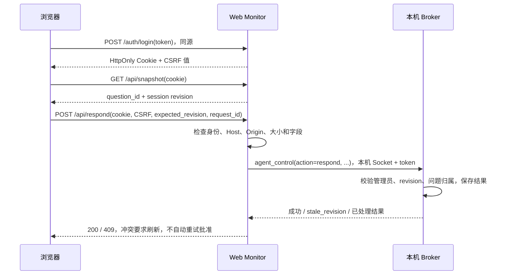

# Phase C 设计规范：跨机群组、工作区同步、历史组修剪、会话命名与 Web 鉴权

> **架构师审核与过滤状态**：经 Antigravity 全面技术评审与精简过滤（2026-11-05）。
>
> **过滤与调整裁定（Antigravity Filter Directives）**：
> 1. **拒绝群组修剪的两阶段分布式锁（No Distributed 2PC for Prune）**：否决 Sol 6.1 设计的 `peer.group_guard(acquire/validate/prepare/finalize)` 与远端 `group_prune_holds`。协调端是群组的唯一权威源（Sole Authority）。历史组修剪坚持 ADR-01 无分布式事务原则：由协调端通过标准 `peer.inspect` 执行只读安全门禁核查（所有成员已 closed/stopped、全部广播投递在 `broadcast_recipients` 达到终态）。核查通过后在协调端单机事务内 CAS 软删除（`deleted=1`）。此后任何拉取到的该组出站请求直接拒绝（`group_deleted`）。完全避免分布式死锁与孤儿租期恢复难题。
> 2. **精简出站拉取验证（Streamlined Outbox Verification）**：远端 Agent 发起广播时直接由执行端本地 Broker 写入 `node_outbox`；协调端 `OutboxPuller` 主动拉取时，在协调端侧严格比对 `remote_group_members` 白名单与当前组 revision，无需在远端维护复杂的短期 token binding 基础设施。
> 3. **保留并实施严格保序核心（Strict Ordering Core Approved）**：完全批准并保留 `target_streams`、单调递增 `target_seq`、Cancel Tombstone 墓碑机制、`agent_delivery_resolve` 证据化人工解除契约，以及执行端 `peer_inbox` 迁移为按 `stream_id` 联合唯一约束。
> 4. **保留不可变工作区增量（Immutable Workspace Delivery Approved）**：完全批准 Patch / Snapshot 双模方案与不可变 Manifest 分块校验。执行端始终在私有 worktree 路径准备与绑定，绝不污染宿主目录。
> 5. **会话原生命名与 Web 鉴权（Session Naming & Web Security Approved）**：完全批准创建事务同写入 `session_names` 以及 Web Monitor 基于 Token/Cookie/CSRF 的安全加固和经 Broker 审批流。

文档日期：2026-11-05。状态：经审核批准的设计规范（Approved Specification）。

本文依据 [多机器设计](multi-machine-design.md)、[接口定义](multi-machine-interface.md) 和当前代码编写。原文 ADR-01～ADR-16 继续有效；本文从 ADR-17 开始记录新增决定。本文涉及的接口和数据库修改必须在实现时同步更新接口定义、类型及测试，不能只修改实现而保留旧签名。

文中的“必须”表示实现和测试必须满足的要求；“不得”表示禁止的行为。“原子”若无特别说明，只指一台机器的一次 SQLite 事务，或同一文件系统内的一次文件替换，不表示跨机事务。

## 1. 目标与边界、实现现状

### 1.1 本阶段交付目标

1. 一个协调端管理包含本地与远端成员的组，广播先保存固定收件人列表，再向各机器投递；同一目标不插队。
2. 远端成员可在本机提交集群广播。协调端主动拉取请求，不授予执行节点反向 SSH 权限。
3. 跨机写任务能在独立工作区使用调用者明确选择的未提交修改；执行端没有源 Git commit 时也可运行。
4. 查询时能区分活跃组和已结束的组；管理员可批量软删除满足安全条件的旧组。
5. 新会话在首个可见数据库版本中已经具有可读名称；Web 监视器的读取和审批必须经过鉴权。

### 1.2 已实现与待实现的分界

用户提供的 Phase A/B 全量测试结果为 335 项通过。这个数量作为既有检查记录，不代表下列 Phase C 行为已经通过测试。代码核对结果如下。

| 对象 | 当前实现 | 本文要求的变化 |
|---|---|---|
| 传输、节点与机器配置 | `peer_transport.py`、`hosts.py`、`node_identity.py` 已有 SSH/Relay、身份文件与 HostRegistry；`HostConfig.pull_interval` 默认 2.0 秒 | 继续使用各机独立 SQLite 和协调端主动 RPC |
| 执行端 RPC | `DirectPeerService` 实现 hello、inspect、catalog、deliver、lookup_delivery、cancel、result、events 共 8 个方法 | 其余白名单方法不等于已有 handler；按本文补齐实际处理与能力协商 |
| 跨机派单 | `Broker._remote_deliver()`、执行端复合建会话及排任务、`agent_operation` 已有 | 保留操作去重；增加有序投递及工作区准备 |
| 投递序号 | `Broker._target_seq()` 从 operation ID 哈希生成数值；`peer_inbox` 序号在整节点范围唯一 | 哈希不是递增计数；必须迁移为独立的目标序列，不可直接复用旧唯一约束 |
| 群组 | `groups.py` 支持本地 Bridge 与本地 native 成员，广播在一个事务内保存本地任务/投递 | 增加远端成员与持久广播记录；本地表不保存远端 session 外键 |
| Phase C 组件 | `DeliveryScheduler`、`OutboxPuller`、`EventMirror` 只有 `Protocol` | 新增实现及 Broker 后台任务 |
| 出站请求 | `node_outbox` 已有 seq、operation_id、group_id、native_id、method、payload、status 等字段 | 缺 binding_id、request_id、result；`ack_outbox(result=...)` 当前不保存结果，必须修改 |
| 成员身份 | 旧设计要求 member MCP Binding | 当前没有可直接依赖的受控 Binding 实现，本阶段必须补齐后才能启用成员广播 |
| 工程目录 | `HostConfig.projects` 已解析 `project_id -> path` | 执行端尚未用它选择工程；当前仍使用 `open.cwd`，不得把这一行为延续到新同步协议 |
| 工作区 | 本地 `workspace.worktree()` 支持 `snapshot_files`、`snapshot_tree`；`capture_patch()` 输出任务结果差异 | 尚无跨机上传/应用；不能把结果补丁直接当作源端输入补丁 |
| 组查询与删除 | 查询过滤 `deleted=0`；delete 为软删除，但会移除当前成员行 | 尚无活跃分类与 prune；增加保留历史成员快照的批量删除 |
| 会话名称 | `monitor.set_session_name()` 按需建 `session_names` 表 | 表进入正式 schema，创建会话的事务同时写名称 |
| Web | `WebMonitorHandler` 无鉴权；snapshot 允许 `Access-Control-Allow-Origin: *`；respond 直接调用 Store | 增加 Token/Cookie、CSRF、来源检查；审批改经 Broker，使用页面读到的 revision |

这些差异修订的是旧文档中的实施状态描述，不否定已经完成的 Phase A/B 派单功能。实现依据以本表列出的具体函数和行为为准。

### 1.3 不包含的工作

- 不做多协调端同时修改同一组，不做协调端选主，不用跨机数据库或分布式提交。
- 不迁移原生进程的内存状态，不接管仍在运行的 Antigravity 终端。
- 不自动同步全部 dirty 文件，不向远端工程根目录覆盖写入，不自动回写源工程或提交 Git。
- 不实现跨机依赖 DAG、跨机硬预算或公网节点 RPC 服务。
- Web 局域网监听是明确选择的监视器功能，不改变节点 RPC 仅使用 SSH 的规定。

## 2. 架构、引用与运行约束

### 2.1 架构拓扑



每个组只有一个 authority，即创建它的协调端。远端保存成员授权凭据和投递记录，不维护另一份可独立修改的组名册。远端源请求中的 group_id 必须与 authority 的 NodeRef 一起解释，不能仅凭相同组名认定为同一个组。

### 2.2 引用定义

```text
NodeRef   = {host_id, node_id, state_generation}
ObjectRef = NodeRef + {local_id}
GroupRef  = authority NodeRef + {group_id}
TargetRef = destination NodeRef + {kind, runtime, target_id}
```

- `host_id` 是该协调端配置的机器别名。执行端不能通过修改 payload 中的 host_id 改变自己的来源身份；来源由已握手连接确定。
- Bridge 目标使用 `kind=bridge, runtime='', target_id=session_id`；native 使用 `kind=native, runtime=codex|antigravity, target_id=native_id`。
- 全局引用必须包含 node_id 和 state_generation。换代后旧成员不能自动指向新节点，即使 host_id 和本地 UUID 相同。
- `cwd` 在用户接口上始终表示调用端源目录；远端成员的 cwd 只是远端显示/核对信息，执行时以执行端已验证会话记录为准。

协调端也必须加载自己的 NodeIdentity，不能沿用当前 `_peer_node()` 中 `socket.gethostname()` / `coordinator_generation='local'` 作为有序流的身份。首次建立 authority 授权后，执行端将该 NodeRef 与已授权接入绑定；协调端换代必须重新登记，不能仅改变请求中的 authority_ref。

### 2.3 三种序号必须分开

| 字段 | 作用范围 | 用途 |
|---|---|---|
| `target_seq` | 一个协调端代际到一个完整 TargetRef | 从 1 开始连续分配；广播和对此既有会话的普通派单共享顺序；不含 group_id |
| `local_seq` | 执行端一个物理 native 目标 `(runtime,native_id)` | 合并来自本地广播、跨机广播及父通知的实际写入顺序 |
| `ack_seq` | 一个节点当前数据库中的全部已提交 peer 写操作 | 数据库外 `NodeIdentity.max_confirmed_seq` 的确认计数；与消息目标无关 |

`stream_id = SHA256(canonical_json(authority NodeRef, TargetRef))`。它作为有序目标标识，不能用含糊的字符串拼接；目标换代产生新 stream。不同组发给同一目标的消息共用 stream，防止借换组插队。首次复合 open 尚无 session_id，使用 `ordering_mode=bootstrap, target_seq=0, stream_id=NULL`，只允许空 target.id 且携带完整 open 的 Bridge 创建请求，按 operation ID 去重；生成会话后在创建事务中登记真实目标为 ordered-only，并返回其 TargetRef。协调端据此建立从 1 开始的 stream，首次任务在该 stream 的所有后续任务之前。bootstrap 不能用于已有目标，也不接受取消墓碑。

`ack_seq` 必须由数据库事务分配，提交后调用 `NodeIdentityStore.advance(ack_seq)`，完成 fsync 后才返回成功。启动时用数据库实际最大确认计数与身份文件比较；对端报告的 `last_acked_seq` 只作额外下限，不能代替查询本地数据库。数据库少于身份文件或对端已确认值时进入 `state_corrupted`，拒绝写；数据库较新而文件较旧时，可核对已提交日志后补写文件。

重复请求读取已保存结果时，也必须确认该写入的 ack_seq 已同步到身份文件，再返回缓存结果；不能从幂等命中分支绕过 fsync。现有 peer_operations 以 operation_id 全局主键去重，本阶段保留此结构，但所有新操作 ID 必须从完整来源身份、接收端代际、方法及业务请求 ID 规范编码后派生；禁止直接使用不同来源可能重复的用户 request_id。每次查询还要核对接收端身份字段。

迁移保留旧 max_confirmed_seq 数值作为计数下限，后续 ack_seq 在其上递增，不能因为旧数值较大就清零；计数用 SQLite 有符号 64 位整数，达到上限时拒绝写并要求管理员换代。旧的哈希 target_seq 不得作为新 stream 的起点，也不得排序后冒充历史发送顺序。

### 2.4 协商与兼容

保持 JSONL 信封 `v=1` 和 1 MiB 帧上限，新增功能通过 `peer.hello.capabilities` 声明：`groups_v1`、`ordered_delivery_v1`、`member_outbox_v1`、`event_mirror_v1`、`workspace_v1`、`session_name_v1`、`prune_guard_v1`。现有列表内的方法名仍保留；新实现必须同时说明支持的方法和功能标记。

`agent_operation.status=completed` 沿用现有“该 RPC 操作已有确定结果”的含义；例如远端派单接单完成，不等于对应 task 已完成。返回中必须保留 task_id 和独立 task/send/processing 状态，不能用 RPC 的 completed 为整个任务或广播结算。

协调端只有在能力标记满足要求后才能发送新增字段/RPC。缺少能力时返回 `peer_not_implemented`，不能退回无序发送、源 cwd 或无鉴权模式。旧 Phase B 请求保留 legacy 处理方式；已有目标切换到 ordered 模式前，必须完成旧请求状态核实，登记旧目标为 ordered-only，随后拒绝对此目标的 legacy 写请求。新建 Phase C 写会话必须有已准备的工作区。

## 3. 主题一：跨机群组与广播

### 3.1 remote_members 接口和生命周期

`agent_group` 保留现有 create/add/remove/delete、expected_revision、request_id，新增 `remote_members`。它与 session_ids、native_members 可同时使用，所有成员变更在协调端一个事务内提交。

```json
{
  "group_id": "review-42", "action": "add", "expected_revision": 3,
  "request_id": "add-gpu-reviewers",
  "remote_members": [
    {"host_id": "gpu-a", "kind": "native", "runtime": "codex",
     "native_id": "11111111-1111-4111-8111-111111111111", "cwd": "/srv/project", "label": "远端审查"},
    {"host_id": "gpu-b", "kind": "bridge", "session_id": "remote-session-uuid", "label": "测试"}
  ]
}
```

现有 `RemoteMember` 类型只定义 native。本例的 bridge 分支是本文明确新增的带 kind 区分的联合类型，不能在未更新类型时发送。native_id 与 session_id 互斥；bridge 分支不接收 runtime/cwd，执行端返回这些信息。create/add 的 node_id/state_generation 可省略，由协调端核实后填入；若调用方明确提供则必须精确匹配。remove 必须提供原 node_id/state_generation、host_id、kind 和对应 native_id/runtime 或 session_id，允许在机器离线时删除旧代成员，不能重新解析 host_id 后误删新代成员。

添加流程：

1. 事务外解析 HostRegistry 并握手，校对固定身份，确认目标存在、native 不被 Bridge 持有、目录及运行时匹配。不能用协调端 `Path(cwd).is_dir()` 判断远端目录。
2. 执行端为 native/member sender 签发短期 Binding；Bridge sender 由本机 Broker 验证其会话进程归属。Binding 只授予明确 GroupRef 和方法，不携带 admin.token。
3. 协调端开启 `BEGIN IMMEDIATE`，重查组 revision、删除状态和身份检查结果是否仍适用，保存所有成员及成员授权。任一校验失败则全部不写。
4. 提交后返回新 revision。远端检查与本地提交不是同一事务，期间会话关闭或退出不造成名册部分写入；实际投递时重新验证，不把“已入组”解释成“保证可执行”。

相同完整成员重复添加是幂等无变更；同一身份但 label/cwd 冲突沿用现有 remove 后 add 规则。移除仅影响未来广播和未来发送权限，既有广播按原收件快照继续；取消既有投递须单独调用取消接口。组软删除后不能广播、加成员或复用 group_id，历史引用仍可查。

Binding 必须由本机 Broker 基于可信进程归属签发：核实 PID、启动滴答和会话锁，不能让普通 MCP JSON 自报 sender 身份。每次调用重验进程归属；落入 node_outbox 时保存验证后的身份和授权版本。协调端处理时还要校验名册、权限及组 revision。远端节点属于同一管理者信任域，本文不声称抵御该节点 root/同 UID 管理员伪造本地记录。



`Stale` 是查询派生结果，不能据此修改已有广播的目标身份。重新登记新代节点必须是新的成员变更。

### 3.2 协调端 DDL

本节为新增表；现有本地成员表保留。时间使用现有 REAL Unix 秒，JSON 使用现有 `encode()` 的规范序列化。状态字段的取值在本文定义，应用层和迁移测试必须共同验证。

```sql
CREATE TABLE remote_group_members (
    group_id TEXT NOT NULL REFERENCES session_groups(id),
    host_id TEXT NOT NULL, node_id TEXT NOT NULL, state_generation TEXT NOT NULL,
    target_kind TEXT NOT NULL CHECK(target_kind IN ('bridge','native')),
    runtime TEXT NOT NULL DEFAULT '', target_id TEXT NOT NULL,
    cwd TEXT NOT NULL DEFAULT '', label TEXT NOT NULL DEFAULT '',
    joined_revision INTEGER NOT NULL, verified_at REAL NOT NULL,
    verification_receipt TEXT NOT NULL, created REAL NOT NULL,
    CHECK((target_kind='bridge' AND runtime='') OR
          (target_kind='native' AND runtime IN ('codex','antigravity'))),
    PRIMARY KEY(group_id,host_id,node_id,state_generation,target_kind,runtime,target_id)
);

CREATE TABLE group_broadcasts (
    id TEXT PRIMARY KEY, group_id TEXT NOT NULL REFERENCES session_groups(id),
    group_revision INTEGER NOT NULL, sender_ref TEXT, message TEXT NOT NULL,
    recipient_snapshot TEXT NOT NULL, request_key TEXT UNIQUE NOT NULL,
    created REAL NOT NULL, settled_at REAL
);
CREATE TABLE broadcast_recipients (
    broadcast_id TEXT NOT NULL REFERENCES group_broadcasts(id),
    recipient_key TEXT NOT NULL, target_ref TEXT NOT NULL,
    delivery_id TEXT UNIQUE, task_id TEXT, status TEXT NOT NULL,
    send_status TEXT, processing_status TEXT, error TEXT,
    updated REAL NOT NULL,
    PRIMARY KEY(broadcast_id,recipient_key)
);
CREATE TABLE target_streams (
    stream_id TEXT PRIMARY KEY, authority_ref TEXT NOT NULL, target_ref TEXT NOT NULL,
    next_seq INTEGER NOT NULL DEFAULT 1 CHECK(next_seq>=1),
    released_seq INTEGER NOT NULL DEFAULT 0 CHECK(released_seq>=0),
    CHECK(next_seq>released_seq)
);
CREATE TABLE peer_outbox (
    delivery_id TEXT PRIMARY KEY,
    broadcast_id TEXT REFERENCES group_broadcasts(id),
    group_id TEXT REFERENCES session_groups(id), group_revision INTEGER,
    stream_id TEXT NOT NULL REFERENCES target_streams(stream_id),
    target_seq INTEGER NOT NULL CHECK(target_seq>=1),
    host_id TEXT NOT NULL, node_id TEXT NOT NULL, state_generation TEXT NOT NULL,
    target_kind TEXT NOT NULL, runtime TEXT NOT NULL DEFAULT '', target_id TEXT NOT NULL,
    operation_id TEXT NOT NULL UNIQUE, payload TEXT NOT NULL, fingerprint TEXT NOT NULL,
    seq_kind TEXT NOT NULL CHECK(seq_kind IN ('message','tombstone')),
    status TEXT NOT NULL DEFAULT 'pending',
    send_status TEXT, processing_status TEXT, receipt TEXT, error TEXT,
    revision INTEGER NOT NULL DEFAULT 0, cancel_requested INTEGER NOT NULL DEFAULT 0,
    blocked_by TEXT, created REAL NOT NULL, updated REAL NOT NULL,
    last_attempt REAL NOT NULL DEFAULT 0,
    UNIQUE(stream_id,target_seq)
);
CREATE INDEX peer_outbox_head ON peer_outbox(stream_id,target_seq,status);

CREATE TABLE delivery_resolutions (
    id TEXT PRIMARY KEY, delivery_id TEXT NOT NULL REFERENCES peer_outbox(delivery_id),
    request_id TEXT NOT NULL UNIQUE, fingerprint TEXT NOT NULL,
    group_revision INTEGER NOT NULL, delivery_revision INTEGER NOT NULL,
    remote_revision INTEGER NOT NULL, request_json TEXT NOT NULL,
    resolution TEXT NOT NULL CHECK(resolution IN ('received','not_received')),
    evidence TEXT NOT NULL, actor TEXT NOT NULL, status TEXT NOT NULL,
    remote_result TEXT, created REAL NOT NULL, updated REAL NOT NULL
);
CREATE TABLE pulled_request_receipts (
    host_id TEXT NOT NULL, node_id TEXT NOT NULL, state_generation TEXT NOT NULL,
    operation_id TEXT NOT NULL, source_seq INTEGER NOT NULL,
    fingerprint TEXT NOT NULL, outcome TEXT NOT NULL,
    result TEXT NOT NULL, acked_at REAL, created REAL NOT NULL,
    PRIMARY KEY(host_id,node_id,state_generation,operation_id)
);
```

`broadcast_recipients.task_id` 不设本地 tasks 外键，因为它也可能引用远端任务；必须结合 target_ref 解释。本地收件也保存在该表，使状态查询及 prune 不再仅依赖易变名册或 requests.result。peer_outbox 不以远端资源 ID 建本地外键。

### 3.3 广播原子拆分

`agent_broadcast` 的成功表示协调端已持久保存整次广播和所有收件安排，不能表示所有机器已执行。必须在一个协调端事务中完成：

```text
BEGIN IMMEDIATE
  查 request_id + fingerprint，重试直接返回原广播，不重新取成员
  校验 group.deleted=0、expected_revision、sender 权限、消息与预算
  冻结本地和远端完整 TargetRef 列表，去重，写 group_broadcasts
  对本地 Bridge：沿用 enqueue_task，或记录 skipped 原因
  对本地 native：写兼容投递记录 + native_send_queue
  对远端：按 stream 分配 next_seq；写 peer_outbox，不进行网络调用
  为每个收件人写 broadcast_recipients；更新组 last_activity_at
  写 group_broadcast 事件和幂等响应
COMMIT
提交后唤醒本地发送器和 DeliveryScheduler
```

网络检查不得放在 SQLite 写事务中。已登记的机器离线仍可保存广播，远端投递进入 waiting_for_host；身份已变则保留旧引用并阻止发送。无成员、revision 冲突、未授权和预算不支持等整次拒绝，不能已投递一部分后才报告广播未创建。已关闭本地会话沿用 skipped 记录；远端执行端明确拒绝的成员单独记 failed，不回滚其他已接收成员。

预算继续为 `budget_scope=host`。启用预算且有 remote native 时整次返回 `peer_budget_scope`；本地 native 沿用 `native_budget_unsupported`。reservation 仅在接收任务的主机记账，不把多个机器余额相加或承诺全局硬上限。

### 3.4 执行端有序收件与原生发送 DDL

当前 `peer_inbox` 的整节点 target_seq 唯一约束必须通过建新表、复制、重建索引迁移，不能只追加列。新表仍名为 peer_inbox；以下为替换后的结构。

```sql
CREATE TABLE peer_inbox_c (
    delivery_id TEXT PRIMARY KEY,
    host_id TEXT NOT NULL, node_id TEXT NOT NULL, state_generation TEXT NOT NULL,
    target_seq INTEGER NOT NULL,
    seq_kind TEXT NOT NULL, operation_id TEXT NOT NULL,
    payload TEXT NOT NULL, status TEXT NOT NULL, receipt TEXT, created REAL NOT NULL,
    ordering_mode TEXT NOT NULL DEFAULT 'legacy' CHECK(ordering_mode IN ('legacy','bootstrap','ordered')),
    stream_id TEXT,
    authority_ref TEXT, target_kind TEXT, runtime TEXT, target_id TEXT,
    revision INTEGER NOT NULL DEFAULT 0,
    ack_seq INTEGER,
    CHECK(ordering_mode='legacy' OR
          (ordering_mode='bootstrap' AND stream_id IS NULL AND target_seq=0) OR
          (ordering_mode='ordered' AND stream_id IS NOT NULL AND target_seq>=1))
);
-- 迁移 COPY 后 DROP 旧表、RENAME 本表；旧数据全部标 legacy。
-- 以下索引在新表上创建，随后随表重命名保留。
CREATE UNIQUE INDEX peer_inbox_legacy_seq ON peer_inbox_c(host_id,node_id,state_generation,target_seq)
    WHERE ordering_mode='legacy';
CREATE UNIQUE INDEX peer_inbox_ordered_seq ON peer_inbox_c(stream_id,target_seq)
    WHERE ordering_mode='ordered';

CREATE TABLE incoming_streams (
    stream_id TEXT PRIMARY KEY, authority_ref TEXT NOT NULL, target_ref TEXT NOT NULL,
    admitted_seq INTEGER NOT NULL DEFAULT 0 CHECK(admitted_seq>=0)
);
CREATE TABLE ordered_targets (
    target_kind TEXT NOT NULL, runtime TEXT NOT NULL DEFAULT '', target_id TEXT NOT NULL,
    authority_ref TEXT NOT NULL, enabled_at REAL NOT NULL,
    PRIMARY KEY(target_kind,runtime,target_id)
);
CREATE TABLE peer_commit_log (
    ack_seq INTEGER PRIMARY KEY AUTOINCREMENT,
    mutation_key TEXT NOT NULL UNIQUE, method TEXT NOT NULL, created REAL NOT NULL
);
CREATE TABLE native_send_queue (
    id TEXT PRIMARY KEY, runtime TEXT NOT NULL, native_id TEXT NOT NULL,
    local_seq INTEGER NOT NULL,
    delivery_source TEXT NOT NULL,
    delivery_id TEXT NOT NULL, message TEXT NOT NULL,
    status TEXT NOT NULL DEFAULT 'pending',
    receipt TEXT, native_turn_id TEXT, processing_status TEXT,
    error TEXT, revision INTEGER NOT NULL DEFAULT 0,
    created REAL NOT NULL, last_attempt REAL NOT NULL DEFAULT 0,
    UNIQUE(runtime,native_id,local_seq), UNIQUE(delivery_source,delivery_id)
);
CREATE INDEX native_send_queue_head ON native_send_queue(runtime,native_id,local_seq,status);
CREATE TABLE native_target_counters (
    runtime TEXT NOT NULL, native_id TEXT NOT NULL, next_seq INTEGER NOT NULL DEFAULT 1,
    PRIMARY KEY(runtime,native_id)
);
```

代码迁移脚本必须使表名与索引目标一致：上例索引写在新表上，重命名由 SQLite 更新引用，不能同时对不存在的 peer_inbox 再建同名索引。peer_commit_log.mutation_key 包含接收端代际、方法及完整操作身份，自然键方法还包含其业务键。迁移前必须按旧规则检查数据库已提交确认值不低于身份文件或对端确认值；发现回滚立即标 state_corrupted，不能用较大 floor 掩盖它。检查通过后插入一条 migration_floor 记录，将 ack_seq 设置为经核实的旧最大确认值，之后由 AUTOINCREMENT 继续。

执行端只接受 `target_seq=admitted_seq+1` 的新消息；相同 delivery、序号和原始参数重放返回已有结果，不再排任务；序号已占但 ID/参数不同返回 `operation_conflict`。大于下一序号返回 `peer_sequence_gap` 并带 expected_seq；小于等于已收序号但没有可核实原记录则拒绝，不能猜测“已经做过”。不能删除仍用于去重的收件记录。

同一事务写 peer_inbox、Bridge task 或 native_send_queue、incoming_streams.admitted_seq、peer 操作结果和 peer_commit_log；之后 fsync 身份文件才 ACK。单机 native 广播和父通知也经过相同 native 队列，任何旧发送路径都不得绕过它。

### 3.5 DeliveryScheduler：两层保序

协调端按 stream 取最小未释放 target_seq，同一 stream 最多一个正在进行的网络写操作；不同 stream 可以并行。采用数据库 revision CAS 领取 `sending`，不能仅靠进程内锁避免重复领取。重启时 sending 改为 uncertain，先 lookup，不立即发送。

需要分别满足两项条件：

1. **网络接单顺序**：前一条必须取得持久 `accepted_remote` 或 tombstone ACK，才能向该目标发送后一条。
2. **实际写入顺序**：native 的前一条还必须有 `send_status=received` 或已确认取消，才能释放协调端的目标序列；执行端 native_send_queue 同样不允许越过 pending/sending/uncertain 队头。

Bridge 的 accepted_remote 已表示任务入持久队列，因此可释放网络序号；后续任务由该会话 Worker 排队。native 的 accepted_remote 只表示待发送记录落盘，不能据此声称原生已收件。native 已收件后允许继续发送，但 `processing_status=running/uncertain` 仍影响广播是否结算。接收不明与执行不明分开，后者不等于可以重发原消息。



`tombstone_pending`、`sending`、`resolving`、`released`、`failed` 是本次需加入的协调端状态；现有 PeerDeliveryStatus 必须同步扩展。native SendQueueStatus 增加 cancelled，仅用于可证明未写入的取消。接收端明确拒绝且证明未产生外部效果时，记录 failed，并以同序号取消确认后释放；不能只把 failed 视为序号已不存在。查询后续消息时返回 blocked_by、队头状态、阻止原因和 revision，新增发送仍可排队，但不越过队头。

机器离线只影响该机器；目标 A 的 uncertain 不阻止同机目标 B。退避、超时和重启都不自动消除 uncertain。为公平性每轮对每个可发送目标最多领取一条，设每 Host 并发上限；不得用全组串行发送造成无关目标等待。

### 3.6 取消墓碑与迟到请求

取消接口保留 task_id / operation_id / delivery_id 三选一。取消尚未发出的有序消息不能删除 peer_outbox 或退回 next_seq：必须将该逻辑投递转为 tombstone_pending，使用原 delivery_id、stream_id、target_seq，消息正文不再发送。

- 消息操作 ID 与墓碑操作 ID 不同，两者均从逻辑 delivery_id 派生并固定；不能以同一个 operation ID 改参数触发幂等冲突。
- `peer.deliver(seq_kind=tombstone)` 对不存在的原投递在同一事务写 cancelled peer_inbox、推进 admitted_seq、写确认日志；绝不创建 task/native 队列项。
- 已有 tombstone 时重放返回原取消结果；迟到的 message 无论使用哪个操作 ID，只要同 delivery/stream/seq 已取消，都返回 cancelled，不能执行正文。
- sending/uncertain 的消息不能直接改成未发送墓碑。必须先 `peer.lookup_delivery`。原消息已入库时使用 `peer.cancel`，在执行端与队列领取使用同一事务/CAS；只有能证明尚未外部写入时才可取消。
- native sending 的取消只能记录请求，不能把发送事实抹掉。收到原生收件凭据后按已收件显示；结果未知保持 uncertain。已运行任务的取消只表达停止请求，不能宣称撤销了已经发生的文件修改。

墓碑 ACK 丢失按原 delivery 查询/重放墓碑。协调端仅在核实执行端已保存取消事实后推进 released_seq。墓碑及其投递指纹的保留期限不得短于整个 stream 的重试/去重期限；Phase C 不自动清理这些记录。

### 3.7 OutboxPuller：远端主动广播

执行节点上的成员调用 `agent_broadcast` 时，本机 member MCP 不直接向其他机器发 RPC，而是核验 Binding 后写 node_outbox，返回 `{operation_id,status:"pending"}`。协调端以 `HostConfig.pull_interval` 为周期运行，默认 2 秒，每 Host 一个拉取任务；该数值是健康连接时的检查间隔，不是广播送达时限。离线 Host 退避并定期握手探测，不因当前标记 offline 永久停止检查。

现有表增量如下，旧记录允许 NULL，缺少已验证 sender 信息的旧请求不能自动按成员权限执行：

```sql
ALTER TABLE node_outbox ADD COLUMN binding_id TEXT;
ALTER TABLE node_outbox ADD COLUMN request_id TEXT;
ALTER TABLE node_outbox ADD COLUMN sender_ref TEXT;
ALTER TABLE node_outbox ADD COLUMN authority_ref TEXT;
ALTER TABLE node_outbox ADD COLUMN authorization_revision INTEGER;
ALTER TABLE node_outbox ADD COLUMN fingerprint TEXT;
ALTER TABLE node_outbox ADD COLUMN result TEXT;
ALTER TABLE node_outbox ADD COLUMN outcome TEXT;
CREATE UNIQUE INDEX node_outbox_member_request
    ON node_outbox(binding_id,request_id) WHERE binding_id IS NOT NULL;

CREATE TABLE member_bindings (
    id TEXT PRIMARY KEY, token_digest TEXT NOT NULL UNIQUE,
    sender_ref TEXT NOT NULL, authority_ref TEXT NOT NULL, group_id TEXT NOT NULL,
    allowed_methods TEXT NOT NULL, authorization_revision INTEGER NOT NULL,
    pid INTEGER NOT NULL, process_start TEXT NOT NULL,
    expires_at REAL NOT NULL, revoked_at REAL, created REAL NOT NULL
);
```

Binding 明文仅交付受控客户端，不出现在 RPC 回执、日志或广播快照。授权撤销后禁止新请求；已入 outbox 的请求是否接纳以协调端处理时的名册和请求中的 expected_revision 为准。过期 Binding 不否定其有效时已由本机验证并持久保存的请求，但被撤销成员的未接纳请求应拒绝。



`peer.pull_requests` 对接现有 pull_outbox，可将记录标 pulled，但 pulled 仍可重拉，不是完成。执行端根据已认证连接的 authority_ref 筛选请求，ack_request 同样只允许确认该 authority 的 outbox；不能让一个协调端拉走并拒绝另一个协调端的请求。每次完整扫描从 after=0 开始，临时 after 按已读页最大 seq 前进，扫描结束回到 0；不能持久前移一个会跳过未确认行的游标。单页内逐项处理；暂时性失败保留未 ACK，永久拒绝也必须保存结果并 ACK。

每个 2 秒检查周期限制页数/处理时间，未完成的扫描在下个周期从内存临时 after 继续，直到读完本次扫描开始时固定的最大 seq，再从 0 重试此前未 ACK 请求。最大 seq 由 pull 响应新增 scan_upper_seq 返回并在本次扫描各页保持；新到请求留待下次扫描。内存游标不在重启后保留，重启从 0 即可。这样既不丢失旧失败请求，也不让第一批失败行永远挡住后段。

协调端在创建广播的**同一事务**写 pulled_request_receipts；查到相同指纹直接重用 outcome/result，再发 ACK，不再次广播。节点换代不能命中旧代 receipts。`peer.ack_request` 按来源 outbox operation_id 自然去重，相同 outcome/result 重放成功，不同结果返回 operation_conflict；必须保存 result，不能继续忽略参数。

新增 OutboxItem 字段：seq、sender_ref、authority_ref、authorization_revision、fingerprint；现有 method 暂仅允许 agent_broadcast，不允许借 outbox 调 admin 工具或任意 Broker 方法。`agent_operation` 在执行节点也必须支持读取本机 outbox 状态及 ACK 结果。accepted 表示协调端接纳，不代表整次广播执行完成。

广播默认包含发送者自己，沿用当前“发给全体成员”的规则；不静默排除 sender。Agent 是否再次广播由其任务指令决定，系统不能把收到广播自动转换为另一条广播。

### 3.8 人工解除：agent_delivery_resolve

管理员接口保持现有类型中 `resolution=received|not_received`。`expected_revision` 按当前 `AgentDeliveryResolveParams` 的注释定义为**组 revision**，不是 session revision。为防止同组 revision 不变而投递状态已变，本文增加必填 `expected_delivery_revision` 和 `expected_remote_revision`，并更新类型定义。

```text
agent_delivery_resolve(
  delivery_id: str,
  resolution: Literal['received','not_received'],
  evidence: str,
  expected_revision: int,              # 当前组 revision
  expected_delivery_revision: int,     # 当前 peer_outbox revision
  expected_remote_revision: int,       # 当前执行端投递 revision
  request_id: str
) -> {resolution_id, status, delivery_id, revision, blocked_by?, receipt?}
```

evidence 去除空白后必须非空，限制 16 KiB；包括核实对象、时间、原生 turn/queue receipt 或受控文件位置及检查结论，不能用“应该没收到”作自动判定。记录管理员身份、时间和指纹，证据不要求包含原始聊天或凭据。

1. 仅管理员可以调用；必须是阻止该目标继续发送的 uncertain 队头。组已删、身份变化、错误 revision、非队头或已有矛盾收件凭据均拒绝，返回可识别错误。
2. 同一事务保存 delivery_resolutions 的 pending 决定，并 CAS 领取该 delivery。之后才调用执行端，不在事务中等待网络。
3. `received`：确认原生确已接收，只修复收件事实，不把 processing 改成 completed，不再写原消息。
4. `not_received`：**取消这条消息**，不重发。执行端在原序号保存已核实未写入和取消决定；后续业务若仍需要消息，必须另建新请求和新序号。
5. 执行端确认后协调端才保存最终决定、推进释放序号；离线时返回 resolving/pending，保留阻止，不能凭管理员一段文本只改协调端就放行。

新增 `peer.resolve_delivery`，参数为 operation、delivery_id、resolution、evidence、expected_delivery_revision；这里的 expected_delivery_revision 使用管理员传入的 expected_remote_revision。执行端以 inbox.revision 作为整个投递的版本，每次其关联 native 队列状态/收件/决定变化，必须在同一事务中递增 inbox.revision，不能只比较孤立队列行的版本。方法原子更新队列/取消记录并保存决定，返回最终收件状态、执行端 revision 和 receipt。执行端已存在相反的确定事实时拒绝；并发发送已结束时重新检查，不以旧 revision 覆盖。此方法管理员专用，不等同于 `peer.review` 的任务验收。

协调端查询时返回双方 revision，管理员明确提供查询到的执行端 revision，保存于 resolution intent 的 remote_revision 和 request_json；不能用协调端 revision 冒充执行端 revision。RPC 超时后凭同一 resolution operation 查询决定，不能创建新决定。request_id 同参数返回原 resolution_id，同 ID 改判返回 operation_conflict。此工具只处理有 group_id 的广播队头；普通派单的未知结果继续使用 agent_operation 查证，不以虚构组 revision 处理。

### 3.9 EventMirror 与父会话唤醒

当前远端 events.seq 不能直接写入协调端 deliveries.event_seq，也不能把远端 task_id 当本地任务外键。引入以下映射：

```sql
CREATE TABLE peer_event_mirrors (
    host_id TEXT NOT NULL, node_id TEXT NOT NULL, state_generation TEXT NOT NULL,
    remote_seq INTEGER NOT NULL, local_seq INTEGER NOT NULL UNIQUE REFERENCES events(seq),
    fingerprint TEXT NOT NULL, created REAL NOT NULL,
    PRIMARY KEY(host_id,node_id,state_generation,remote_seq)
);
CREATE TABLE peer_event_cursors (
    host_id TEXT NOT NULL, node_id TEXT NOT NULL, state_generation TEXT NOT NULL,
    after_seq INTEGER NOT NULL DEFAULT 0,
    PRIMARY KEY(host_id,node_id,state_generation)
);
CREATE TABLE peer_parent_routes (
    host_id TEXT NOT NULL, node_id TEXT NOT NULL, state_generation TEXT NOT NULL,
    child_id TEXT NOT NULL, parent_ref TEXT NOT NULL,
    created REAL NOT NULL,
    PRIMARY KEY(host_id,node_id,state_generation,child_id)
);
CREATE TABLE mirrored_parent_notifications (
    local_seq INTEGER PRIMARY KEY REFERENCES events(seq), parent_ref TEXT NOT NULL,
    operation_id TEXT NOT NULL UNIQUE, status TEXT NOT NULL,
    receipt TEXT, updated REAL NOT NULL
);
```

创建跨机子任务时持久登记 parent_ref 路由，`peer.deliver` 新增可选 parent_ref，执行端只保留它供事件引用，不将其写成本机 sessions.parent。本文 parent_ref 的 local_id 指向目标主机的 `parents.id`，不是随意填写的 native_id 或 sessions.id；现有 `parents` 是 native 父会话通知记录。现有协议注释称 parent session，实施时必须同步澄清。每个 child 只允许一个固定父记录，沿用当前 deliveries.event_seq 主键的一事件一父规则；本阶段不增加多父通知。远端事件不能自行指定任意父会话，必须匹配派单时已授权路由。

协调端周期拉取 `peer.events(after=cursor)`，每页在同一事务内完成去重、写本地 events、更新相关投递状态、登记父通知和推进游标；任一步失败不推进游标。同一来源序号不同指纹是数据冲突，暂停该来源，不能静默覆盖。远端序号可有正常过滤间隔，按分页返回的持久 cursor 前进，不要求事件编号连续。

本地镜像事件的 data 保存完整 remote ObjectRef、原事件类型、receipt、ArtifactRef；events.session_id/task_id/attempt_id 仅在确有本地对象时填写，否则 NULL。大型结果不复制正文。已收到的确定事实不能被迟到 pending 覆盖；processing=completed/failed 后的旧 running 事件不回退。



`peer.notify_parent` 是接收父通知的 handler，不意味着远端主动反向连接协调端。父在协调端时，EventMirror 使用同一服务函数本机调用；父在远端时由协调端主动调用父宿主。RPC 中的 operation 指向接收宿主身份，event.ref 保留原事件来源，不能用协调端身份重写原来源。每个父宿主各自分配 mirror_seq。

本地镜像序号和父路由共同保证不给同一事件重复建 deliveries；已有事件要求通知给不同父记录时必须拒绝路由冲突。parent_ack 仍只确认本机 events.seq；接收通知的 ACK、通知已写入原生队列、父模型已处理是三个不同结果，查询必须分别呈现。

## 4. 主题二：跨机工程与工作区增量同步

### 4.1 输入定义与使用方式

写任务的输入是“固定 base 的文件内容 + snapshot_files 选择的当前内容/删除项”。保持现有行为：`snapshot_files=None` 或 `[]` 只使用 base；不自动携带未选择的 dirty/untracked。索引状态不传输；选中文件使用当前工作区字节。调用方要带未提交修改时必须列出这些文件。

```text
agent_dispatch(
  host_id='gpu-a', project_id='bridge', cwd='/home/user/bridge',
  profile='...', access='workspace-write', workspace_mode='git',
  base='HEAD', snapshot_files=['src/example.py','tests/test_example.py'],
  instruction='...', request_id='...'
)
```

执行端不再使用源 cwd 作目标目录，也不在缺失 project_id 时回退到 `.`。`project_id` 只选择执行端本机管理员登记的允许工程；远端相同 project_id 可以位于完全不同目录。现有 HostConfig.projects 是协调端配置视图，不能单靠协调端声称的路径授权执行端写入；执行端 Config 必须新增自身 `projects` 根级映射并核对真实目录，握手/目录查询可公开 project ID，不公开敏感路径。

现有 session_id 的后续 dispatch 默认使用该会话已绑定工作区；若再次传 base/snapshot_files/project_id 等输入重置字段则拒绝 `workspace_already_attached`，要求创建新会话。不得在运行中的工作区重新应用源快照。只读会话可使用执行端 project 目录，但仍由 project_id 解析，不能接受任意远端 cwd。

### 4.2 两种准备方式

| 方式 | 前提 | 传输内容 | 执行端准备 |
|---|---|---|---|
| Patch 增量 | 远端允许工程已有源 base commit，且文件类型在支持范围内 | 明确选中文件的二进制 patch/内容、删除项和权限清单；只传缺失 blob | 在最终私有路径建立 detached worktree，检查原文件摘要，再应用输入 |
| Snapshot 内容快照 | 缺少 base 或管理员选择不用宿主 Git 对象 | 源 base 的 tracked 内容完整清单叠加选定修改，按 SHA-256 上传缺失内容 | 私有目录重建完整输入，在最终位置初始化本机 Git 并固定输入 tree |

两者均不需要 git fetch、源 origin 可访问或中央 Git 服务。Snapshot 首次可能传完整工程，必须在传输前返回文件数/总量；“增量”指内容缓存去重，不承诺首次零全量。代码允许 clone 的工程不代表所有依赖、编译器和数据集也随工程传输，运行环境仍以远端 profile 为准。

固定 manifest 前，源端先以只读 `peer.inspect(kind='workspace',section='base',project_id,base_commit)` 探测远端可用 base，再选定 Patch 或 Snapshot。inspect 增加 project_id/base_commit 字段，返回 base 是否可用及项目配置摘要；它不授权上传任意目录。方式一旦纳入清单就固定；若之后 base 消失或配置变化，准备明确失败，新请求可复用已捕获内容选择 Snapshot，不修改原 manifest 后冒充同一次重试。

远端基于自己的对象库证明拥有完整 base，不能只比较分支名。Snapshot 模式的新 Git commit/tree 是执行端本机创建的，不伪称与源 commit 相同；source_base_commit 只作来源信息。两种方式最终都写入正确的 `workspace.snapshot_tree`，让现有 `capture_patch()` 对**交付输入**计算任务结果差异。

源输入 patch 必须从固定 base 到固定选择快照生成，不能使用任务结束后 `capture_patch()` 的结果代替。补丁只优化传输，不扩大修改范围；每个路径、旧内容摘要、新内容摘要和模式均由清单限定。二进制补丁通过 Git 的普通校验应用，不使用 `--unsafe-paths`、模糊合并或执行补丁附带命令；冲突时返回 workspace_conflict，不自行改成三方合并。

### 4.3 不可变 Manifest

```json
{
  "schema": 1, "workspace_id": "ws-<stable-id>", "project_id": "bridge",
  "workspace_mode": "git", "source_base_commit": "<resolved commit>",
  "delivery_mode": "patch", "selected_files": ["src/example.py", "old.py"],
  "input_digest": "sha256:<canonical full input manifest>",
  "files": [
    {"path": "src/example.py", "op": "put", "size": 247,
     "before_sha256": "<base file digest>", "sha256": "<new bytes digest>", "mode": 420},
    {"path": "old.py", "op": "delete", "before_sha256": "<base digest>"}
  ],
  "patch": {"sha256": "<optional binary patch digest>", "size": 512},
  "total_bytes": 759, "file_count": 2
}
```

这是结构示例，摘要占位符不是有效请求。manifest_sha256 对不含自身 digest 字段的规范 JSON 计算，传输块与文件内容分别校验。规范 JSON 沿用 encode：UTF-8、sort_keys=True、ensure_ascii=False、separators=(',',':')，摘要输入不含末尾换行；清单不含浮点值。完整 input_digest 对按路径 UTF-8 字节排序的 `{path,sha256,size,mode}` 数组做同样 SHA-256，包含完整允许权限位，不使用 Git SHA 代替 SHA-256。文件内容不转换换行，路径不自动做 Unicode 归一化。

Patch 模式 files 仅列差异，差异路径必须是 selected_files 的子集，清单外修改/删除一律拒绝；通过基准文件清单计算完整输入摘要。Snapshot 模式 files 列完整最终输入，源 base 未选路径维持 base 字节，删除项用于来源说明而不生成文件。基准文件清单也作为内容 blob 传输并校验，不能仅凭可变远端工作目录计算它。

源端复用 `snapshot()` 的显式选择和捕获时变化检查，保存不可变字节和清单。request_id 一旦绑定快照，重试读取已保存快照；不重新读取源目录。base 在首次请求解析为 commit 后固定，不能每次按变化后的 HEAD 解析。源文件在捕获期间变化返回 snapshot_changed，要求新请求。

第一版只允许普通文件和删除项，mode 是 0～0777 的普通读写执行位，拒绝 sticky/setuid/setgid 等额外位、设备、FIFO、目录作为文件、symlink 和 submodule。base 文件的默认模式取 Git 记录的 0644/0755，选中文件取捕获的完整普通权限位，目录固定为私有 0700。base 中存在不支持类型时明确拒绝整个准备；不能静默忽略这些 tracked 项。路径必须是规范 UTF-8 相对路径，不含 `..`、NUL、绝对路径、`.git` 或重复/冲突的父子文件路径。对源敏感文件沿用显式选择，不能自动把 ignored 文件全部打包。

### 4.4 上传 RPC 与数据库

现有 peer.result 是下载任务结果的接口，不能当上传入口。新增一个白名单方法 `peer.workspace`，以 action 区分 prepare、chunk、seal、abort；所有 action 带 operation，状态查询用 peer.inspect(kind='workspace')。分页缺失内容列表，禁止把数万路径塞入单帧。

| action | 参数 | 返回与保证 |
|---|---|---|
| prepare | workspace_id、project_id、manifest_sha256、manifest_size、base 描述、模式、预估字节数 | 固定传输记录；返回 manifest 缺块和传输限制，此时不能计算最终缺失文件 blob |
| chunk | workspace_id、blob_sha256、offset、data_base64、chunk_sha256 | 相同 offset/字节重放成功，不同字节冲突；内容和块均受限 |
| seal | workspace_id、manifest_sha256、expected_revision | 验证全部块、完整清单与最终输入摘要；构建成功返回 ready + receipt |
| abort | workspace_id、reason、expected_revision | 仅允许未 attached；撤销本次未绑定工作区，不删除共享内容缓存 |

manifest 本身也作为受 SHA-256 保护的 blob 分块上传，prepare 只含足够鉴权与预检的头部。清单必须完整验证后才使用文件路径。prepare/seal/abort 各有稳定操作 ID；chunk 的 operation ID 从 workspace_id、blob_sha256、offset 固定派生，禁止每次重试生成新 ID。

manifest 上传完成后由 `peer.inspect(kind='workspace',id=workspace_id,section='missing',after=...,limit<=100)` 返回缺失内容/块位置和当前 revision；inspect 增加这些可选分页字段。prepare 幂等重放只返回原申请结果，最新进度通过 inspect 查询。未验证清单时 section=missing 只返回 manifest 缺块，不宣称已知文件 blob。

```sql
CREATE TABLE workspace_transfers (
    workspace_id TEXT PRIMARY KEY, authority_ref TEXT NOT NULL,
    project_id TEXT NOT NULL, project_config_digest TEXT NOT NULL,
    project_root TEXT NOT NULL, manifest_sha256 TEXT NOT NULL,
    source_base_commit TEXT, delivery_mode TEXT NOT NULL,
    status TEXT NOT NULL, input_digest TEXT,
    metadata TEXT NOT NULL, ready_path TEXT, attached_session_id TEXT REFERENCES sessions(id),
    revision INTEGER NOT NULL DEFAULT 0, error TEXT,
    created REAL NOT NULL, updated REAL NOT NULL
);
CREATE TABLE workspace_chunks (
    workspace_id TEXT NOT NULL REFERENCES workspace_transfers(workspace_id),
    blob_sha256 TEXT NOT NULL, offset INTEGER NOT NULL CHECK(offset>=0),
    size INTEGER NOT NULL CHECK(size>0), chunk_sha256 TEXT NOT NULL,
    stored_path TEXT NOT NULL,
    PRIMARY KEY(workspace_id,blob_sha256,offset)
);
CREATE TABLE workspace_blobs (
    sha256 TEXT PRIMARY KEY, size INTEGER NOT NULL CHECK(size>=0),
    stored_path TEXT NOT NULL, verified_at REAL NOT NULL
);
```

建议的首版默认限制：原始块至多 256 KiB（base64 约 342 KiB，预留 1 MiB 帧空间）、单文件 64 MiB、单工作区 1 GiB、100000 个文件、manifest 32 MiB、每 Host 同时 2 个准备。它们是本设计的新配置默认值，不是当前代码已有值。超限在申请/逐块写入/解码前检查，管理员可在本机配置提高总量，但单帧上限不变。空文件不需要非空 chunk，仍校验其摘要。磁盘配额、超时、过期未绑定传输均返回明确状态。

仅允许固定大小对齐的块，最后一块可短；禁止重叠区间、超出清单长度、超量 base64、压缩解包及归档路径。blob 的 SHA 验证完成前不能写入共享缓存，临时文件 fsync 后在同一文件系统替换，目录 fsync 后才标 verified。缓存用于去重，不存认证文件、聊天或运行数据库；共享缓存只在同一管理员信任域使用。

接收和应用文件时必须从可信目录描述符开始，使用不跟随 symlink 的相对打开/创建方式（如 dir_fd 与 O_NOFOLLOW），每一级父目录均核对；不能只先调用 selected_path 检查，然后以普通绝对路径再次打开。工作区与上传暂存目录归当前 UID，其他用户无写权限。

### 4.5 准备、发布和回滚



`workspace_transfers` 是持久准备日志。只有 ready 工作区可出现在 `peer.deliver.open.workspace_ref={workspace_id,manifest_sha256,input_digest}`。该 RPC 同一事务完成工作区归属/未使用检查、创建 session（及 name）、创建 task、保存操作结果和状态 attached。文件准备可能很长，必须在这个事务之前完成，不能持有 SQLite 写锁运行 Git。

prepare 固定执行端 project 的规范目录、目录归属和相关配置摘要；seal 与 attach 前重新检查配置仍允许且摘要相同，项目被撤销/改指目录时拒绝旧 ready 输入，不自动改投新目录。已 attached 会话的私有目录不受 project 映射变化影响；管理员若要停止既有任务须单独关闭会话。

每次上传/查询/绑定都核对 workspace_transfers.authority_ref，不能仅凭猜到 workspace_id 读取或覆盖另一 authority 的输入。输入内容读取用于原生 capture_patch 的 Git tree 只能表示文件内容和 executable；完整普通权限另外保存在工作区元数据中，最终输入摘要按实际 mode 验证。若结果包含 Git patch 无法表达的权限变化，结果 Artifact 另附模式变更清单，不能声称纯 Git diff 已保留它们。

seal/abort 使用每 workspace 准备锁和传输 revision CAS。seal 领取 preparing 前保存 intent；耗时文件准备后提交 ready 前再次检查状态与 revision。abort 对 preparing 先登记 abort_requested，等待准备器停止，再由同一持锁处理者清理；不能并发删除 Git 正在使用的目录。attached 与 abort 的最终状态更新也在同一 SQLite 写锁下互斥。崩溃恢复同样先取得准备锁，防止两个恢复者同时发布。

私有路径由可信的 workspace_id 派生，位于 state 下，不能从清单传入绝对目标。Patch 模式在最终私有路径创建 Git worktree，以 ready 标记和数据库引用发布；已注册的 Git worktree **不得直接 rename**，否则其 Git 元数据仍指向原位置。Snapshot 可先建立普通暂存目录、原子 rename 至最终位置，再 git init/建立输入 tree；未 ready 时任务完全不可见。

文件系统和 SQLite 无共同事务，所以这里的“原子回滚”是：**失败前未发布任务，失败后不会修改宿主工程；再次准备只复用验证过的同一输入或新建工作区**。它不表示把两个资源放进了一个原子提交，也不表示能撤销模型运行后产生的外部效果。

- receiving/verified 崩溃：保留已核实块，恢复后续传；摘要冲突直接失败。
- preparing 崩溃：核对日志与目录，仅在未绑定时删除/重建本次私有工作区；Git worktree 通过 Git 正规移除，不对宿主工程执行 reset/clean。
- ready 标记已 fsync、DB 尚未记录 ready：重启核对清单和输入摘要，补写 ready；不能执行任务。
- DB 已 attached、RPC ACK 丢失：按同 operation 查询原 session/task，不重建、不重新应用输入。
- attached 后禁止 abort、重新 seal 或覆盖文件；会话关闭和工作区清理是后续独立管理员操作，不按目录年龄自动删除。

既有 session.workspace 元数据继续保存 kind、snapshot_tree 等 capture_patch 所需字段，增加 source_base_commit、workspace_id、manifest_sha256、input_digest。任务结果补丁按既有 Artifact 读取，不自动应用到源端；返回结果的 SHA、来源和基准必须明确。

## 5. 主题三：组生命周期与历史修剪

### 5.1 状态定义与查询

`session_groups.deleted` 继续是软删除事实，活跃状态按当前成员与未结算工作派生。组不会因为空闲自行删除。

| activity_state | 定义 | `active` |
|---|---|---|
| active | 有允许继续运行的 open Bridge 会话、正在运行的 native 会话，或有未结算工作 | true |
| inactive | 暂停且停止的成员/空组，无未结算工作，但尚不满足完成条件 | false |
| completed | 所有成员均能证明已关闭/停止，且所有工作结算；空组保持 inactive | false |
| unknown | 有远端离线、身份变化、过期检查或 native 无可靠进程状态，且没有更明确 active 事实 | true，保守纳入活跃列表 |
| deleted | 管理员已经软删除 | false，默认列表不返回 |

open 但 idle 的 Bridge 仍是 active；paused 且进程未退出仍是 active。未知状态不能写成 stopped。`completed` 是派生视图，成员重新打开会变 active；不新增与真实任务状态互相矛盾的手工 completed 标志。

```text
agent_groups(group_id: str | None = None, active_only: bool = False)
```

默认 False 保持现有列表能查全部未删除组。列表中新增 activity_state、active、activity_reasons、last_activity_at、checked_at、stale、unsettled_count 和远端成员数量。active_only=True 返回 active/unknown；指定 group_id 时仍返回该组详情及 active 字段，不因过滤丢失管理员定位对象。直接查询已删除组可返回 deleted 详情。

未结算工作至少包括：Bridge queued/assigned/running/waiting_input/interrupted/recovery_needed 或需人工验收的任务、pending question、native pending/sending/uncertain、已收件但 processing running/unknown、未 ACK 的 member outbox、peer_outbox 未释放/未完结、未完成的取消/人工决定和父通知。接单成功但仍在执行的广播不算结算。只有明确 skipped/failed/cancelled、或有明确终态与所需验收结论的收件人可结算。

状态聚合必须包含**历史广播收件人**，不能只查当前名册；成员移除不能隐藏仍在执行的旧任务。当前 group.delete 对含未结算工作的组也必须新增相同禁止条件，不能绕过 prune 安全要求。

### 5.2 生命周期 DDL

```sql
ALTER TABLE session_groups ADD COLUMN updated_at REAL;
ALTER TABLE session_groups ADD COLUMN last_activity_at REAL;
ALTER TABLE session_groups ADD COLUMN deleted_at REAL;
ALTER TABLE session_groups ADD COLUMN delete_reason TEXT;
CREATE INDEX session_groups_prune ON session_groups(deleted,last_activity_at);

CREATE TABLE group_prune_runs (
    id TEXT PRIMARY KEY, request_id TEXT NOT NULL UNIQUE, fingerprint TEXT NOT NULL,
    cutoff REAL NOT NULL, status TEXT NOT NULL, created REAL NOT NULL, finished REAL
);
CREATE TABLE group_prune_items (
    run_id TEXT NOT NULL REFERENCES group_prune_runs(id),
    group_id TEXT NOT NULL REFERENCES session_groups(id),
    expected_revision INTEGER NOT NULL, member_snapshot TEXT NOT NULL,
    check_result TEXT NOT NULL, status TEXT NOT NULL, reason TEXT,
    PRIMARY KEY(run_id,group_id)
);
```

迁移旧组时从已有 group_changed/group_broadcast 事件及关联任务/投递的最后状态时间计算 last_activity_at；历史不完整、不能证明最后活动时间的组使用迁移时间作为保守起点，不能立刻按 created 批量删除。成员真实状态仍未知则独立显示 unknown。新组 updated_at/last_activity_at 初始均为 created，业务写入同事务更新；读取和周期查询不刷新活动时间。

### 5.3 prune 命令与安全条件

```bash
agent-bridge group prune --older-than 7d --dry-run
agent-bridge group prune --older-than 7d
```

第二条是管理员明确授权的批量软删除，不另加默认交互确认；CLI 显示每组 pruned/skipped 和原因。dry-run 只读，不创建 hold 或删除记录。`--older-than` 支持正整数加 h/d/w；7d=604800 秒，按命令开始时的固定 UTC cutoff 比较 last_activity_at，不能在循环内不断移动 cutoff。

新增管理员工具 `agent_group_prune(older_than, dry_run=True, request_id)` 供 CLI 使用；CLI 的非 dry-run 对应 dry_run=False。一次 run 保存固定候选及每组 revision，逐组处理，单组失败不撤销已完成的其他组。重复 request_id 返回同一 run，不扩大候选。没有 force 绕过以下条件：

1. 未删除，最后活动严格早于 cutoff；无 unknown 状态；当前成员和历史未结算目标均可查证。
2. 所有 Bridge 成员 desired=closed、observed=stopped，owned PID/cgroup 已空，无可重启任务；paused 不能作为可删除的 closed。
3. 所有 native 成员都有本机可靠的已停止证明，无未读队列、活动进程或发送锁；执行端无法可靠核实时跳过。
4. 所有广播及本节列出的关联工作已结算；取消墓碑必须被执行端 ACK，uncertain 不算失败结算。
5. 在删除事务提交前组 revision、成员快照、最后活动、成员状态和未结算计数均未变化。

门禁核查机制采用**协调端权威核验（Authoritative Coordinator Verification, ACV）**，坚持 ADR-01 无分布式事务的原则：

1. **只读状态探测**：协调端对每个成员发起探测。本地成员查 Store，远端成员调用 `peer.inspect` 查询对应会话与任务状态。任何节点离线、超时或返回仍在运行（或无法证实已停止）时，跳过该组并记录 `group_prune_blocked`。
2. **结算事实核查**：协调端在本地 `broadcast_recipients`、`peer_outbox` 中校验该组名下所有投递均已达终态（`released`、`cancelled`、`failed`），且无任何 `uncertain`、`pending`、`sending` 阻塞项。
3. **单机原子 CAS 软删除**：协调端开启写事务，校验组 `deleted=0` 与 `revision` 未变，随后原子写入：
   ```sql
   UPDATE session_groups
   SET deleted=1, deleted_at=:now, delete_reason='pruned', revision=revision+1
   WHERE id=:group_id AND revision=:expected_revision AND deleted=0;
   ```
4. **权威防御保证（Authority Invariant）**：由于协调端是组名册与广播派发的唯一权威源，一旦 `session_groups.deleted=1` 提交生效：
   - 协调端彻底封死该组所有新广播、新派单与成员变更；
   - 远端若在修剪后仍产生针对该 `group_id` 的反向出站请求，协调端 `OutboxPuller` 在拉取时依据 `session_groups.deleted=1` 直接拒绝并回传 `group_deleted`；
   - 彻底避免了引入远端两阶段锁（`peer.group_guard`）所带来的跨机死锁、孤儿租期悬挂与脑裂难题。

软删除保留 remote_group_members 和本地成员行、广播、任务、审查与投递记录，后续查询按 deleted 过滤；与当前 delete 会清空名册不同，本阶段统一保留删除时成员快照，旧 delete 已删掉的成员不能凭空恢复。prune 不关闭任何会话、不删除工作区、不清理去重记录。出现新活动的组在删除前跳过；已删除后新入组/广播返回 group_deleted。



## 6. 主题四：创建时写入会话名称

### 6.1 接口与语义

```text
agent_open(..., name: str | None = None)
agent_dispatch(..., name: str | None = None)
```

name 只在本次操作创建新 Bridge session 时生效，不把它当 native_id，不强制修改原生 CLI 内部标题，也不自动改组名。对已有 session_id 传非 None name 返回 `invalid_request`，要改名仍使用独立命名入口。None 保持原有无自定义名行为；字符串去除首尾空白后 1～128 个 Unicode 字符，拒绝 NUL、换行和控制字符，允许中文和重复名称。ID 仍是唯一标识。

名称必须进入请求 fingerprint；相同 request_id 改 name 返回冲突，不能重试时给已有会话悄悄改名。None 与省略等价，Broker.api_call、Store.open 以及远端 stable operation ID 计算前均移除新增的 name=None 字段，避免 MCP locals() 带默认值导致升级前无 name 的请求重试失效；非空名使用验证后的规范字符串。两端都验证 name，不能只信客户端检查。事件 session_opened.data 包含 name（若存在），首轮监视器不需猜测 instruction 或等待后续改名。

### 6.2 表与事务

```sql
CREATE TABLE IF NOT EXISTS session_names (
    session_id TEXT PRIMARY KEY,
    name TEXT NOT NULL,
    created REAL NOT NULL
);
```

沿用 monitor 当前表形状，不新增 sessions 外键，以保持既有表及历史记录兼容。当前 set_session_name 只能命名查询到的 Bridge sessions，不支持任意外部 native ID。正式建表移到 Store schema，monitor 不再负责首次建表。新 Bridge 记录由 Store 创建函数检查 session 存在；现有 set_session_name 改为调用共同的验证/写入函数，保留其覆盖规则。

本地 `Store.open()` 与 `Store.create_session()` 均增加 name 参数，在同一 db 连接和事务内写 sessions、可选 session_names、session_opened 事件及幂等结果。`Broker` 本地 open、dispatch 内部新建和执行端复合派单必须全部调用共同逻辑，不能遗漏任一入口。

跨机时 `Broker._remote_open_spec()` 增加 name；执行端只有在同一复合事务创建 session 时写 session_names。返回 session_id/name，协调端如缓存显示名称须按 ObjectRef 缓存，不创建一条同名本地假 session。远端复合派单任务创建失败，则名称与会话一起回滚；工作区已 ready 可保留。本地 dispatch 当前通过单独 agent_open 事务创建会话，再派单；本项仅要求 session 与 name 同事务，不承诺本地后续派单失败也撤销已经成功的 open，查询应如实显示该空会话。

## 7. 主题五：Web Monitor 鉴权与审批安全

### 7.1 监听规则与威胁范围

继续默认监听 `127.0.0.1:8080`。`--host 0.0.0.0` 是用户明确启用局域网访问，必须启用鉴权；loopback 上的敏感读写也使用相同规则，防止浏览器恶意页面直接调用本机审批。

复用 state/admin.token，不另建长期口令。读取前检查文件为当前 UID 所有、权限 0600、普通文件且非空；不存在/不合规时拒绝启动 Web，提示通过既有 init/Broker 初始化。Web 不为方便启动而生成另一个与 Broker 不同的 token。不得把 token 放在命令行参数、URL 查询、页面 HTML、localStorage、Referer 或访问日志。

该 token 代表现有管理权限，不提供多用户隔离或只读访客角色。除静态登录入口外，handler 必须在收集数据、读取业务 body 或调用 Broker 前完成鉴权；登录只读取受严格大小限制的 body。

本节防止无凭据局域网访问、跨站请求伪造和页面内容触发审批；不声称抵御同 UID/root 或 HTTP 网络嗅探。原始 HTTP 上 token 和 Cookie 可被同网段有监听条件的人截获。默认 LAN HTTP 会明确提示这一限制；需要保密时使用 SSH 转发或 HTTPS 反向代理。TLS 不在本阶段 Python http.server 中自建，不能把 token 校验写成传输加密。

### 7.2 Header 与 Cookie

| 请求 | 认证要求 | 响应 |
|---|---|---|
| `GET /login` | 无 | 只给静态登录页，不含任何运行数据 |
| `POST /auth/login` | 同源 JSON body 中 token | 恒定时间比较 admin.token；成功签发短期 Cookie |
| `POST /auth/logout` | 已登录 + CSRF | 撤销会话并清 Cookie |
| `GET /auth/session` | 有效 Cookie | 返回本次会话 CSRF 值和过期时间，页面刷新后恢复；不返回 session ID 或 admin.token |
| `GET /`、`GET /api/snapshot` 等运行页面/数据 | Cookie 或 `Authorization: Bearer <admin.token>` | 无效返回 401；页面可跳转静态 login |
| `POST /api/respond` 及后续所有写接口 | 同上，Cookie 还必须有 CSRF header | 未授权 401，来源/CSRF 不符 403 |

Cookie 存的是随机 256 位 web session ID，**不直接存长期 admin.token**。服务器内存只保存 session ID 摘要、CSRF 随机值、token 版本摘要与绝对过期时间；默认 8 小时过期，重启即失效，不新增数据库。Cookie 设置 `HttpOnly; SameSite=Strict; Path=/`，不设置 Domain；HTTPS 发布时必须 Secure。HTTP 模式不能虚称具有 Secure Cookie 的保密保护。

Bearer 采用 `hmac.compare_digest` 核对当前 token。每次请求检查 token 文件是否更换；轮换后所有 Cookie 失效、旧 Header 无效；文件缺失/损坏则拒绝访问，不能继续使用旧缓存。现有 Broker 只在初始化时读取 self.token，也必须改为使用同一个安全 token 读取/轮换规则，避免 Web 接受新 token 而 Broker 仍只认旧值。轮换不撤销已提交的审批，后续新请求按新文件验证。日志只写路由、结果、请求 ID，不写认证头、Cookie、登录 body 或 token 摘要。

新增 Web 配置项 `allowed_hosts`、`public_origin`：监听 0.0.0.0 只表示 bind 地址，不是合法浏览器 Origin。管理员配置可访问的真实主机名/IP 和端口；未配置时只接受 loopback Host，不能因 wildcard bind 自动允许任意 Host。启动时显示如何填写实际 LAN 地址。反向代理 HTTPS 需显式 public_origin，不信任任意客户端传来的 X-Forwarded-*。

### 7.3 CSRF、页面内容与 HTTP 处理

- Cookie 写请求必须 `Content-Type: application/json`、Origin 精确等于配置的 scheme/host/port、`X-CSRF-Token` 与当前 web session 对应；无 Origin 的 Cookie 写请求拒绝。登录也检查 Origin，避免跨站登录。
- Bearer 脚本可无 Origin；带 Origin 时仍校验，不允许第三方网页通过跨域 Header 使用 token。移除 `Access-Control-Allow-Origin: *`，不启用跨域带凭据 CORS；跨域预检不授予写权限。
- 所有请求验证 Host，限制 URL/头部/Content-Length，写 body 默认最多 64 KiB，设置读取超时；不读入无上限字节。不支持的方法返回 405，不使用宽泛 startswith 匹配敏感路由。
- 登录失败限速，返回通用错误，不区分 token 的正确前缀。snapshot 含路径/任务信息，未登录也不能读取。
- 前端禁止将 name、instruction、事件、错误直接拼入 innerHTML；用 textContent 和明确 DOM 属性。当前内嵌脚本需迁移为每响应随机 nonce 或固定哈希支持的形式，CSP 不允许 unsafe-inline/unsafe-eval。
- 返回 `Cache-Control: no-store`、`X-Content-Type-Options: nosniff`、`Referrer-Policy: no-referrer`，CSP 至少包含 default-src 'self'、frame-ancestors 'none'、base-uri 'none'；script-src/style-src 仅允许自身及经 nonce/hash 标记的内嵌代码，不能遗漏现有内嵌 style。Cookie 和错误响应同样禁止缓存。

### 7.4 审批必须经 Broker

当前 Web 直接 `Store.respond()` 并自动读取最新 revision，既绕过 Broker 管理检查，也会让旧页面批准新状态。本阶段改为：页面带上 snapshot 时读取的 session revision、question_id、明确 decision 和稳定 request_id；handler 认证成功后，经本机 Unix Socket 调用既有 `agent_control(action='respond',session_id,question_id,answer,expected_revision,request_id)`，附服务端 token。用户 JSON 不能覆盖传给 Broker 的 token。



不再用毫秒时间戳临时生成审批 request_id；前端一次用户动作生成随机 UUID，并在响应未知时复用。页面必须展示实际审批选项，handler 不以缺省 decision=allow 自动同意。Broker 不可达返回 503；不退回直接 Store 写入。错误返回经过现有 safe_error 处理的简短信息，不把 token、配置或完整异常堆栈传给浏览器。

## 8. RPC 变更清单与权限

现有 14 个白名单方法保留；新增 2 个方法（`peer.workspace` 与 `peer.resolve_delivery`）后为 16 个。每个新增方法必须在 peer_protocol、PeerClient、Relay 白名单、DirectPeerService 和契约测试同时登记，所有 action 均携带指向接收节点代际的 operation。

| 方法 | 新增/变化 | 权限与幂等 |
|---|---|---|
| `peer.inspect` | 新增精确 session/native/workspace/delivery 查询，返回 revision、可靠 stopped/unknown 和 capability | 节点读取；不以空 items 当 stopped |
| `peer.deliver` | 增加 ordering_mode、stream_id、authority_ref、parent_ref、open.workspace_ref、open.name；Bridge/native/tombstone 真正分支处理 | 固定 operation + delivery + seq；bootstrap 仅用于首次创建 |
| `peer.cancel` | 与 inbox/native queue 领取同事务；回传实际取消/停止状态 | 受控调用；不能只标原 operation cancelled 就宣称消息未发生 |
| `peer.lookup_delivery` | 返回收件、处理状态、两端核对需要的执行端 revision、取消/人工决定 receipt | 查询不触发重发 |
| `peer.pull_requests` | 落实 handler 与来源验证；条目增加 seq/固定 sender，扫描增加 scan_upper_seq | 按已认证 authority 筛选；pulled 可重拉 |
| `peer.ack_request` | 保存 outcome/result，冲突检查、提交日志及身份 fsync | outbox operation_id 为自然幂等键 |
| `peer.events` | 受限分页，提供可持久 cursor 与完整来源引用 | 只读，不因重连重置游标 |
| `peer.notify_parent` | 保存本机镜像及父通知，验证路由 | operation 去重，事件来源去重，再按父记录去重 |
| `peer.workspace` | 新增 prepare/chunk/seal/abort | 仅已授权协调端对允许 project；operation/自然块键去重 |
| `peer.resolve_delivery` | 新增有证据的队头决定 | 管理员；执行端投递 revision，与工具的组/协调端投递 CAS 共同使用 |

跨机组加入、prune 和人工决定涉及管理操作，节点必须在可信 SSH 接入配置中固定允许的 coordinator 身份与管理权限。OperationKey 的 node_id/state_generation 当前指向**接收端**，它只是去重和换代校验，不是证明调用者为管理员的凭据。Relay 在本机 Socket 上也不能仅凭用户提交 `method=peer.control` 自动取得管理权；应使用独立已授权 peer 入口/凭据和现有 Unix 对端进程检查。未完成该限制前，不开放成员通道调用管理 RPC。

`peer.bind_member` 不可由协调端提供任意 PID 直接签发有效 sender：注册 group 权限后，执行端 member wrapper 仍须验证真实进程才能取得 Binding。`peer.control/review/inbox` 的旧协议虽已有定义，相关 Phase C 路径使用前必须有实际 handler 和 capability，不能忽略 peer_not_implemented。

### 8.1 错误返回

现有 `peer_identity_mismatch`、`peer_state_corrupted`、`operation_conflict`、`delivery_uncertain`、`delivery_blocked`、`peer_sequence_gap`、`peer_permission_denied` 和 `peer_not_implemented` 继续使用。保留本地群组/会话的 `stale_revision`；peer CAS 使用协议已有的 `revision_conflict`，都必须回传当前可查询版本，Web 统一返回 HTTP 409。

新增错误码须进入正式类型和测试：`workspace_conflict`（输入/应用/绑定冲突）、`workspace_already_attached`、`workspace_limit_exceeded`、`workspace_project_changed`、`group_prune_blocked`、`native_stop_unverifiable`、`parent_route_conflict`。只记录请求 ID、对象引用和简短原因，不把原始凭据塞入错误文本；正文、文件内容和 admin token 不能出现在通用错误日志。

## 9. 异常与恢复矩阵

| 故障/冲突 | 必须持久保存的事实 | 恢复动作 | 禁止行为 |
|---|---|---|---|
| 广播事务中途失败 | 无半份广播提交 | 回滚本地事务；原 request_id 重试 | 已做网络发送后再回滚名册 |
| 提交扇出后协调端重启 | 全部 recipient/outbox 与序号 | 恢复队头，查询 sending 的实际接收状态 | 再次分配 broadcast_id 或 target_seq |
| 远端离线 | waiting_for_host、原代际与序号 | 后台握手恢复后继续原投递 | 改到别机执行、视为 failed |
| 接单成功但 ACK 丢失 | 远端 inbox/task/queue 与 operation | lookup 后采用原 receipt | 无查询地新建任务 |
| 收件时收到更大序号 | admitted_seq 不变 | 返回 expected_seq，协调端补查前序 | 跳过空洞或调小已有序号 |
| 取消墓碑 ACK 丢失 | 原序号 cancelled 记录 | 查询或同墓碑重放 | 删除本地排队行后放行 |
| 原生写入后崩溃无 receipt | sending 转 uncertain，保留写入意图 | 原机查证；管理员核对组、协调端投递和执行端投递版本 | 自动再次写入原生输入 |
| native 已收件但处理不明 | received + processing uncertain | 不重发；查原生运行/结束凭据 | 把 accepted_remote 当 completed |
| 出站广播 ACK 丢失 | 协调端请求回执与广播同事务 | 重拉返回原结果，再 ACK | cursor 前移导致永远不 ACK |
| 成员移除/组 revision 变化 | 原广播 recipient_snapshot | 原广播继续，新的 sender 请求按新 revision 拒绝 | 按新名册重写旧广播 |
| 节点 generation 改变 | 旧完整 TargetRef | 阻止旧代投递；人工重新登记 | 只凭同 host_id 自动发送 |
| 数据库回滚/确认计数倒退 | 外部身份文件、确认日志 | state_corrupted；管理员核实并换代 | 单纯重连清零计数 |
| 上传断线/重复块 | chunk 偏移与 SHA、固定 manifest | 缺失块续传；冲突拒绝 | 重新读取变化后的源文件 |
| 无 Git base | 固定完整输入清单 | 显式 Snapshot 方式，按量限制传输 | 隐式 git fetch 或使用别的 HEAD |
| 应用冲突、空间不足 | failed journal，未 attached | 清理本次未绑定私有目录，保留可验证输入 | 修改宿主 project、仍创建 task |
| ready 与 DB 绑定间崩溃 | ready marker + journal | 核实摘要，复用同一目录/操作 | 生成第二个会话或覆盖已绑定目录 |
| 事件重复/乱序 | NodeRef+remote_seq 映射和单调 cursor | 重用 mirror_seq，确定状态不倒退 | 将远端 seq 直接用作本地外键 |
| 父通知发出但 ACK 丢失 | 每父通知 operation 与 mirror | 同一 notify_parent 重试，父宿主去重 | 将传输 ACK 当父模型已处理 |
| prune 时新派单/恢复 | hold、revision、候选快照 | 获取失败或重查失败跳过 | 关停会话以强行满足条件 |
| prune 远端不可查/acquire 过期 | skipped 原因 | 保存 aborted 后 finalize 其余 hold，保持组 | 将不可达当 stopped |
| prune 已 prepared 但协调端失联 | 持久 prepared 与 run/item 身份 | 保持停止，恢复持久决议后 finalize | 按过期时间自动允许目标启动 |
| 命名或复合派单失败 | sessions/name/task 同事务 | 一并回滚，重试相同请求 | 先建 name 后异步建 session |
| token 缺失/轮换 | 当前文件状态 | 拒绝请求，轮换后旧 Cookie 失效 | 沿用旧 token 或切到匿名访问 |
| Web 审批陈旧/重复/断线 | 请求 UUID 与原 revision | 409 刷新，未知结果复用 UUID 查询 | 自动读取新 revision 再批准 |

跨机器灾难恢复必须保留身份文件与数据库的一致备份说明；本文不提供跳过换代检查的恢复命令。保留的去重表、墓碑、事件映射不属于 group prune 的清理对象。

## 10. ADR-17 起的架构决策

| 编号 | 决定 | 原因与代价 |
|---|---|---|
| ADR-17 | 每组单一协调端，本地事务冻结收件列表并写全部投递意图 | 不依赖跨机事务；成功只表示广播安排已持久保存，逐成员结果独立展示 |
| ADR-18 | target_seq、native local_seq 与节点 ack_seq 分离；旧哈希序号迁移为 legacy | 避免多目标序号碰撞、确认计数失真；需要表重建及受控切换 |
| ADR-19 | 两层保序，未确认取消以原序号墓碑保存 | 远端接单与原生收件不同；队头未知会阻止同目标后续，管理员必须处理 |
| ADR-20 | OutboxPuller 默认每 Host 2 秒主动拉取，广播与来源回执同事务 | 无反向 SSH；重复拉取不重复广播；不能提前永久前移未 ACK 游标 |
| ADR-21 | 人工解除使用组与投递 revision、持久证据及执行端确认；not_received 表示取消 | 管理员不能仅改协调端就越过执行端未知写入；有意重发必须是新请求 |
| ADR-22 | 远端事件映射为各父宿主本地 seq，父通知仍由协调端主动发起 | 保留既有 parent_ack 外键，事件去重与父通知去重各自明确 |
| ADR-23 | 工作区采用不可变清单、内容分块、Patch/Snapshot 双方式 | 不依赖中央 Git；首次无 base 时可能传完整输入，必须控制大小 |
| ADR-24 | 只向私有工作区应用输入，准备日志与 ready 发布隔离执行 | 文件系统与 SQLite 无共同事务；失败可清除未绑定目录，宿主工程不被覆盖 |
| ADR-25 | 活跃状态派生，unknown 保守纳入；协调端权威只读核验 + 单机原子 CAS 软删除 | 坚决不使用分布式 2PC 锁；协调端软删除后封死新广播并拒绝对该组的出站请求，杜绝跨机死锁 |
| ADR-26 | 名称属于会话创建事务的可选字段，保留现有 session_names 形状 | 首轮可见、重试不漂移；显示名不承担唯一标识或原生改名职责 |
| ADR-27 | Web 复用 admin.token，短期 Cookie + CSRF，审批经 Broker | 消除未登录审批与直接 Store 绕过；HTTP 保密性仍需 TLS/SSH |
| ADR-28 | 新功能通过 capability 协商及显式新增白名单 RPC | 老节点不假支持；新增方法需同步更新协议、客户端、Relay 和权限测试 |

## 11. 实施顺序与检查要求

### 11.1 工作包和修改位置

| 顺序 | 工作 | 主要文件与依赖 |
|---|---|---|
| C0 | 确认计数分离、schema 迁移、capability 与受控 peer/member 权限 | store.py、node_identity.py、peer_protocol.py、peer_transport.py；后续跨机组件依赖 |
| C1 | native_send_queue 抽取，兼容旧投递查询与原生锁规则 | native_broadcast.py、codex_queue.py、agy_wake.py、notifications.py；禁止新旧发送器同时处理同条消息 |
| C2 | remote_members、固定广播记录、DeliveryScheduler、取消与人工决定 | groups.py、broker.py、peer_api.py、mcp_server.py；依赖 C0/C1 |
| C3 | Binding、OutboxPuller、事件映射和父通知 | broker.py 后台任务、peer_api.py handlers、MCP role/member wrapper；依赖 C2 事务函数 |
| C4 | Workspace Manifest、上传、双方式准备及复合派单绑定 | workspace.py、store.py、peer_api.py、broker.py、config.py；不靠未实现上传接口 |
| C5 | activity 查询、prune CLI/工具与远端 hold | groups.py、cli.py、mcp_server.py；依赖广播结算记录 |
| C6 | name 参数与正式 schema | Store.open/create_session、Broker 新建分支、MCP、monitor；可独立实施 |
| C7 | Web Token/Cookie、来源检查、DOM 转义、Broker 审批 | web_monitor.py、cli.py；可独立实施 |

迁移前备份本机数据库和身份文件；停用写入、完成表迁移及约束检查后再启动发送器。不得在升级脚本里重发 uncertain。旧 native_broadcast_deliveries 保留查询兼容，按持久 source ID 一次性导入新队列；received/sending/uncertain 按原事实迁移，不能全部变 pending。没有历史顺序可证明时阻止该目标并要求核实，不能按 UUID 排序假定原顺序。

历史广播从既有 group_broadcast 事件、requests 回执、tasks.details 与 native_broadcast_deliveries 重建可证明的广播/收件记录；不按当前名册猜过去的成员。无法完整重建时保留 legacy 查询，并让 prune 检查原表；存在无法证明已结算的历史工作时跳过该组，不能只查新表为空就删除。

Broker 为 DeliveryScheduler、OutboxPuller、EventMirror 管理独立后台任务，停止时停止领取新工作并保存未完成状态；隔离某 Host 的网络错误，不使整个 Broker 退出。监视器应显示 backlog、最老等待时长、队头 ID/原因、未 ACK outbox、事件游标和工作区准备状态；显示不得含 Binding/token 或原始聊天。

### 11.2 必须通过的验证

| 类别 | 检查 |
|---|---|
| 数据迁移 | 从当前 SCHEMA 与仅 monitor 建过名称表的数据库升级；迁移重复执行安全；旧 target_seq 保留 legacy；两个不同目标可各自 seq=1；ack_seq 不倒退；外键检查通过 |
| 群组与事务 | 本地/两远端混合广播事务任一点失败均无部分安排；同 request 重试收件列表不变；相同 UUID 跨 Host/代际不会串用；移除后旧广播仍可查 |
| 排序与取消 | 同目标跨组/普通派单无插队；native 本地与跨机共用队列；队头 uncertain 阻止后续、无关目标继续；取消墓碑 ACK 丢失、迟到 message、sending 竞争均不重复执行 |
| 人工决定 | 非管理员、空证据、任一陈旧 revision、非队头、相反 receipt 均拒绝；离线 resolving 不放行；not_received 不重发；同 request 重试只一条决定 |
| 出站拉取 | 远端无反向 SSH 仍可广播；ACK 丢失重拉只创建一次广播；首条临时失败不丢失；重复 ACK、冲突 ACK、撤销成员、伪 sender/过期进程均正确处理 |
| 事件/父通知 | 两节点 remote_seq 相同产生不同本地事件；同事件重拉无重复唤醒；父在本地/另一节点均无需反向 SSH；父 ACK 不混用远端 seq；终态不倒退 |
| 工作区 | 明确选中的 dirty、untracked、删除、二进制、执行位；未选 dirty 不传；无 base 的 Snapshot 可运行；补丁相对输入 tree；上传断线、重复冲突块、路径穿越、symlink/submodule、磁盘不足、seal/attach 崩溃均不修改宿主工程 |
| 生命周期 | open idle/paused stopped/空组/离线 unknown 分类；active_only 默认兼容；旧组时间保守迁移；未结算历史成员阻止 prune；hold 过期/并发 resume/新广播跳过；native 不能证明停止则跳过 |
| 命名 | open、dispatch 新建、跨机复合新建首事务有名称；回滚无孤立名；升级前无 name 的请求升级后原 ID 重试；None 兼容、中文和重复名有效、控制字符拒绝；同 request 改名冲突 |
| Web | 未登录不能读 snapshot/审批；Header 与 Cookie 成功；跨 Origin/CSRF/Host/超大 body 拒绝；token 轮换失效；DOM 中恶意名称不执行；旧 revision 409；断线复用 request_id 不重复批准；Broker 离线不写 Store |

执行现有完整 unittest 与 Ruff 后，运行上述有故障注入的新增测试。测试使用隔离 state 和模拟 peer/CLI，不向真实会话发送消息。Phase D 再做经授权的真实双机断线、原生队列/AGY 锁、工作区差异及局域网浏览器检查；模拟测试通过不能写成真实双机已验证。

### 11.3 完成判据

五项功能分别需要实现、迁移、接口说明和对应自动测试；现有 335 项测试不得被新的测试数量替代或被误写成 Phase C 已完成。跨机群组启用前必须完成有序队列、Binding、取消/人工解除和事件恢复，不能只实现 remote_members 参数就宣告跨机广播可用。

本文只新增设计文档，不修改现有服务、数据库、会话或 CLI 行为。
