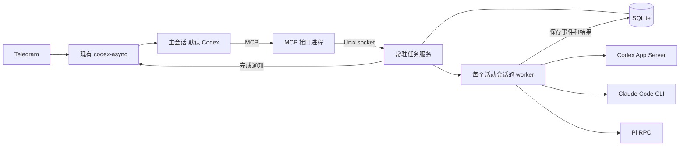

> 语言：[English](../design.md) | 中文

# 本地跨 agent 系统设计

这份设计用于开发一个在本机运行的跨 agent 系统，项目名 `cli-agent-bridge`。默认由 Codex 主会话分配任务，Codex、Claude Code、Pi 都可以作为执行程序，同一个程序可以同时运行使用不同模型的独立会话。

默认采用用户确认的“均衡”策略：质量达标后兼顾费用与完成时间。主 agent 可以明确指定程序、供应商、模型和推理强度；指定后不自动替换。下面定义开发行为与测试要求，不表示系统已经部署或测出了性能收益。

# 程序与模型

把四件事分开记录：运行哪个程序、连接哪个供应商配置、请求哪个模型、使用什么推理强度。同一个模型通过不同程序执行，也要分别统计，因为工具、提示词、缓存和重试行为不同。

| 用途示例 | 程序 | 供应商配置 | 模型 |
| --- | --- | --- | --- |
| 主会话分析和检查结果 | Codex | 当前 Codex 登录配置 | 保留主会话模型，示例为 `gpt-6-astra` |
| 实现一个已明确的小任务 | Codex | 同一或另一个已配置的 Codex 登录配置 | `gpt-6.1-sol` |
| 独立检查修改或执行任务 | Claude Code | 明确指定的 Anthropic 或兼容服务配置 | 该配置实际支持的准确模型 ID |
| 分析、修改或生成测试 | Pi | DeepSeek 配置 | `deepseek-flash` 或 `deepseek-v4-pro` |
| 比较同模型在不同程序中的表现 | Pi | OpenAI API 或 Codex 登录配置 | 启动时查询到的模型 ID |

这张表是初始分工示例，不是模型质量排名。Astra、Sol、Claude、DeepSeek 的具体任务表现由本地测试决定；允许主 agent 直接完成任务，避免为简单工作额外开会话。

一个执行配置包含 `runtime`、`provider_profile`、`model_id`、`reasoning_effort`、`service_tier`、`billing_mode` 和 `quota_group`。认证配置只保存私有文件或现有登录的引用，不复制密钥到任务、日志或 MCP 参数。使用同一账户额度的 Codex 与 Pi 配置归入同一 `quota_group`。

每个任务记录请求模型、CLI 报告的模型、供应商配置和后端模型确认程度。未知模型身份标为未知。DeepSeek 官方文档说明其 Anthropic 兼容接口会转换部分 Claude 模型别名，因此程序名称或别名不能证明实际调用了 Claude 模型。[DeepSeek 文档](https://api-docs.deepseek.com/guides/anthropic_api/)

已有会话固定程序和供应商配置。需要换程序或供应商时，新建会话并传递任务摘要、代码版本与结果文件；不把其他供应商的原生 session ID 当作可迁移会话。同程序不同模型的并行执行也使用不同会话。

# 运行结构

使用 Python、本机 Unix socket、SQLite WAL 和 systemd 用户服务。主 agent 决定任务怎么拆和结果是否合格；普通代码负责队列、进程、状态和统计，不再增加一个负责分配任务的模型。



MCP 接口随客户端启动，常驻任务服务独立运行。每个活动会话的 worker 持有原生程序连接，持续读取输出并保存事件；worker 使用独立的 systemd 用户单元，避免 MCP 或任务服务重启时关闭管道。暂停或长期空闲后可以释放 worker，保留会话记录。实现时检查用户服务管理器是否可用；不可用时明确报告，不悄悄降低进程存活保证。

| 对象 | 通信方式 | 用途 |
| --- | --- | --- |
| 主 agent 与项目 | MCP over stdio | 提交任务、管理会话、查询结果 |
| 项目内部进程 | Unix socket 上的版本化 JSONL 请求 | 控制、查询和恢复连接 |
| Codex | App Server 的 JSON-RPC，stdio 或现有本机 daemon socket | 会话、执行轮次、模型选择和中断 |
| Claude Code | 官方 Python Agent SDK 控制本机 CLI，底层为输入输出管道和 JSON 消息 | 执行、继续会话、进度和结果 |
| Pi | `pi --mode rpc`，JSONL 命令与事件 | 执行、选择模型、继续会话和中断 |

Codex 原生接口按安装版本生成的 schema 检查；已有共享 daemon 通过线程 ID 控制，关闭某个会话不得结束整个 daemon。[Codex App Server](https://learn.chatgpt.com/docs/app-server)

Claude 使用官方 `claude-agent-sdk` 的流式客户端，指定本机 CLI 路径，保留原生模型、session 和认证。SDK 提供中断及权限回调，避免自行实现其内部控制消息；开发时固定 SDK 与 CLI 的兼容版本。[Claude Python SDK](https://code.claude.com/docs/en/agent-sdk/python)

Pi 使用原生 RPC 管理新建的后台会话；已有终端会话继续由现有 Pi extension 接入，禁止另起进程同时写同一个 session 文件。[Pi RPC](https://github.com/earendil-works/pi/blob/main/packages/coding-agent/docs/rpc.md)

# 会话和任务记录

会话是可多次继续的上下文；任务是一次明确交付；attempt 是任务的一次执行。失败后换模型或重试产生新的 attempt，保留之前的费用、文件修改和退出原因。

| 记录 | 主要字段 |
| --- | --- |
| Session | session_id、parent_session_id、执行配置快照、native_session_id 或 Pi session 文件、工作目录、desired_state、observed_state、revision、owner |
| Task | task_id、parent_session_id、assigned_session_id、request_id、请求摘要哈希、任务说明、依赖任务、交付要求、预算、状态、validation_status |
| Attempt | attempt_id、task_id、execution_session_id、native_turn_id、实际执行配置、起止时间、usage、退出原因 |
| Event | event_seq、session_id、task_id、attempt_id、事件类型、内容或本地文件引用 |
| Delivery | event_id、接收主会话、是否已被接收、是否已被主会话处理 |

`request_id` 由调用方生成。重复 ID 且内容相同返回原结果；ID 相同但内容不同返回冲突。数据库唯一约束和事务保证不会因并发重试创建两个任务。

任务状态包括 `queued / running / waiting_input / interrupted / completed / failed / cancelled / recovery_needed`。依赖尚未满足时仍为 queued，并附等待原因；拒绝循环依赖。后续任务默认只在前序结果已通过检查后启动，不把模型结束回答当作依赖完成。 换程序或模型重试时，Task 指向新的执行会话，旧会话身份保存在 Attempt 中；前序任务失败或被拒绝时，依赖任务保持排队并说明原因，由主 agent 修改或取消。

原始输出保存在本机私有目录；主 agent 默认只收到简短回答、修改文件、测试结果、费用和需要处理的问题。大日志按文件位置和范围读取。所有事件按序号读取并可重放，重复事件按 ID 去重。

# 主 agent 如何调用

提供九个 MCP 工具，不另做一套通用流程引擎。

| 工具 | 输入与行为 |
| --- | --- |
| `agent_catalog` | 返回可用程序、配置、模型目录、支持的操作、价格来源和验证时间 |
| `agent_open` | 指定执行配置和工作目录，创建独立会话；可以暂不发任务 |
| `agent_dispatch` | 提交任务；指定已有 session，或指定执行配置，或使用自动选择；返回 task_id 和 session_id；无需委派时返回 execute_locally 建议，不创建子会话 |
| `agent_control` | 对会话执行 pause、resume、close、reopen，或 respond 回答待处理问题；附 request_id 和 expected_revision |
| `agent_cancel` | 取消一个排队或运行中的任务，不连带关闭同会话其他任务 |
| `agent_inspect` | 查询会话、任务、选择模型的原因、进程状态和剩余预算 |
| `agent_wait` | 按事件序号限时等待，超时返回当前状态；等待超时不代表任务失败 |
| `agent_result` | 获取最终回答、文件、测试记录、usage 和未完成事项，可重复读取 |
| `agent_review` | 主 agent 按 task_id、attempt_id 和 revision 接受或拒绝结果，附实际检查记录；通过后释放依赖任务 |

指定已有会话时，传入的模型配置必须与会话一致；不一致就返回错误，调用方另开会话。所有写操作验证调用者是否可以管理该会话。子 agent 默认只能报告本任务结果，不能控制父会话、其他任务或继续创建子 agent。

已实现的发现接口为 `agent_catalog(refresh=false, profile=null)`，直接查询配置对应程序或供应商的元数据，缓存 5 分钟，分别报告错误及旧结果。主 agent 可将返回的准确模型 ID 传给 `agent_open/agent_dispatch` 的 `model` 参数，同时指定已有 `profile`；无需预先为每个模型建立配置。新模型沿用供应商、认证、权限和并发组，不沿用旧模型的价格或推理验证标记。目录发现不执行推理；省略目标的均衡打分仍以已验证配置为候选。具体接口和限制见 [项目说明](README.md#自主发现与选择模型)。

```json
{
  "request_id": "fix-parser-001",
  "target": {
    "runtime": "codex",
    "provider_profile": "codex-default",
    "model_id": "gpt-6.1-sol",
    "reasoning_effort": "medium"
  },
  "task": {
    "kind": "code_edit",
    "instruction": "修复已复现的解析错误并运行指定测试",
    "workspace": "registered-project",
    "base_snapshot": "snapshot-id",
    "depends_on": [],
    "deliverables": ["patch", "test-results"]
  },
  "policy": {
    "objective": "balanced",
    "allow_model_fallback": false
  }
}
```

上例明确指定模型，不参与自动替换；自动分配时省略 `target`，由已注册的候选配置选择。批量任务通过多次提交和 `depends_on` 表达先后关系。首版的后续消息进入项目自己的队列，当前轮次结束后发送，不混用各 CLI 内部队列造成顺序难以判断。

原生输入和审批请求保存为带 `question_id`、原生请求 ID 与过期时间的事件。`agent_control(action=respond)` 仅回答仍有效的请求；普通问题可由主 agent 回答，必须由用户批准的请求交给用户。没有回答时保持 waiting_input 或按原生协议拒绝，不自动同意。暂停、关闭或断线后已经失效的请求不能补发批准。

# 开启暂停恢复和关闭

每个会话分别记录期望状态 `open / paused / closed` 与实际状态 `starting / idle / running / waiting_input / stopping / stopped / recovery_needed`。收到控制请求不等于操作完成，调用方通过事件确认实际状态。

| 操作 | 具体行为 |
| --- | --- |
| open | 创建会话记录和原生会话；启动失败时保留错误，不宣称已就绪 |
| pause 默认模式 | 立即停止派发后续任务，中断正在执行的轮次，确认停止后标记 paused |
| pause drain 模式 | 停止派发后续任务，等待当前轮次完成后进入 paused |
| resume | 恢复原生上下文，允许派发后续任务；传入 continue_task_id 才继续指定的中断任务并创建新 attempt，默认不重跑中断任务 |
| close | 停止派发，中断活动任务，取消尚未开始的任务，释放该会话占用的进程或连接；保存历史、结果和未合入修改 |
| reopen | 由主 agent 明确重新打开 closed 会话；完成通知和新消息不会自动 reopen |
| cancel task | 排队任务直接取消；运行任务调用原生中断，确认退出当前轮次后才标记取消 |

Codex 使用 `turn/interrupt`；Pi 使用 `abort`，必要时处理其内部重试或已排队消息；Claude 调用 SDK `interrupt()` 并继续读取被中断轮次的终止结果，读取完后才能提交下一轮，避免把旧结果当成新结果。随后可以释放会话进程，恢复时使用相同原生会话 ID 或文件。[Claude 中断行为](https://code.claude.com/docs/en/agent-sdk/python)

暂停保留可恢复的对话和工作目录，不承诺从生成到一半的 token 位置继续。恢复时把已完成步骤、已发生的文件修改和中断位置交给原会话，防止重复执行。暂停不能撤回已发生的外部操作；中断后的远端计算也可能已经产生费用。进程冻结信号不作为默认暂停方案。

每次控制携带 `expected_revision`，防止旧的取消请求结束后来启动的新任务。进程通过 PID、启动时间、boot ID 和 systemd 单元识别；只终止项目拥有的进程。终止超时保持 stopping 或 recovery_needed，不能显示“已暂停”。

# 默认按均衡策略分配任务

主 agent 提供任务类型、交付要求、所需工具、输入长度与类型、可发送给哪些供应商、是否修改文件，以及时间和费用约束。系统先检查硬性条件，再比较预计开销。

1. 明确指定程序或模型时，检查该配置能否执行。缺失、未授权或不支持所需操作就返回具体原因；不自动替换。

2. 自动分配时，排除工具权限、上下文长度、输入类型、供应商许可、账户额度或验证状态不满足条件的配置。

3. 先选择在同类任务上达到质量要求的候选，再估算总费用和完成时间。估算包含启动、上下文输入、主 agent 分配与检查、失败重试、测试和合入。

4. 淘汰费用和时间都更差、质量也不更好的选择。均衡策略对剩余候选的费用和耗时各赋 0.5 权重，按本次候选中的正数最小值归一化后比较；缺少可靠估计时返回“未测量”，使用固定的已验证候选顺序，不编造分数。

5. 同时考虑主 agent 自己完成。任务太小、传递上下文太贵或检查成本太高时，不创建子会话。

质量通过率来自项目实际测试和主 agent 对交付的判定，按任务类别、执行配置和大致输入规模记录。没有历史数据时，先验证模型能完成小样本，再作为候选；初始分工只作为假设。默认用有日期与来源的目录价格估算参考计算成本；订阅模型的参考计算成本不等于用户实际支付金额。候选价格不完整或存在无法比较的零值时，整个候选集合统一用预计总 token 数作为费用项，并说明原因，不把美元和 token 混在一个数值中比较，也不把未知费用当作免费。实际 API 费用约束和账户额度仍分别检查。

评分不是额外的模型请求。主 agent 已经理解任务，常驻服务用已有统计计算候选。每次选择保存候选、排除原因、估计值、所用数据时间和最终原因。任务失败后由主 agent 决定重试、换模型或自行接手；自动策略的有限重试必须事先在任务中允许，且所有 attempt 累计计费。

同一原生会话一次只执行一个轮次。不同会话可以并行，但同时受全局并发、共享账户并发、任务依赖和工作目录写入限制。初始外部并发上限为 3，每个共享账户组默认 2；这些是起始配置，通过实测调整，不声称它们最优。限流或余额错误按供应商给出的时间退避，暂停新派发，避免不停开新会话重试。

# 上下文文件和结果

每个任务附带最小必要信息：目标、完成条件、相关文件位置、代码快照、限制、前序结果。默认不复制主聊天全部历史。后续同类任务优先继续已有工作会话，减少重复解释；继续会话仍可能重新计入输入 token，不能把 session 恢复当作免付费缓存。

修改代码时，一个写入会话使用一个独立 Git worktree，保持到后续追问结束。工作副本从明确的提交加指定补丁快照创建；需要的未提交或未跟踪文件逐项纳入快照，不擅自提交、stash 或清理主工作目录。非 Git 项目使用明确目录副本或单写者模式，不假装具有 worktree 隔离。

只读要求由原生工具限制或经过验证的操作系统限制执行；worktree 只隔离修改，不是安全沙箱。Pi 的工具和 MCP 工具都必须按任务限制；不能只禁用 write 却保留任意 shell 写入。后端无法执行请求的权限限制时拒绝该模式。

子 agent 的结果包括完成说明、补丁、测试命令与退出码、未完成项和疑问。运行状态 completed 只表示原生轮次正常结束；独立的 validation_status 记录待检查、通过或不通过。主 agent 检查实际文件和相关测试后才能接受结果；子 agent 的自然语言声明不替代检查。子结果作为任务资料处理，不赋予它修改主会话权限的权力。

# 断开重启和自动继续

SQLite 中保存任务、事件、预算预留和通知。会话 worker 持有原生输入输出；MCP 客户端退出不会终止任务。任务服务重启后连接已有 worker，读取未处理事件和状态；worker 意外退出时核对原生会话与结果，无法确认已执行到哪里就进入 recovery_needed。

派发前先保存任务与 attempt，再启动执行。收到原生接受事件后保存 native_turn_id。每个 session 的 worker 与活动 attempt 都有唯一所有者记录；控制请求带会话 revision，事件带 attempt_id，过期 worker 的事件可以留作历史，但不能推进新 attempt 的状态。若在发送后、记录接受结果前崩溃，不自动重发：这种状态不能仅凭数据库里没有完成记录判断任务尚未运行。request_id 防止重复创建任务，不保证外部文件或网络操作恰好执行一次。

完成事件与结果一起保存，随后通知主会话。主会话忙时通过现有队列排队；进程已退出时，由已登记的主会话控制者恢复原会话。父会话 paused 时只积累事件，closed 时不唤醒。原生会话仍被桌面或终端持有时，交给其现有消息接口；不能取得合法控制时显示等待，禁止强行接管。

通知分别记录“已接收”和“主会话已处理”，按 event_id 去重。Telegram 继续使用已有话题和消息发送记录。主 agent 处理完成事件后选择接受、继续追问或终止整个任务；不要把子 agent 自己退出视为主任务完成。

目标使用流程是：Telegram 发起任务，Codex Astra 分配修改给 Codex Sol，同时让 Pi 分析独立资料；修改结束后 Claude 检查相同补丁；主 agent 窗口关闭期间子任务继续运行，完成事件排队，恢复后的主会话检查结果并回复。

# 费用与速度如何验证

记录每个 attempt 的输入、输出、缓存读取、缓存写入、可获取的推理 token、排队时间、首个有效输出时间、执行时间、测试时间和重试次数。来源包含 Codex 原生 usage 事件、Claude 结果 usage、Pi usage 事件与会话统计。累计值与单次值必须区分；模型切换、压缩或重启后不能直接相加，也不能把推理 token 在总输出已包含它时重复计数。

保存 provider_reported_cost、catalog_estimate 和实际账单确认状态。价格附来源、日期、币种和计价单位；订阅费用与 API 费用分别展示。Pi 本地价格目录可用于估算，不能证明账户的实际账单。主会话分配、检查和总结的 token 计入项目总量；无法获得时标为部分统计，不声称总成本下降。

任务开始时在事务中预留预算，并发任务共享同一预算账本。达到阈值后停止新派发并请求中断。外部 CLI 的统计可能延迟，因此一般 token 或金额限制只能尽力控制，并可能超出一个在途请求；要求绝不超额时，仅允许支持并已验证硬限制的配置，否则拒绝启动。

开发后的比较使用固定代码版本、相同任务、相同测试和记录的缓存条件，至少包含单主 agent 直接完成、指定模型分工、自动均衡分配三种方式。费用计入所有失败、重试、审查与主会话开销；时间使用用户任务从开始到验证通过的总耗时，同时报告中位数和较慢任务。用不同于调参样本的一组任务验证选择规则。只有质量不下降且费用或耗时改善，才能报告收益；现阶段不预估节省百分比。

# 复用已有代码与开发安排

现有 `codex-async` 已有 Codex App Server、Claude CLI、Pi RPC/extension 的调用代码，以及 Telegram 话题、队列和通知处理。保留它的原生会话识别、忙碌检查和错误处理，提取新项目需要的部分；不能直接沿用其针对无人值守任务设置的全部权限策略。新项目只增加任务与会话管理、执行配置、预算和选择规则。

| 参考项目 | 采用的设计 | 本项目的选择 |
| --- | --- | --- |
| [CLI-Subagents](https://github.com/lunati228/CLI-Subagents) | 真实 CLI 会话、异步任务和后续消息 | 先检验可直接使用的部分；Pi 和统一会话控制仍需补充 |
| [PAL clink](https://github.com/serpro69/pal-mcp-server/blob/main/docs/tools/clink.md) | 简单 MCP 工具、工作目录检查和结果解析 | 优先原生 session 继续，不默默用历史重放冒充恢复 |
| [codex-agy-bridge](https://github.com/varadfromeast/codex-agy-bridge) | 长期执行进程独立于 MCP、保存事件与结果 | 用于 Codex、Claude、Pi 的 worker；不引入 Antigravity 作为首版依赖 |

先运行关键用例检验现成实现，能使用的代码直接使用并保留许可证；不并行运行三套各自管理任务的服务。开发目录独立于上游。代码按 `mcp_server`、`broker`、`store`、`worker`、`routing` 和 `runtimes` 等模块组织；SQLite 保存结构化状态，本地文件保存大日志和补丁。首版不增加网页后台、远程执行集群或账号轮换。

| 阶段 | 开发内容 | 交付检查 |
| --- | --- | --- |
| 1 | 三个程序的连接、准确模型选择、原生 session 继续和中断 | Codex、Claude、Pi 各完成一次小任务和一次原会话追问；明确实际供应商 |
| 2 | 会话 worker、SQLite、MCP、暂停关闭、异常恢复 | 断开与重启不重复执行；一个会话的控制不影响另一个 |
| 3 | 工作目录隔离、任务依赖、usage 与预算 | 修改不污染主目录；并发预算不会重复分配；统计包含失败 |
| 4 | 均衡选择、主会话自动继续和 Telegram 接入 | 跑完整跨程序任务，完成固定任务集的对比报告 |

按一名开发者、现有登录可用估算，完整首版约 10–15 个工作日；任务集性能比较另需运行时间。默认包含 Codex、Claude、Pi 和同程序多模型，不以只接入一种程序作为首版完成。

# 实现后必须通过的检查

| 编号 | 检查 | 通过条件 |
| --- | --- | --- |
| R1 | 本机三个程序 | Codex、Claude、Pi 分别真实执行并返回可核对结果，不能只检查版本或目录 |
| R2 | 从主 agent 分配不同任务 | 一个 Codex 主会话向至少两个程序提交独立任务，收到正确归属的结果并继续处理 |
| R3 | 根据任务要求选择 | 图像、工具、上下文或供应商约束不满足的候选被排除；缺少质量数据明确显示 |
| R4 | 同程序不同模型与跨供应商 | Astra 主会话同时控制 Sol 子会话和 Pi DeepSeek；Claude 任务保留自己的实际配置；主模型不被改变 |
| R5 | session 控制 | 三种程序都验证 open、pause、resume、close、reopen；确认原生 session 身份与修改记录连续 |
| R6 | 费用速度并行比较 | 固定任务集比较直接执行和分配执行，包含主会话、失败、重试、审查成本与质量结果 |
| E1 | 重复请求 | 同请求重复提交只产生一个任务；相同 ID 不同内容报错 |
| E2 | 暂停竞态 | 旧 revision 无法停止新轮次；paused 时新任务不执行；drain 不发送中断 |
| E3 | 关闭与恢复 | closed 不被完成通知自动唤醒；重新打开不丢历史或未合入修改 |
| E4 | 客户端与服务重启 | MCP 断开仍运行；任务服务恢复后取回原 run；无法确认的执行不自动重发 |
| E5 | 文件与权限 | 并行 worktree 相互独立；主目录未提交文件保留；禁止的写入实际失败 |
| E6 | 原生结束判断 | Codex 检查对应 turn 的终止状态；Claude 检查所属轮次的 ResultMessage 与 terminal_reason；Pi 等待 agent_settled 并检查最终错误，不能将接受消息当完成 |
| E7 | 配额与模型 | 共享账户限额共同生效；指定模型不可用时不换模型；目录可见不冒充推理已验证 |
| E8 | 费用完整性 | 重放事件不重复计费，恢复会话累计 usage 不重复相加，未知价格不计为零 |
| E9 | 用户输入与审批 | 等待用户输入与模型运行区分，原生请求 ID 正确关联，超时或无人响应不自动同意 |
| E10 | 父会话与 Telegram | 父会话忙时排队，退出后合法恢复；暂停不唤醒，关闭不唤醒；重复完成通知不重复发起处理 |
| E11 | 中断后继续 | 中断结果完整读取后才接受下一轮；continue_task_id 明确关联中断任务，确认先前文件操作不被盲目重做 |
| E12 | 检查结果与依赖 | agent_review 接受正确 attempt 后才释放后续任务；旧 attempt 的接受请求不能影响新执行 |

原生程序可能自带后台命令或子 agent。控制操作需要确认这些工作是否仍在运行；不能因为顶层回答结束或连接关闭，就声称其所有后台工作已停止。对不受项目管理的外部作业，返回仍在运行的明确状态。

# 本机检查结果和开发前条件

2026 年 10 月 22 日已查询到 Codex CLI 0.163.0、Claude Code 2.1.307、Pi 1.3.0。Codex App Server 的元数据请求成功，目录包含 `gpt-6-astra` 和 `gpt-6.1-sol`。Pi RPC 的元数据请求成功，返回 55 个模型条目，供应商包括 DeepSeek、OpenAI 和 OpenAI Codex；其中包含 `deepseek-flash`、`deepseek-v4-pro`。查询进程均已退出，没有发起推理请求。

这些结果证明安装和元数据接口可用，不能证明所有列出的模型都可调用。[OpenAI 关于目录与实际模型访问的说明](https://developers.openai.com/siwc/token-sharing-open-source/codex-app-server)

开发阶段在实际 systemd 服务环境中执行最小真实请求，确认认证、代理、准确模型、权限和 usage。Claude 的实际供应商与模型需要单独确认；不根据程序名字推断。不同程序访问同一个模型时上下文窗口和价格目录也可能不同，按实际执行配置记录。

设计的六项要求已分别对应 R1–R6，其他检查覆盖恢复和数据处理。完成设计与完成软件实现分别记录：本次交付设计；开发完成时必须取得上述真实运行结果。
