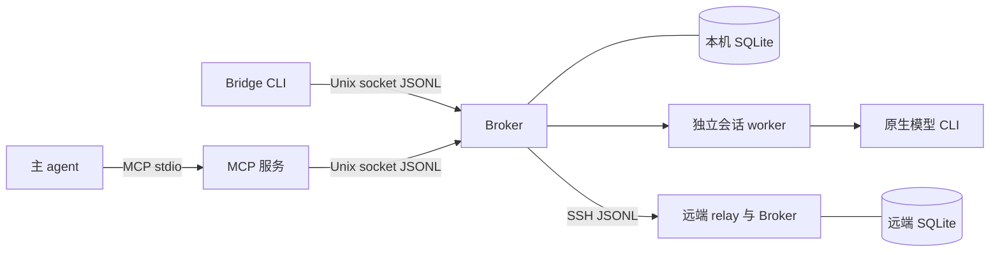

> 语言：[English](../design.md) | 中文

# 程序结构

Bridge 在本机或受信任的 SSH 主机上运行 Codex、Claude Code、Pi 和 Antigravity 独立会话。调用它的 agent 决定任务和检查结果；Broker 管理队列和保存的状态，不需要另一个模型管理 Broker。

## 组成与通信

| 文件 | 作用 |
| --- | --- |
| `mcp_server.py`、`cli.py` | 向 MCP 客户端和命令行提供相同的任务、会话操作。 |
| `broker.py` | 检查请求、派发队列任务、检查 revision 和依赖、管理 worker，以及发送已登记的父会话通知。 |
| `worker.py` | 持有一个会话的原生连接，每次运行一轮，保存事件、用量、文件和结束结果。 |
| `runtimes.py`、`antigravity.py` | 处理原生会话、工具、权限、中断和结果事件。 |
| `store.py` | 用 SQLite WAL 保存本机的会话、任务、attempt、回执和节点记录。 |
| `hosts.py`、`peer_transport.py`、`peer_api.py` | 管理受信任的主机，核对节点身份，通过 SSH 交换有大小限制的消息。 |
| `monitor.py`、`web_monitor.py` | 为终端和需登录的 HTTP/SSE 页面读取任务、进程与用量。 |
| `updater.py`、`update_guard.py` | 准备校验后的版本，在短期 Broker 维护期间保留兼容 worker 的运行。 |

各主机独立保存数据库并管理进程，不共用 SQLite 文件。[节点接口说明](multi-machine-interface.md)列出已支持的方法、消息大小、身份检查及尚未实现的操作。

| 原生程序 | 接口 |
| --- | --- |
| Codex | 通过已配置原生连接使用 App Server JSON-RPC。 |
| Claude Code | 官方 Python Agent SDK 控制本机 CLI。 |
| Pi | 通过 stdio 交换 JSONL RPC 命令和事件。 |
| Antigravity | 通过 stdio 交换 headless stream-JSON 输入与输出。 |

## 任务执行与恢复

- session 保存可继续的原生上下文，task 说明要做的工作，attempt 记录一次执行。重试会保留旧 attempt 和用量。
- `agent_dispatch` 将工作入队并返回 ID，不等待模型执行完成。每个会话同时运行一轮，其他会话在配置允许的并发数内运行。
- 相同 `request_id` 和相同参数返回原操作；相同 ID 搭配不同内容会被拒绝。这能防止重复入队，不能保证所有外部操作只执行一次。
- `completed` 只表示原生一轮已结束。主 agent 检查文件和实际测试结果后调用 `agent_review`，依赖任务等待审查通过。
- worker 独立于发起请求的 MCP 客户端运行；客户端断开不会取消任务。进程意外退出或无法确认外部操作结果时，可能进入 `recovery_needed`，需要人工检查。
- 已登记父会话的通知分别保存收到和处理状态。分组广播只发给指定成员；发送结果不明时，先检查再决定是否重发。

任务与会话操作、模型发现和选择、预算及可选 Telegram 集成见[使用指南](getting-started.md)。

## 配置与信任范围

模型配置引用已有原生登录或私有环境文件。模型发现不执行推理，目录可见不代表当前账号能运行该模型；明确选择的程序和模型不会被自动替换。

[节点配置和身份记录支持运行中更新](dynamic-hosts.md)。模型配置在 Broker 启动时加载，已有会话保持原配置。[OTA 更新](ota-updates.md)保留兼容的运行任务；重启结果不明时停止重试。

Bridge 面向单个操作系统用户及明确受信任的节点。worktree 只分开文件修改，不能隔离同一用户身份下的恶意程序。见[安全说明](SECURITY.md)和[检查及限制](production-readiness.md)。

## 详细说明

- [多机架构决策](multi-machine-design.md)
- [当前节点接口](multi-machine-interface.md)
- [分组、消息顺序、工作目录、会话名称与 Web 登录](multi-machine-phase-c-design.md)
- [任务检查和独立记录脚本](agent-tiering.md)
- [后续多机设计提案](multi-machine-future-design.md)：尚未实现，不代表当前可用功能。
