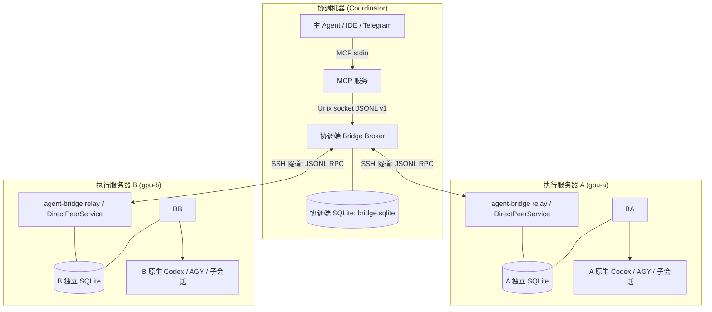
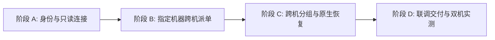

> 语言：[English](../multi-machine-design.md) | 中文

# 多机器接入设计与架构规范（正式版）

> **文档状态**：已定稿（技术规范）。2026-11-04 正式版。  
> **设计对象**：跨物理机/服务器的分布式 CLI Agent 协同系统（协调端与多执行节点）。  
> **审查集成**：本文整合了 Antigravity (`gemini-4-argon-high`) 与 Pi (`deepseek-flash`) 对初稿的对抗审查结论（共 16 项关键缺陷及应对方案）。
> **实现状态**：SSH relay、跨机派单、分组、工作区和事件同步已接入代码。本文保留架构决策与后续计划，当前接口和未实现项以 [接口说明](multi-machine-interface.md) 为准。

---

## 1. 目标、范围与设计原则

### 1.1 首版实现目标
1. **单一入口统一调度**：主 Agent（如 Codex、Claude 或 Antigravity）通过协调机器（Coordinator）的 MCP 接口，统一查询各机器模型目录、向指定目标服务器派发任务，并按需增量读取执行结果。
2. **跨机分组与广播**：会话组可跨多台机器包含 Bridge 子会话或原生会话（Codex、Antigravity）；广播消息只投递给指定成员快照，并执行 CAS 版本校验（`expected_revision`）。
3. **原生会话接入**：
   - 远端 Codex 使用原机持久队列（`thread/queue/add`），不强行接管会话终端；
   - 远端 Antigravity 原生会话必须在其完全关闭后，才由远端本地 Bridge 恢复同一原生 ID 注入消息，不干扰运行中的终端。
4. **断网恢复与幂等**：网络闪断或协调机重启时，远端已接收的任务继续独立执行；网络恢复后凭持久化 `operation_id` 与两阶段回执对齐状态，**绝不因断网重跑任务或更换机器**。

### 1.2 边界与非目标
- **信任域假设**：面向同一管理者控制的 Linux 机器集群，节点间保持隔离，但非针对恶意 root/同 UID 攻击的沙箱。
- **暂不做**：公网暴露的 TCP/HTTP 端口、跨物理机迁移原生会话内存/上下文、跨机任务依赖 DAG（`dependencies` 跨机传递）、自动同步全部工程代码、分布式事务（如 2PC/Raft）。

---

## 2. 运行架构与网络拓扑



### 2.1 零暴露面连接模型
1. **纯 SSH 隧道传输**：协调机器主动通过已有 SSH 配置（支持 SSH Config 别名、ProxyJump、Tailscale VPN 等）发起连接，执行远端固定的可执行文件路径与 `relay` 命令。
2. **严禁开放外部端口**：集群内**不监听任何 TCP 端口**，消除公网暴露风险。
3. **严禁跨网络共享 SQLite**：SQLite WAL 机制强依赖本地内核 POSIX 共享内存与文件锁（`*-shm` / `*-wal`），在 NFS、SMB 或 SSHFS 上运行会导致静默数据损坏。各机器**必须持有各自独立的 SQLite 数据库**。
4. **Relay 进程**：`agent-bridge relay` 通过 `DirectPeerService` 处理 SSH stdin/stdout 请求，直接访问远端本地 SQLite；Broker 从同一数据库领取任务并启动 Worker。SSH 进程中断、Relay 退出不停止远端已在运行的任务。

### 2.2 单向主动 RPC 与拉取流（审查决策 A1/D5/D6）
为防止远端服务器拥有对协调机器的反向 SSH 权限造成横向越权，系统采用**单向 RPC 架构**：
- **正向调用**：由协调机发起请求，经 Relay 调用 `DirectPeerService`，提交到远端本地数据库。
- **反向出站（拉取模式）**：当远端原生主会话调用跨机组广播时，远端 Broker 仅将操作写入本机的 `node_outbox` 表。协调机后台任务默认每 2 秒发起一次 `peer.pull_requests` 拉取一页出站请求，校验发送权限并完成派发后，调用 `peer.ack_request` 持久化确认。**远端服务器无须反向 SSH 连接协调机器**。

---

## 3. 架构决策记录（双模型对抗审查结论）

在技术方案定稿前，系统通过 Antigravity (`gemini-4-argon-high`, 代号 A) 与 Pi (`deepseek-flash`, 代号 D) 进行了两轮独立对抗审查，整理出 16 项关键缺陷并写入本规范：

| 编号 | 问题来源 | 核心风险 | 正式架构规范解决方案 |
|---|---|---|---|
| **ADR-01** | A1, D5, D6 | 反向推送与单机 Unix Socket 短连接不兼容 | 放弃双向长连接通道方案；改为协调机主动定时 `peer.pull_requests` 拉取，Relay 对本机 Broker 保持标准短连接。 |
| **ADR-02** | A2, D1 | 原生 Agent 自报 `native_id` 存在身份伪造风险 | 增加受控 Member MCP 包装器，由本机 Broker 签发短期不透明 Binding，校验调用者 PID、`starttime` 滴答数与写锁，防止冒充发送者。 |
| **ADR-03** | A6, D2 | 数据库回滚时 Generation 一同回滚，旧数据丢失无法感知 | 引入独立于 SQLite 备份的持久化身份文件与递增确认序号；握手时校对双方 Generation 与最大确认序号，回滚立即报警并拒绝新请求。 |
| **ADR-04** | D6 | 两节点相同 `request_id` 造成冲突，断网重连无处排空 | 引入全局唯一的 `(node_id, state_generation, operation_id)` 命名空间，节点重连直接比对持久化 Operation 记录。 |
| **ADR-05** | D3 | SQLite 事务与外部原生进程写入无法做原子提交 | 实行两阶段提交：先本地落盘持久化 Intent，再将状态标记为 `sending`，最后执行 CLI 交互并写入 Receipt；未确认 Receipt 记为 `uncertain`，绝不盲目重发。 |
| **ADR-06** | A3 | `operation_pending` 被原单机缓存误判为冲突死锁 | `api_requests` 针对跨机操作只记录 Operation 引用；恢复后先查关联 Operation，直到终端结果明确才写回最终响应。 |
| **ADR-07** | A4, D8 | 远端成员记录违反本地组外键约束，UUID 发生冲突 | 新建独立的 `remote_group_members`、`peer_inbox` 与去外键化的 `native_send_queue`，唯一键强制包含 `(host_id, node_id, state_generation)`。 |
| **ADR-08** | A5 | 等待中的原生消息被后续消息插队 | 发送队列按目标串行排队，建立严格的队头顺序与本地递增序号；遇到前序状态不明时阻断后续发送，必须通过人工 Evidence 解除。 |
| **ADR-09** | D7 | 前序未转交消息直接删除造成永久序号空洞 | 新增带原序号的 Cancel Tombstone（取消墓碑）；后续消息必须等待取消墓碑在执行端确认后才能继续递增。 |
| **ADR-10** | A7, D4 | 远端 `event_seq` 与父机器外键冲突导致通知丢失 | 引入跨机 `parent_ref`；协调机去重后生成父机器本地镜像 `events.seq`，再接入既有的 `deliveries` / `parent_ack` 状态流。 |
| **ADR-11** | A8 | 跨机源目录与目标目录混淆、取消目标缺失 | 严格分离本地源目录 `cwd` 与远端托管工程 `project_id`；`agent_cancel` 扩展支持 `operation_id` / `delivery_id`。 |
| **ADR-12** | D5, D8 | Relay 缺乏方法白名单，远程透传越权 | Relay 严格限定 5 组 `peer.*` 方法白名单；禁用任意命令透传与远程 Quota 任意修改。 |
| **ADR-13** | A3 | 跨机复合 Open/Dispatch 步骤断网造成孤儿子会话 | 远端无 `session_id` 的派发作为原子复合操作处理，执行端在同一 Operation 下创建并找回 Session，禁止拆成两次独立 RPC。 |
| **ADR-14** | 综合 | 共享账号跨机预算失控 | 明确定义 Token 预算仅限单机作用域（`budget_scope=host`），包含远端原生成员的广播在启用预算时严格拒绝。 |
| **ADR-15** | 综合 | 跨机大结果与日志将通知撑爆 | 结果只回传元数据引用（`host_id + artifact_id + sha256`），大内容强制在原机按页读取。 |
| **ADR-16** | 综合 | 断网重连事件与旧通知重放导致震荡 | 机器重启后不改变原有事件游标，已确认的收件和处理回执不随连接刷新而倒退。 |

---

## 4. 节点身份、安全与权限模型

### 4.1 节点身份三元组
每台机器节点通过以下不可伪造的字段唯一标识：
- `host_id`：管理员在协调端配置的稳定机器别名（如 `gpu-a`、`cloud-node-1`）。
- `node_id`：节点安装初始化时生成的强随机 UUID，写入私有文件，服务重启保持不变。
- `state_generation`：随机字符串，每次数据库重建、冷恢复备份或重新初始化时重新生成。
- **全局对象唯一引用**：统一格式为 `host_id + node_id + state_generation + 本地资源ID`。

### 4.2 独立身份文件（审查决策 A6/D2）
- 节点在 SQLite 数据库外部维护一个独立的 `node_identity.json`（权限 `0600`），实时保存当前 `state_generation` 和本地确认的最大操作序号 `max_confirmed_seq`。
- **写前同步检查**：每次处理写请求时，先提交数据库事务，再 `fsync` 身份文件，最后向对端返回 ACK。
- **回滚探测**：若握手时发现本地数据库记录的最大序号小于身份文件或对端已记录序号，说明数据库发生过非一致性回滚，节点立即转入 `state_corrupted`，拒绝接收任何写操作，直至人工核实并换代。

### 4.3 成员受控访问（审查决策 A2/D1）
- 远端节点上的主会话连接独立的受控 MCP 端口：`agent-bridge mcp --role member`。
- 本地 Broker 为其签发具有时效性的短期 Binding Token，绑定其被核验的真实进程 PID、启动时间戳和归属组名册。
- 严禁信任模型在请求 JSON 中自填的 `sender_id`，模型无法通过伪造参数冒充其他会话发言。

---

## 5. 通信协议与 RPC 方法白名单（审查决策 D5）

协调机器与执行节点 Relay 间仅允许调用以下明确声明的 `peer.*` 方法，其余方法一律拒绝：

```
peer.hello            # 身份认证、握手、代号校验与版本协商
peer.catalog          # 读取远端脱敏后的模型目录与配置
peer.inspect          # 远程会话、任务及 Cgroup 进程状态查询
peer.pull_requests    # 协调机主动拉取节点 outbox 积压的出站广播请求
peer.ack_request      # 协调机回传对节点出站请求的处理结论与持久化状态
peer.deliver          # 向远端节点下发单条任务或组广播消息
peer.control          # 执行 pause/resume/close 等受控操作
peer.cancel           # 取消已下发但未完成的操作/任务
peer.review           # 针对远端已完成尝试提交人工审查证据与判定
peer.events           # 按游标分页读取远端持久化事件流
peer.result           # 读取指定任务结果摘要及 Artifact 分页数据
peer.inbox            # 读取指定原生目标的本地收件箱历史
peer.notify_parent    # 交付完成事件至父会话镜像队列
```

---

## 6. 跨机数据存储设计（审查决策 A4/A7/D8）

在协调端与执行端的 SQLite 中扩展以下持久化表结构：

### 6.1 执行节点核心表

```sql
-- 节点出站操作表（用于协调机定时主动拉取）
CREATE TABLE IF NOT EXISTS node_outbox (
    operation_id TEXT PRIMARY KEY,
    binding_id TEXT NOT NULL,
    request_id TEXT NOT NULL,
    method TEXT NOT NULL,
    payload TEXT NOT NULL,
    status TEXT NOT NULL DEFAULT 'pending', -- pending, pulled, acked
    result TEXT,
    created REAL NOT NULL,
    acked_at REAL,
    UNIQUE(binding_id, request_id)
);

-- 跨机入站投递表
CREATE TABLE IF NOT EXISTS peer_inbox (
    delivery_id TEXT PRIMARY KEY,
    coordinator_id TEXT NOT NULL,
    coordinator_generation TEXT NOT NULL,
    group_id TEXT NOT NULL,
    target_kind TEXT NOT NULL,              -- bridge, native
    target_id TEXT NOT NULL,
    message TEXT NOT NULL,
    status TEXT NOT NULL DEFAULT 'received',
    created REAL NOT NULL
);

-- 原生统一发送队列（解耦本地与跨机，避免虚假组和重复唤醒）
CREATE TABLE IF NOT EXISTS native_send_queue (
    id TEXT PRIMARY KEY,
    runtime TEXT NOT NULL,
    native_id TEXT NOT NULL,
    local_seq INTEGER NOT NULL,
    delivery_source TEXT NOT NULL,          -- local_broadcast, peer_inbox
    delivery_id TEXT NOT NULL,
    message TEXT NOT NULL,
    status TEXT NOT NULL DEFAULT 'pending', -- pending, sending, received, uncertain, failed
    receipt TEXT,
    native_turn_id TEXT,
    processing_status TEXT,                -- running, completed, failed, uncertain
    error TEXT,
    created REAL NOT NULL,
    last_attempt REAL NOT NULL DEFAULT 0,
    UNIQUE(runtime, native_id, local_seq)
);
CREATE INDEX IF NOT EXISTS native_send_queue_head ON native_send_queue(runtime, native_id, local_seq, status);
```

### 6.2 协调端核心表

```sql
-- 跨机远端组成员表
CREATE TABLE IF NOT EXISTS remote_group_members (
    group_id TEXT NOT NULL REFERENCES session_groups(id),
    host_id TEXT NOT NULL,
    node_id TEXT NOT NULL,
    state_generation TEXT NOT NULL,
    runtime TEXT NOT NULL,
    native_id TEXT NOT NULL,
    cwd TEXT NOT NULL,
    label TEXT NOT NULL,
    PRIMARY KEY(group_id, host_id, runtime, native_id)
);

-- 跨机发送出站记录
CREATE TABLE IF NOT EXISTS peer_outbox (
    delivery_id TEXT PRIMARY KEY,
    broadcast_id TEXT NOT NULL,
    group_id TEXT NOT NULL,
    host_id TEXT NOT NULL,
    node_id TEXT NOT NULL,
    state_generation TEXT NOT NULL,
    target_kind TEXT NOT NULL,
    target_id TEXT NOT NULL,
    message TEXT NOT NULL,
    target_seq INTEGER NOT NULL,
    status TEXT NOT NULL DEFAULT 'pending', -- pending, waiting_for_host, accepted_remote, cancelled, uncertain
    error TEXT,
    created REAL NOT NULL,
    last_attempt REAL NOT NULL DEFAULT 0
);
```

---

## 7. 广播投递、取消墓碑与原生恢复

### 7.1 顺序投递与 Cancel Tombstone（审查决策 A5/D7）
1. **严格保序**：针对每一个远端会话目标，协调机分配严格单调递增的 `target_seq`。前序消息未取得 `accepted_remote` 之前，禁止发送下一条。
2. **取消墓碑（Tombstone）**：若某条排队中的消息在未发送前被用户取消，协调机必须向执行机发送携带原序号的 **Cancel Tombstone**；执行机落盘确认后方可释放该序号。后续消息绝对不能跳过空洞序号直接执行，防止网络延迟导致被取消的指令后发先至。
3. **消除卡死（Evidence 解除）**：若前序消息因断网或崩溃处于 `uncertain` 状态，后续消息必须暂停等待。管理员可通过 `agent_delivery_resolve` 工具提交人工核实证据和会话 `revision`，安全解除队头等待，系统绝不自动静默重试。

### 7.2 远端原生会话闭环恢复（严格单机本地裁决）
- **Codex 队列注入**：执行端本地 Broker 调用本地已常驻的共享 App Server 注入 `thread/queue/add`，协调端无须启动任何 Daemon。
- **Antigravity 唤醒保证**：
  - 执行端严格检查本地 `/proc/locks` 与 `presence/<native_id>.lock`；
  - 只有确认原终端实例完全退出、且没有其他活跃进程持有会话时，才在远端启动独立 Stream-JSON 进程，将消息注入原生 `--conversation`；
  - 严格读取执行端本地数据库 `MAX(idx)` 作为基线，只确认 `index > baseline` 的新 `user_input/DONE` 回执；
  - 协调端绝不能跨机持有远端进程锁，所有锁判断与进程回收都在原机本地完成。

---

## 8. 扩展 API 契约

| 接口 | 类型 | 行为与参数规范 |
|---|---|---|
| `agent_hosts` | **新增** | 查询已登记节点的连接状态（`online` / `offline` / `identity_changed`）、代号信息与最后通信时间。 |
| `agent_catalog` | 增强 | 支持传入 `host_id` 查询特定机器或汇总目录；返回各配置所属机器及新鲜度标志（`stale`）。 |
| `agent_open` / `agent_dispatch` | 增强 | 支持指定 `host_id` 与远端 `project_id`；无 `session_id` 的远端派发作为复合原子指令，防止断网泄露孤儿子会话。 |
| `agent_group` | 增强 | 新增 `remote_members` 参数，格式为 `[{host_id, kind, runtime, native_id, cwd, label}]`，支持跨机原子入组。 |
| `agent_operation` | **新增** | 客户端在收到 `operation_pending` 响应后，凭此接口与稳定 `operation_id` 轮询异步执行结果。 |
| `agent_delivery_resolve` | **新增** | 管理员专用；凭特定 delivery 引用、核实证据和 expected_revision 解除卡死的队头等待。 |
| `agent_cancel` | 增强 | 互斥接收 `task_id`、`operation_id` 或 `delivery_id`，解决远端尚未生成 task_id 时的取消需求。 |

---

## 9. 容灾、断线重连与恢复矩阵

| 故障场景 | 执行端行为 | 协调端行为 | 最终一致性恢复机制 |
|---|---|---|---|
| **远端离线，消息在协调端** | 未收到请求 | 标记 `waiting_for_host` | 机器恢复且代号一致后，按原 `delivery_id` 和原序号继续下发。 |
| **远端已接单，但 SSH 回执丢失** | 任务已入库并正常执行 | 暂时处于未确认状态 | 协调端重连后调用 `peer.lookup_delivery`，取得原执行记录与状态，绝不重复创建任务。 |
| **执行中途 SSH 连接断开** | Worker 进程在本地后台持续运行，不受断线影响 | 状态显示“断开连接，等待重连刷新” | 重连后拉取本地 `peer_event` 游标，同步最新执行状态。 |
| **原生输入写入后进程崩溃** | 标记为 `uncertain`，保留已发事实 | 标记为 `uncertain` | 停止后续下发；必须由管理员调用 `agent_delivery_resolve` 提供证据解除。 |
| **执行端数据库发生不一致回滚** | 启动检测到序号倒退，转入 `state_corrupted` | 握手探测到 Generation 或序号异常，拒绝通信 | 阻断所有新任务；必须由管理员介入人工换代并重新登记。 |

---

## 10. 实施路线与演进阶段



### 阶段 A：身份与只读连接
- 实现 `hosts.py`、`peer_transport.py` 与 `agent-bridge relay` 命令行子程序；
- 实现 `peer.hello` 握手协商与 `node_identity.json` 身份持久化机制；
- 暴露 `agent_hosts` 工具，在单机上能跨 SSH 查询远端已登记节点的配置目录。

### 阶段 B：指定机器跨机派单
- 扩展 `broker.py` 支持按 `host_id` 路由任务；
- 在 SQLite 中建立 `node_outbox`、`peer_inbox` 与复合 Operation 处理机制；
- 实现快照文件清单（`snapshot_files`）基于 SHA-256 校验的远端传输与 Worktree 构建。

### 阶段 C：跨机分组与原生恢复
- 扩展 `groups.py` 支持 `remote_members`，构建全局收件人快照；
- 提取并实现去外键依赖的 `native_send_queue`；
- 实现协调端定时拉取机制（`peer.pull_requests`）与完成事件镜像映射（`peer.notify_parent`）。

### 阶段 D：联调交付与双机实测
- 实施测试矩阵中的 13 项容灾与冲突场景测试；
- 完成真实双机授权网络切断恢复实测与文档交付。

---

## 11. 完备验证矩阵（必须通过的 13 种关键场景）

1. **同名资源隔离**：两台机器拥有相同的 Profile 名称或完全相同的原生 UUID 时，消息只路由给指定机器的目标，不会跨机混用。
2. **组快照不变性**：组内包含跨机成员，广播时仅快照内成员收件；组 Revision 变更后，已发出的广播请求严格按原快照执行。
3. **分阶段断网**：分别在协调端保存前、远端接单前、原生写入前及任务执行中切断 SSH，重连后同一任务只执行一次，未确认状态绝不伪报为失败。
4. **两端并发重启**：两端同时重启，事件乱序或迟到时，已确认的 `received` 与 `completed` 状态绝不倒退回 `pending`。
5. **身份篡改防护**：伪造 `host_id`、篡改 `node_id`、数据库非一致性回滚或更换 SSH Host Key 时，新请求被拒绝。
6. **远端 AGY 进程锁检查**：远端 AGY 运行时广播保持 Pending；原进程退出后自动拉起原会话恢复，并只确认 `index > baseline` 的新接收步骤。
7. **取消墓碑实测**：取消队头未转交消息，确认远端成功落盘 Cancel Tombstone，后续递增序号消息正常流转。
8. **越权拦截**：普通 Member 角色尝试调用 Admin 接口、伪造 `sender_native_id`、越权使用未授权 Group 时，均被拒绝。
9. **大体积文件防护**：大日志与大补丁回传通过 Artifact 按页切片拉取，避免把数 MB 的原始输出直接塞进通知导致内存暴涨。
10. **单机功能向后兼容**：不涉及跨机参数时，现有单机调度、测试套件（230 项用例）及 Telegram 状态拦截完全保持原有逻辑。
11. **复合派单断网恢复**：无 `session_id` 的远端派单在执行中途断网，重连后凭稳定 `operation_id` 找回同一会话，不泄露孤儿子进程。
12. **人工 Evidence 解除**：对处于 `uncertain` 的队头投递，验证必须提供非空证据与准确 Revision 方可解除，不自动静默重试。
13. **多节点事件镜像去重**：不同节点相同数值的 `event_seq` 回传至父机器时，分别映射为独立的本地镜像事件，Parent ACK 不串联。
