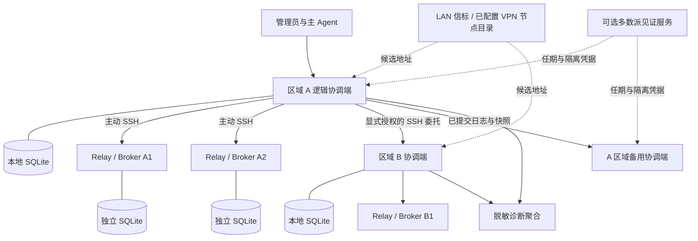
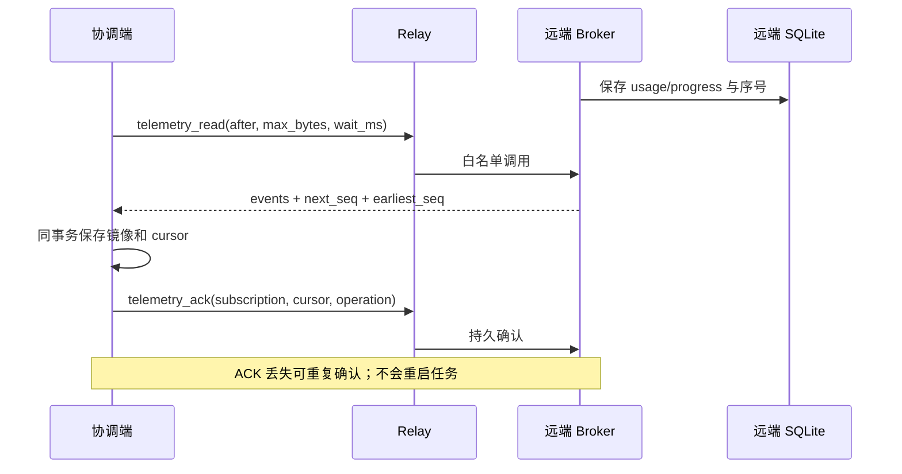
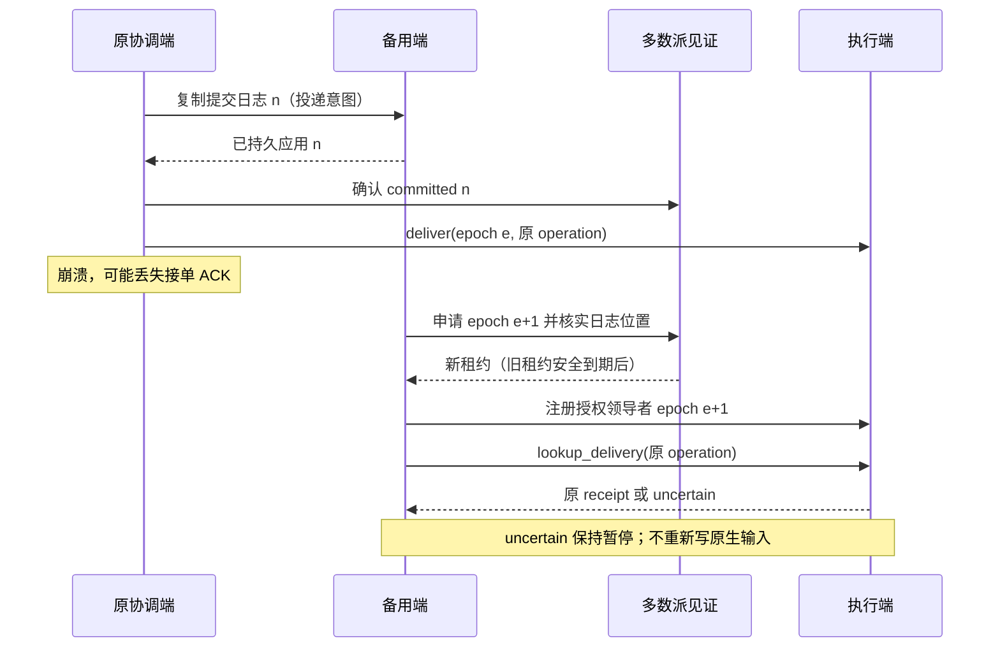
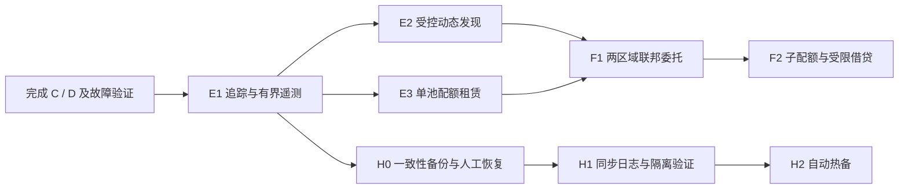

> 语言：[English](../multi-machine-future-design.md) | 中文

# 多机器未来演进与下一阶段设计建议

文档日期：2026-11-05。状态：设计提案，未实现、未做真实多机验证。

本文接续 [多机器设计](multi-machine-design.md)、[接口定义](multi-machine-interface.md) 和 [Phase C 设计](multi-machine-phase-c-design.md)。ADR-01～ADR-28 继续有效；本文新增 ADR-29～ADR-38，涉及旧限制的调整必须独立评审后实施。本文不会使任何新 RPC 自动进入白名单。

## 1. 背景与问题陈述

现有实现已有 SSH Relay、节点身份、HostRegistry 和跨机派单；Phase C 对跨机组、有序投递、工作区、事件镜像及 Web 鉴权给出了设计，但不能据此认定这些功能全部实现。`peer_transport.py` 已包含实际 SSH 传输与客户端，`peer_api.py` 中的部分后台组件仍是 Protocol。接口文档开头“没有任何运行时接线”和初版设计的“当前单机”属于历史描述；实施状态应按 Phase C 第 1.2 节及代码逐项确认。已有测试数量不作为本文功能通过的证明。

下一阶段有六类问题：静态 hosts 难以维护临时节点；增量用量与进度难以持续查看；单协调端不适合跨区域自治；协调端故障后缺少安全接管；单机预算无法限制共享账号；跨进程错误难以关联。它们互有关联，但不应一次引入完整分布式控制系统。

推荐先完成 Phase C 与 D 的故障验证，再实现流式遥测、统一追踪和受控发现。联邦与配额按实际规模启用；自动热备最后实施。没有足够状态复制与执行端隔离旧主的措施时，保持人工恢复。

### 1.1 必须保留的规则

- 每组仍只有一个逻辑 authority；网状网络不授予节点修改任意组的权限。
- 每台机器使用本地 SQLite，禁止 NFS/SSHFS 共享数据库，也禁止直接复制活动中的 WAL 文件作为热备协议。
- `NodeRef` 包含 node_id、state_generation；host_id 是登记方别名，不能充当跨联邦全局身份。数据库换代、执行端重建与协调端领导任期分开表示。
- `target_seq`、原生 `local_seq`、节点 `ack_seq`、遥测游标和复制日志序号各有用途，不得互换。
- 接单、原生收件、执行结束、父模型处理是不同状态；trace 或遥测事件不能证明后两者。
- 网络不可达表示 unknown；`uncertain` 原生输入仍需原机查证或人工提交证据，不自动重发。
- 不引入跨机 2PC。Phase C 顶部审核决定优先于正文残留的 prune hold/prepare/finalize 描述；未来联邦修剪也不恢复该方案。

## 2. 核心架构拓扑



图中连接表示授权关系，并不要求所有节点两两连接。执行节点继续无需反向 SSH 凭据；遥测由协调端建立的 SSH 请求返回。区域协调端间的互访需要单独授权，不能继承普通 worker 权限。备用端不运行发送器。

分开定义 `cluster_id`、稳定 `authority_id`、协调端物理 NodeRef 和 `leader_epoch`。普通部署 authority_id 绑定原创建者 NodeRef；热备部署才启用经授权的逻辑 authority 注册。执行端保存逻辑 authority 到物理领导者的绑定，不能仅靠请求增加 epoch 自封新主。现有 stream_id 继续保留原 authority 身份，不因切主重新从 1 分配序号。

## 3. 动态发现与网状拓扑

### 3.1 发现只产生候选节点

默认仍是静态 SSH hosts。可选发现器读取 mDNS/LAN 信标或管理员提供的 VPN peer 目录，仅发布协议版本、安装 ID、公钥指纹摘要、私网地址和过期时间；不发布工程目录、会话名、模型账号或 token。WireGuard 本身不承担应用发现：需要外部已配置成员目录，本文不实现新的 VPN 控制服务。

发现器不得自动接受 SSH host key、生成任意 ssh 命令、修改 ProxyJump 或获得组成员资格。地址必须属于允许的 LAN/VPN 网段，remote_executable 来自本地配置。管理员批准指纹并钉扎 NodeRef 后，才允许 hello 和只读 catalog；写权限、project_id、配额池分别授权。地址变化不能改变身份，身份变化必须重新登记。

### 3.2 租约与状态变化

建议初始参数：心跳 10 秒、suspect 30 秒、租约 60 秒，均加随机抖动并可配置。使用本机单调时钟判定本次运行的租约；持久墙钟时间只供展示，重启后重新握手，不延续旧在线判断。

状态为 discovered → pending_approval → verified → online → suspect → offline；revoked 与 identity_changed 单独保存。租约过期只停止新派单并保留原队列，不迁移执行中的任务，不删除组成员。静态配置优先于发现，人工撤销优先于任何新信标。限制每来源地址的候选数、消息大小与速率，避免伪信标耗尽存储。

### 3.3 零公网暴露的明确含义

Bridge RPC 仍只经 SSH/Unix Socket，不新增公网监听。LAN mDNS/信标属于新的局域网 UDP 通信，必须显式启用、绑定指定接口并禁止公网转发。这是对旧设计“集群不监听任何 TCP”的补充，不可宣传为完全没有网络端口。若要求连 VPN UDP 也不能从公网访问，则只使用已有私网 VPN/隧道，无法直连的节点继续离线；本项目不自动开放端口或配置公网中继。

## 4. 流式用量与进度遥测

### 4.1 协议与事件定义

新增能力 `telemetry_batch_v1`，首先采用有界长轮询 `peer.telemetry_read`；协调端主动请求，执行端在同一 SSH 响应内返回事件批次，实现反向数据传递，不需要远端回连。后续能力 `telemetry_stream_v1` 才支持多帧响应，需修改当前一请求一响应的传输读取循环及 Relay；不能直接向现有 JSONL 通道发送 unsolicited 帧。

请求包含 source NodeRef、subscription_id、after_seq、max_bytes、max_events、wait_ms、filter_revision；初始限制为 256 KiB、128 条、最长等待 20 秒，每 host 独立限额。只读读取不推进持久 ACK。新增可变 `peer.telemetry_ack` 在协调端提交镜像事务后确认连续游标；按既有 OperationKey 去重并执行 ack_seq/fsync 规则。多帧模式另带 frame_seq、end 标记，仍遵守单帧 1 MiB 上限，并独占连接，避免进度挤占取消和审批。

事件键为 `(source_node_id, source_generation, telemetry_seq)`；内容包含 task_ref、attempt_id、kind、observed_at、elapsed_monotonic_ms、trace_id、span_id 和 schema_version。

| kind | 必要字段与解释 |
|---|---|
| usage | input/output/cache token 累计量、计量来源、revision、is_final；未知为 null，不填零 |
| progress | phase、可选 completed_units/total_units、单位；无可靠总量时不显示百分比 |
| tool_delta | tool_call_id、delta_index、start/update/end、脱敏摘要或 ArtifactRef |
| task_state | 独立任务状态引用；权威终态仍由持久任务结果确认 |
| gap | 缺失序号范围、原因、最新快照引用；不得伪装为完整事件历史 |

usage 使用每 attempt、provider、计量类别的累计快照；接收方按 revision 替换，不直接累加重放 delta。估算值与供应商结算分别保存，终态可修正旧估算；未知供应商数据不推断为免费。CLI 没有公开 tool delta 时只报告已观察到的阶段，不解析屏幕文本猜测。

### 4.2 背压、持久性与恢复

执行端先保存可恢复事件再发送，协调端提交镜像和 cursor 同一事务后 ACK。每订阅限制窗口和字节数，慢消费者只影响本订阅；每 host 采用公平轮转，控制 RPC 使用独立连接与预算。取消订阅不会取消任务。

初始每节点遥测磁盘限额 128 MiB，普通 delta 保留 24 小时，可配置。压力增大时合并尚未分配序号的 progress/usage，已编号事件保持不可变；允许按保留规则清除普通 delta，但必须返回 gap。任务终态、审批、投递 receipt、预算账本保存在独立可靠表，不能因遥测清理删除。可靠表满时拒绝新任务，保留取消与查询空间；不因监控消费者离线停止已运行 CLI。重连先检查最早可用序号，有 gap 时导入当前快照再继续，界面显示历史不完整。



## 5. 分层协调与联邦协调端

每个区域自治管理本地任务、工作区、审批和配额。父协调端只得到授权目录和委托结果；目录带有效期，不能根据陈旧容量保证接单。联邦 GroupRef 使用 `(cluster_id, authority_id, group_id)`，物理目标仍保留完整 NodeRef。不存在可同时写同一组的两个 authority。

新增能力 `federation_v1`，方法建议为 `peer.federation_catalog`、`peer.delegate`、`peer.lookup_delegation`、`peer.delegation_events`。可变方法必须带 OperationKey、request_hash、delegation_id、authority_ref、path、hop_limit、deadline、预算子租约和明确权限；这些名字均是提案，实施时再同步接口与白名单。

父端先保存委托 outbox；子端在一个本地事务中去重、冻结本地收件人、安排本地投递并保存委托 receipt，然后返回 accepted。父端 ACK 丢失只能 lookup 原 delegation_id。取消沿原委托逐层传递，各层保存取消请求与结果；超时不等于未执行，也不能换区域重派。

级联组在父端冻结“直接成员与子组引用及 revision”，子端按该 revision 冻结自己的成员，返回快照摘要。任一子组版本不符，拒绝该分支并记录原因，其他已接受分支继续；不承诺跨区域同时广播或全部成功。完整收件人只有各分支接受后才能汇总，界面区分 awaiting_expansion 与 accepted。需要提交时就确定完整名册的任务必须先获取并固定全部成员引用，再逐一派发，仍无跨机原子提交。

path 检查重复 cluster/authority，初始 hop_limit=4；跨区只发布授权子组，不递归同步全部组。每条委托边分别保存事件游标，重复事件不重复父通知。目标并发来自多个 authority 时继续由执行端 local_seq 串行化，不承诺跨 authority 的全局提交顺序。审批只交给原审批 authority；级联权限不能把 member 提升为 admin。

## 6. 协调端高可用与故障转移

### 6.1 先区分备份与热备

SQLite 本地 WAL 保留；使用一致性备份 API 生成快照，通过 SSH 传到备用端。快照必须包括数据库摘要、日志位置与身份确认记录，不能在活动数据库旁直接复制 db/wal/shm。异步快照只能提供灾难恢复，不能保证已 ACK 数据不丢失；缺少日志时必须人工恢复并报告丢失范围，不自动切主。

自动热备采用单写者、备用端顺序重放逻辑提交日志，并由独立多数派服务保存领导任期与提交位置。Raft 仅选主不能保护 SQLite 内容：发出外部 RPC 前，该发送意图、operation、stream 序号和请求指纹必须在备用端持久应用，并在多数派记录中标为 committed。对外 ACK 的写入也要达到该条件。没有可用同步副本时停止新写入，不能默默降为异步。

该方案成本明显高于单机事务，建议两台数据副本加独立见证形成三投票成员；见证不是数据副本，主副本丢失时必须核实剩余副本达到 committed 位置。若实现无法把日志确定性重放、事务结果和身份文件确认关联起来，应继续人工切换，不用定时复制 WAL 替代。

### 6.2 领导租约与执行端隔离

执行端在每次可变操作入库前检查 authority_id、leader_epoch、已验证的领导凭据与有效期，并持久保存见过的最大 epoch。只比较“我见过的最大 epoch”不能阻止尚未见到新主的节点接收旧主写入。因此自动模式要求执行端在线核验多数派签发的短期租约，或在有明确时钟误差上界时验证租约有效期；失去核验条件就拒绝新写入。新主等待旧租约安全过期，并完成所需节点的 epoch 登记，再恢复各目标发送。不能确认的目标继续暂停。

领导 epoch 不进入业务 operation_id，不改变原 stream_id 和 target_seq；同一投递随新 epoch 重试仍对应原记录。旧主恢复后只能只读，不能凭本地 SQLite 中未提交的 outbox 发送。



### 6.3 接管顺序

备用端核实日志、数据库身份和外部 ack_seq 下限，取得合法领导权后启动只读核对。恢复 inbox/outbox、未 ACK 来源请求、广播快照、target_streams、事件镜像游标、预算租约及审批 revision。sending 先 lookup，收到 receipt 后采用原结果；只有确定未交付且符合原有队列规则的记录才重试原操作。审批响应仍须核对原 request_id 和 revision，不能自动批准。工作区 ready/attached 按 Phase C journal 恢复。身份确认计数倒退仍为 state_corrupted，热备不提供绕过换代的入口。

## 7. 细粒度配额租赁与预算借贷

### 7.1 预算对象与记账

预算池以 tenant、provider_account 的不可逆引用、model_class、window_id、unit 定义；unit 区分 token、整数微货币、并发 slot 和请求数，不能相互直接相加。每池只有一个账本 authority。联邦父池可向子池预留额度，子池只能从已持久收到的额度中发子租约；上级失联不影响已授权范围内执行，不可自行扩额。

金额预算和并发租约分开。池内不变量为 `已结算 + 未结算预留 <= 硬上限`；子池收到的预留在父池计为未结算，而非两次消费。用量结算以 usage_source、attempt_id、计量 revision 去重。价格版本固定在租约中；结算更正产生补记分录，不覆盖历史账本。

新增能力 `quota_lease_v1`；建议 RPC `peer.quota_reserve/renew/settle/release`，均按业务租约 ID 和 OperationKey 去重。reserve 先事务检查余额并写 reservation，再 ACK；接单将租约绑定原 task/attempt，重试派单不得再预留。模型启动前执行端检查有效租约与剩余额度。

### 7.2 断网、到期与借贷

租约到期表示不能启动新任务，不能证明旧 CLI 已停止。并发 slot 只有收到可验证停止/结束记录才归还；失联记为 held_unknown。金额预留也不能仅因超时全额释放。硬预算要求可控制的调用接口能够限制最大输出和终止新增调用，并为尚未上报的消费预留最坏额度。无法限制原生 CLI 供应商消费时，只能报告软预算，不能承诺账号硬上限；保持现有 `budget_scope=host` 与 `peer_budget_scope` 行为，直到新模式被明确选择且满足条件。

借贷在同一池 authority 内先实现：从可借储备转入借款方预留，记录 lender、borrower、额度、归还规则和期限，审批与限额明确。跨池借贷使用预拨子额度，不做双方可同时使用同一额度的转账。收回额度只影响未来启动；正在运行的任务不能因撤销事件迟到而被算作未花费。供应商返回 429 时采用供应商要求的等待并缩小并发，不把租约等同于供应商保证。

## 8. 分布式追踪与诊断聚合

入口生成 trace_id，每次 Broker、SSH Relay、远端 Broker、Worker、CLI 交互、审批等待和父通知创建独立 span_id，通过可选 trace_context 传递。重试产生新 span，通过 operation_id/delivery_id 和 span link 关联；trace_id 不是幂等键、授权凭据或状态确认。联邦可以保留 trace_id，但只向获授权区域传递允许的字段。

原生 CLI 不支持 context 时由本地 wrapper 记录调用跨度和已观察到的 native turn ID，不修改原始聊天、不伪造 CLI 内部 span。审批可能跨天：保存等待跨度与 request_id，响应创建关联跨度，记录 revision 冲突或过期，绝不记录审批 token。

日志采用结构化字段：cluster_id、NodeRef、authority_id、leader_epoch、operation_id、delivery_id、stream_id、target_seq、attempt_id、trace/span、event_seq、error_code、duration_ms。跨机墙钟只供大致展示；耗时使用各机单调时钟，先后关系依据消息与序号，不能按时间戳断言因果。

默认只存工具名称、状态、大小和摘要，不存 prompt、tool 参数正文、命令输出、环境变量、密钥、数据库原始内容。脱敏在源端执行，聚合端按 cluster/project 权限过滤。正常跨度可采样，错误和投递状态变化保留；诊断采样不会删除业务账本。聚合可先使用同一主动拉取通道，后续可选本机 collector 导出，但不新增未经配置的公网服务。

一次诊断查询应返回：最后已确认状态、当前等待原因、原机是否可达、缺失事件区间、关联审批、预算占用和可执行的只读核对动作。不能仅凭跨度结束把任务标为 completed。

## 9. SQLite 持久化 Schema 提案

以下是增量设计草案，不是可直接运行的仓库迁移。`*_ref_json` 必须用规范 JSON 保存完整引用；接收方仍校验字段与权限，不能只信任 JSON。业务表、幂等表和墓碑沿用 Phase C，不在此重建。所有外键仅指本地行，远端对象不建立本地 session 外键。

```sql
CREATE TABLE discovery_candidates (
    candidate_id TEXT PRIMARY KEY,
    node_id TEXT NOT NULL,
    state_generation TEXT NOT NULL,
    source TEXT NOT NULL,
    endpoint_json TEXT NOT NULL,
    fingerprint TEXT NOT NULL,
    status TEXT NOT NULL,
    observed_at REAL NOT NULL,
    expires_at REAL NOT NULL,
    UNIQUE(node_id, state_generation, source, fingerprint)
);
CREATE TABLE node_leases (
    node_id TEXT NOT NULL,
    state_generation TEXT NOT NULL,
    authority_id TEXT NOT NULL,
    lease_revision INTEGER NOT NULL,
    status TEXT NOT NULL,
    last_seen_at REAL NOT NULL,
    PRIMARY KEY(node_id, state_generation, authority_id)
);
CREATE TABLE telemetry_log (
    source_node_id TEXT NOT NULL,
    source_generation TEXT NOT NULL,
    seq INTEGER NOT NULL CHECK(seq > 0),
    task_ref_json TEXT NOT NULL,
    attempt_id TEXT NOT NULL,
    kind TEXT NOT NULL,
    payload_json TEXT NOT NULL,
    trace_id TEXT,
    created_at REAL NOT NULL,
    PRIMARY KEY(source_node_id, source_generation, seq)
);
CREATE TABLE telemetry_cursors (
    subscription_id TEXT PRIMARY KEY,
    source_ref_json TEXT NOT NULL,
    filter_revision INTEGER NOT NULL,
    committed_seq INTEGER NOT NULL DEFAULT 0,
    acked_seq INTEGER NOT NULL DEFAULT 0,
    CHECK(acked_seq <= committed_seq)
);
CREATE TABLE federation_delegations (
    delegation_id TEXT PRIMARY KEY,
    parent_authority TEXT NOT NULL,
    child_authority TEXT NOT NULL,
    request_hash TEXT NOT NULL,
    snapshot_json TEXT NOT NULL,
    path_json TEXT NOT NULL,
    status TEXT NOT NULL,
    receipt_json TEXT,
    revision INTEGER NOT NULL,
    UNIQUE(parent_authority, delegation_id)
);
CREATE TABLE authority_epochs (
    authority_id TEXT PRIMARY KEY,
    max_epoch INTEGER NOT NULL,
    leader_ref_json TEXT NOT NULL,
    grant_digest TEXT NOT NULL,
    committed_index INTEGER NOT NULL
);
CREATE TABLE replication_log (
    log_index INTEGER PRIMARY KEY,
    epoch INTEGER NOT NULL,
    transaction_id TEXT NOT NULL UNIQUE,
    previous_hash TEXT NOT NULL,
    entry_hash TEXT NOT NULL,
    changes_json TEXT NOT NULL,
    status TEXT NOT NULL CHECK(status IN ('prepared','committed','applied'))
);
CREATE TABLE quota_pools (
    pool_id TEXT PRIMARY KEY,
    authority_id TEXT NOT NULL,
    window_id TEXT NOT NULL,
    unit TEXT NOT NULL,
    hard_limit INTEGER NOT NULL CHECK(hard_limit >= 0),
    settled INTEGER NOT NULL DEFAULT 0 CHECK(settled >= 0),
    reserved INTEGER NOT NULL DEFAULT 0 CHECK(reserved >= 0),
    revision INTEGER NOT NULL,
    CHECK(settled + reserved <= hard_limit)
);
CREATE TABLE quota_leases (
    lease_id TEXT PRIMARY KEY,
    pool_id TEXT NOT NULL REFERENCES quota_pools(pool_id),
    parent_lease_id TEXT,
    borrower_ref_json TEXT NOT NULL,
    task_ref_json TEXT,
    reserved_amount INTEGER NOT NULL CHECK(reserved_amount >= 0),
    settled_amount INTEGER NOT NULL DEFAULT 0,
    expires_at REAL NOT NULL,
    state TEXT NOT NULL,
    revision INTEGER NOT NULL
);
CREATE TABLE quota_ledger (
    entry_id TEXT PRIMARY KEY,
    lease_id TEXT NOT NULL REFERENCES quota_leases(lease_id),
    metering_key TEXT NOT NULL,
    metering_revision INTEGER NOT NULL,
    delta INTEGER NOT NULL,
    reason TEXT NOT NULL,
    UNIQUE(lease_id, metering_key, metering_revision)
);
CREATE TABLE diagnostic_spans (
    trace_id TEXT NOT NULL,
    span_id TEXT NOT NULL,
    parent_span_id TEXT,
    source_ref_json TEXT NOT NULL,
    operation_id TEXT,
    duration_ms INTEGER,
    status TEXT NOT NULL,
    attributes_json TEXT NOT NULL,
    PRIMARY KEY(trace_id, span_id)
);
CREATE INDEX telemetry_task ON telemetry_log(attempt_id, seq);
CREATE INDEX delegation_pending ON federation_delegations(status, child_authority);
CREATE INDEX quota_lease_state ON quota_leases(pool_id, state, expires_at);
CREATE INDEX spans_operation ON diagnostic_spans(operation_id);
```

序号分配与事件写入同一事务，不能使用删行后的 MAX(seq)+1；另建持久计数器或使用已有安全计数设施。订阅过滤固定在 filter_revision，改变过滤条件建立新订阅，不能沿用旧 ACK 跳过数据。gap 保存在保留范围元数据中，不能靠查询空页判断无丢失。usage 最新值另以 `(完整 task_ref, attempt_id, provider, category)` 建唯一快照，按 revision 更新。

quota_pools 的余额检查与 lease/ledger 更新使用同一 `BEGIN IMMEDIATE` 事务；借贷另外保存来源子租约，跨库引用不用外键。复制事务包含确定的业务 ID、结果及计数器变化，禁止备用端重新生成 UUID、时间戳或重算发送序号。租约凭据中的敏感部分保存于受限文件或进程内，表中只存摘要。

迁移采用 schema_version 分步升级，先备份 DB 和身份文件，在停止本机写入时增加表、索引与约束。默认关闭新功能；不改旧 target_seq、不清除旧 uncertain、不迁移远端任务到新机器。热备逻辑 authority 的启用需要逐节点登记与停止旧发送器，是单独操作，不能作为普通启动迁移自动完成。

## 10. 异常与恢复矩阵

| 异常 | 保存的事实 | 恢复动作 | 禁止行为 |
|---|---|---|---|
| 信标伪造或 IP 被复用 | 候选、钉扎指纹与 NodeRef | 拒绝身份不符，等待重新登记 | 自动信任新 host key |
| 心跳到期但 CLI 仍运行 | 原任务和目标引用 | 显示 unknown，重连原机查询 | 换机再执行 |
| 遥测 ACK 丢失 | 接收 cursor 与源日志 | 原游标重读、唯一键去重 | 累加重复 token |
| 消费者缓慢或遥测满 | 保留范围、gap、业务结果 | 限速、清理普通 delta、快照恢复 | 删除 receipt 或审批记录 |
| tool delta 超过帧限额 | Artifact 摘要 | 分页拉取 | 放宽无界内存缓冲 |
| 联邦重复委托/ACK 丢失 | request_hash 与 receipt | lookup 原 delegation | 创建新子任务 |
| 子组 revision 变化或跨区断网 | 原分支快照及接受状态 | 分支拒绝或等待；已接受分支继续 | 声称全组原子失败 |
| 环路或权限跨级 | path、hop_limit、授权范围 | 拒绝并返回具体原因 | 递归广播到所有发现节点 |
| 主端故障且备用日志落后 | committed_index、摘要 | 暂停接管，补齐或人工恢复 | 仅赢得选举即发送 |
| 网络分区、旧主存活 | epoch 与可验证租约 | 未能核验者拒绝写；等待安全换主 | 两端同时领取 outbox |
| 接管时原生发送状态不明 | 原 inbox/outbox、operation、序号 | 原机 lookup；uncertain 保持暂停 | 新 epoch 生成新投递 ID |
| 身份文件领先 DB | ack_seq 下限 | state_corrupted，人工核实换代 | 热备模式跳过检查 |
| 配额租约到期但执行端离线 | 未结算预留、held_unknown slot | 保留占用，查证停止后归还 | 到期立即重复分配 |
| 结算重复或供应商更正 | 计量 revision 与账本 | 去重或追加差额分录 | 覆盖历史后重复收费 |
| 追踪丢失或时钟偏差 | 状态表与消息序号 | 显示诊断不完整，查询业务状态 | 用跨度时间判断任务成功 |
| 审批响应重复/切主后迟到 | request_id、revision、原 authority | 返回原结果或拒绝陈旧 revision | 自动读取新版本后批准 |

## 11. ADR 架构决策

| 编号 | 建议决定 | 替代方案及取舍 |
|---|---|---|
| ADR-29 | 发现与授权分开，静态配置保留 | 自动纳管更省操作，但候选网络消息不能获得写权限 |
| ADR-30 | 网状表示可达关系，每组单 authority | 全节点多主会破坏组 revision 和目标顺序，不采用 |
| ADR-31 | 先有界长轮询，再协商多帧流 | 调整 ADR-01 的传输限制必须单独实施；不要求反向 SSH |
| ADR-32 | 遥测可缺段，业务 receipt 与预算账本不可被遥测清理 | 全量永久 delta 成本无界；gap 必须让用户可见 |
| ADR-33 | 联邦按分支持久委托，无跨区原子广播 | 全局 2PC 不采用，接受分支独立成功或等待 |
| ADR-34 | 热备需同步业务日志、选举与执行端隔离三者同时成立 | 单纯 WAL 复制或单纯 Raft 选举都不足；代价是失去同步副本时停止新写 |
| ADR-35 | 逻辑 authority 稳定，epoch 不改变业务幂等键 | 每次切主换 stream 会绕过旧 uncertain，不采用 |
| ADR-36 | 预算使用单 authority 预留与子租约 | 扩展 ADR-14 必须显式选择；无法限制 CLI 花费时继续仅软预算 |
| ADR-37 | 到期不等于资源可回收 | 保留 unknown 占用牺牲利用率，避免超配或超支 |
| ADR-38 | trace 关联诊断，状态与权限由业务记录决定 | 不保留原始聊天，不用 trace ID 作为授权或完成证据 |

## 12. 分阶段实施路线与验证



| 阶段 | 修改对象 | 必须证明的结果 |
|---|---|---|
| E1 | peer_protocol/transport、Relay、Worker 事件归一化、EventMirror、Web 展示 | 断线重连无重复计量；慢订阅不影响取消/审批；超限产生 gap；无原始聊天与密钥 |
| E2 | hosts、发现插件、配置与节点登记命令 | 伪信标、IP 复用、重启、撤销、代际变化均不自动授权；公网接口没有新增监听 |
| E3 | Store 预算事务、执行端启动检查、provider 计量 | 并发 reserve 不超额；重复结算不重复扣费；unknown slot 不提前归还；硬/软预算明确区分 |
| F1 | federation 协议、组分支快照、委托 outbox/inbox | 两区域重复委托、环路、revision 冲突、部分接受与取消均有确定记录 |
| F2 | 子租约、借贷账本与审批 | 父子断网不增发额度；逾期不释放未知支出；单笔预拨没有双方同时可用窗口 |
| H0 | 本地快照、SSH 备份与恢复工具 | 在隔离 state 验证备份一致性、身份下限检查、缺日志报告；人工恢复不重发 uncertain |
| H1 | 复制日志、备用应用器、见证接口、执行端 epoch 检查 | 在所有提交/复制/ACK 窗口崩溃后，未提交意图不发送、已确认状态不丢失；分区旧主不能写 |
| H2 | Broker 启停顺序、领导租约、全部后台发送器 | 接管保留流序号、墓碑、审批与配额；发送器、OutboxPuller、父通知及控制请求都受领导检查 |

测试先用临时数据库、模拟 CLI/peer、可控时钟和故障注入；覆盖两个 authority 同时向同一 native 目标投递、遥测源重建、订阅过滤变更、主副本同时崩溃及额度结算修正。吞吐与延迟以 E1 实测为依据再设置性能阈值，不在设计中编造已验证容量。至少记录事件字节率、P95 可见延迟、ACK 积压、DB 增长、控制 RPC 延迟和恢复耗时。

每阶段更新接口定义、TypedDict、能力列表、Relay 白名单、迁移和权限测试，再运行完整 unittest 与 Ruff。文档检查不等于这些实现测试通过。真实多机、真实 CLI、VPN 与自动切主测试需按既有操作范围单独安排，报告明确区分模拟结果与真实结果。

## 13. 实施前需要确定的配置

E1 前确定各运行时可提供的实际用量字段、遥测保留时间与脱敏规则；E2 前确定发现接口和允许网段；E3 前确定共享账号归属、价格版本及哪些调用可以限制花费。联邦启用前确定组 authority、审批归属和跨区数据权限。H1 前确定多数派服务、时钟或在线租约验证方式、同步副本策略与可接受停写时间。

这些配置没有确定时，相关新功能保持关闭；现有单机、静态 SSH 和 host 预算继续运行。下一阶段实际交付优先选择 E1：它直接改善执行中的可见信息，也为后续发现、配额与接管提供可检查的运行记录。
